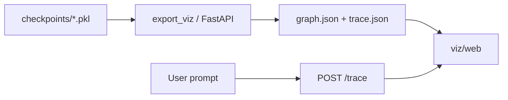

# TK_001 — Graph UI: Minh họa inference, training và đồ thị

| Field | Value |
|-------|-------|
| **ID** | TK_001 |
| **Title** | Web UI minh họa hình học inference / training + viewer đồ thị |
| **Status** | Implemented (Phase A + B). **Cập nhật 2026-07-09:** Parent Explorer chỉ **A3 multi** (gỡ Hybrid/Compose/Essay dropdown); mặc định `network_v10_histwiki_paragraph.pkl`; completion API `mode=autoregressive` only. |
| **Repo** | `nn-aivie` (monorepo: core + `viz/`) |
| **Liên quan** | checkpoint `checkpoints/grade_03.pkl`, HCA matcher, G1/G3 |

---

## 1. Đề bài

Cần **minh họa hình học** cho hai quá trình cốt lõi của AIVIE và cho phép **nhìn rõ đồ thị sau training**:

1. **Inference** — tại mỗi bước generate, token cuối `w₀` làm neo; history có decay; score ứng viên qua ma trận kề `A` + matcher (rule/Var arbitration).
2. **Training** — teach imprint cấu trúc; G1 co-activation cửa sổ; G3 dopamine/LTD teacher-forced (masked QA sau `Đáp:`).
3. **Đồ thị training** — checkpoint là `GraphState` = vocabulary + `SparseAdjacency` (~30k cạnh grade 3), cần explore theo rule/subgraph, không dump toàn bộ dense matrix.

**Mục tiêu người dùng:** debug prompt (vd. QA sau `Đáp:`), hiểu vì sao token nào thắng argmax, thấy cạnh nào G1/G3 làm dày/mỏng.

**Ràng buộc:**

- Không thay đổi semantics core inference/training khi thêm UI.
- Export/read-only từ checkpoint; UI không bắt buộc GPU.
- Giữ nguyên nguyên tắc matcher: không hardcode từ tiếng Việt trong logic export.

---

## 2. Current (hiện trạng)

### 2.1 Đầu ra training

- File: `checkpoints/grade_03.pkl` (`GraphState`).
- Cấu trúc:
  - `Vocabulary` — map token ↔ id (`Rule:…`, `Var:…`, `Lbl:…`, `R_-k`, surface, `<EOS>`).
  - `SparseAdjacency` — dict `(i,j) → float`, khái niệm ma trận kề **thưa**, không phải tensor dense kiểu transformer.

### 2.2 Inference (code hiện có)

| Module | Vai trò |
|--------|---------|
| `hca/forward.py` | `dual_context_read` — frame + bind context qua `w₀` |
| `hca/matcher.py` | Rule arbitration, eligible Var, answer-zone guard sau `Đáp:` |
| `hca/generate.py` | Vòng autoregressive: readout → matcher → mask → argmax |

**Công cụ debug hiện tại:** `scripts/prompt_one.py` — in prompt, generate, top-8 matcher/generate step (text console). Không có đồ thị, không step replay.

### 2.3 Training (code hiện có)

| Phase | Module | Cập nhật đồ thị |
|-------|--------|------------------|
| Teach | `teaching/imprint.py` | Imprint rule/const/var/segment |
| G1 | `training/g1_passive.py` | `update_from_coactivation` trong cửa sổ + sentence bind |
| G3 | `training/g3_dopamine.py` | `update_dopamine_feedback`; mask QA chỉ train sau `Đáp:` |

**Log hiện tại:** CLI in thống kê tổng (`records`, `updates`, `correct/wrong`). Không log per-step cho replay.

### 2.4 Visualization

- **Chưa có** web app, API export, hay graph viewer trong repo.
- Gần nhất: `scripts/dump_copula_rules.py` — dump text cấu trúc rule copula ra terminal.

### 2.5 Hạn chế khi debug bằng console

- Khó thấy đồng thời: active rule, eligible Var, score vector, cạnh liên quan.
- Đồ thị ~30k cạnh không đọc được từ log; cần filter theo `Rule:…`.
- Training G1/G3 không có “phim” cạnh đổi theo thời gian.

---

## 3. Solution (giải pháp đề xuất)

### 3.1 Kiến trúc tổng thể

```
nn-aivie/
├── src/nn_aivie/           # core (giữ nguyên)
├── viz/
│   ├── server/             # FastAPI — đọc checkpoint, trace inference
│   └── web/                # Vite + React — 3 panel UI
└── scripts/export_viz.py   # CLI export JSON tĩnh (offline)
```

**Luồng dữ liệu:**



### 3.2 Ba màn hình chính

#### A. Graph Explorer

- Load subgraph theo `Rule:pattern_id` hoặc theo node seed (token / Var).
- Layout force-directed; màu theo loại node: surface / Rule / Var / Lbl / Position.
- Độ dày / opacity cạnh ∝ `A[i,j]`; filter `weight >= threshold`.
- Panel chi tiết: click node → liệt kê hàng/cột kề, token string.

#### B. Inference Lab

- Input prompt (vd. `Hỏi: Em học gì ? Đáp:`).
- **Step-by-step:** mỗi bước hiển thị:
  - `w₀`, history (kèm decay weights `d_frame`, `d_bind`)
  - `scores` trước/sau matcher, top-k bar chart
  - `active_rules`, `eligible_vars` (từ `_resolve_active_rules`, `_eligible_var_ids`)
  - token được chọn (argmax)
- Đồ thị highlight: cạnh `w₀ → v` và imprint Var → surface cho top candidates.

#### C. Training Replay (phase sau)

- Khi train với flag `--viz-log`, ghi `train_trace.jsonl` (G1 window pairs, G3 reward/LTD).
- Web phát lại: cạnh xanh (+η) / đỏ (−β), caption câu corpus.

### 3.3 API / export schema (draft)

**`graph.json`**

```json
{
  "meta": { "checkpoint": "grade_03.pkl", "n_nodes": 0, "n_edges": 0 },
  "nodes": [{ "id": 0, "label": "là", "kind": "surface" }],
  "edges": [{ "source": 0, "target": 1, "weight": 2.0 }]
}
```

**`trace.json` (một bước inference)**

```json
{
  "step": 0,
  "w0": "Đáp:",
  "history": ["Hỏi:", "Em", "học", "gì", "?", "Đáp:"],
  "active_rules": ["Rule:vi_QA_hoi_dap"],
  "eligible_vars": ["Var:A"],
  "scores_top": [{ "token": "Em", "score": 12.3, "after_matcher": 45.1 }],
  "chosen": "vui"
}
```

### 3.4 Stack đề xuất

| Layer | Công nghệ |
|-------|-----------|
| Export / API | Python, FastAPI, tái dùng `GraphState`, `dual_context_read`, matcher |
| Graph render | `react-force-graph` hoặc Cytoscape.js |
| Charts | Recharts / lightweight bar chart |
| Build | Vite, TypeScript, React |

### 3.5 Lộ trình triển khai

| Phase | Phạm vi | Ước lượng |
|-------|---------|-----------|
| **A** | `export_viz.py` + Graph Explorer (static JSON) | 1–2 ngày |
| **B** | Inference Lab + FastAPI `/trace` | 2 ngày |
| **C** | Training replay + `--viz-log` G1/G3 | 2–3 ngày |

---

## 4. Changes (thay đổi dự kiến)

### 4.1 File / thư mục mới

| Path | Mô tả |
|------|-------|
| `TK_001_GRAPH_UI.md` | Tài liệu này |
| `viz/web/` | Frontend React |
| `viz/server/` | FastAPI app |
| `scripts/export_viz.py` | CLI export checkpoint → JSON |
| `src/nn_aivie/viz/` (tuỳ chọn) | Module `export_graph`, `trace_inference` dùng chung CLI + server |

### 4.2 Thay đổi core (tối thiểu)

| File | Change |
|------|--------|
| `src/nn_aivie/hca/trace.py` | **Mới** — `trace_generate_step(state, history)` trả dict scores/rules/vars |
| `src/nn_aivie/cli/__main__.py` | Subcommand `export-viz` (optional) |
| `src/nn_aivie/training/g1_passive.py` | Optional `--viz-log` (phase C) |
| `src/nn_aivie/training/g3_dopamine.py` | Optional `--viz-log` (phase C) |

**Không đổi:** thuật toán score, arbitration, Hebbian update (chỉ thêm hook observability).

### 4.3 Dependency mới (dev / viz)

```
# pyproject optional: viz = ["fastapi", "uvicorn"]
# viz/web/package.json: react, vite, react-force-graph, recharts
```

### 4.4 Acceptance criteria

- [x] Export `grade_03.pkl` → JSON; load được trên Graph Explorer.
- [x] Chọn subgraph `Rule:vi_QA_hoi_dap` + `Rule:vi_copula_S_la_NA` — hiển thị const/var/lbl rõ.
- [x] Inference Lab: prompt QA sau `Đáp:` — thấy `Var:A` eligible, `là` bị penalize (answer-zone guard).
- [x] Top-k chart khớp pipeline `trace_generate_step` / `prompt_one.py`.
- [ ] (Phase C) Replay ít nhất 1 câu G1 + 1 bước G3 đúng/sai.

### 4.5 Out of scope (TK_001)

- Ma trận hóa GPU / batch Hebbian.
- Chỉnh sửa checkpoint từ UI (train/inference read-only).
- Deploy production (chỉ local dev: `uvicorn` + `npm run dev`).

---

## 5. Tham chiếu code

| Khái niệm | File |
|-----------|------|
| Ma trận kề thưa | `src/nn_aivie/core/adjacency.py` |
| Checkpoint | `src/nn_aivie/core/state.py` |
| Dual-context readout | `src/nn_aivie/hca/forward.py` |
| Matcher / QA zone | `src/nn_aivie/hca/matcher.py` |
| Generate loop | `src/nn_aivie/hca/generate.py` |
| G1 passive | `src/nn_aivie/training/g1_passive.py` |
| G3 dopamine | `src/nn_aivie/training/g3_dopamine.py` |
| Debug console | `scripts/prompt_one.py` |

---

## 6. Ghi chú

- Checkpoint sau train grade 3: ~30k edges — UI **bắt buộc** filter subgraph; không render full graph mặc định.

## 7. Cập nhật 2026-07-09 (TK_019 §7)

- `GraphExplorer.tsx` / `api.ts` / `viz/server/main.py`: một mode sinh — `generate(multi=True)`.
- `export_graph_v3.py`: `completion_graph` luôn autoregressive; không nhánh hybrid/essay.
- Checkpoint mặc định: `viz_default_checkpoint()` → v10 paragraph + VarLM sidecar.
- Inference geometry: hub `w₀` + decay trên history là trục chính của animation; training geometry: cạnh co-occurrence / reward là trục chính replay.
