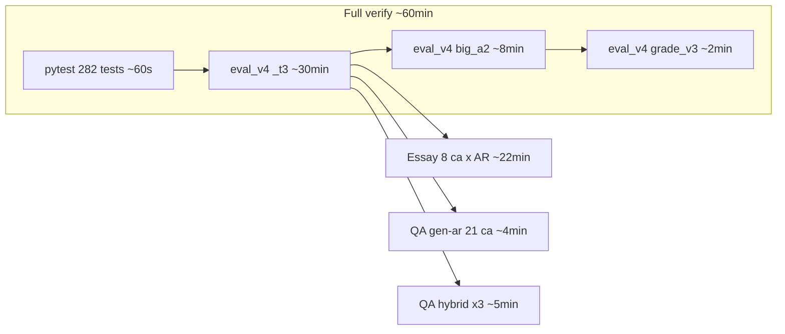
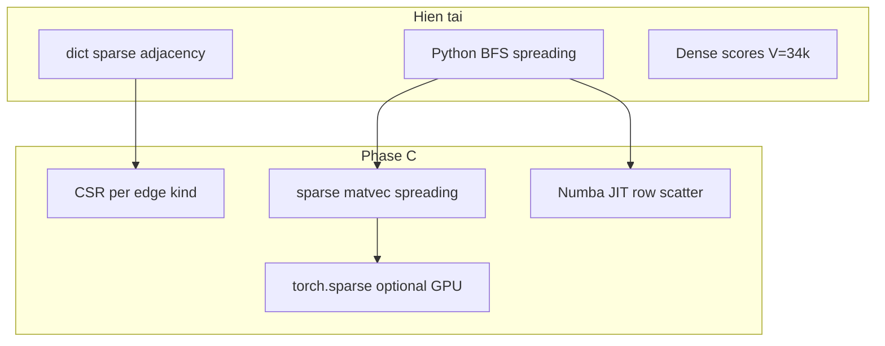

# TK_011 — Observability + tăng tốc verify / eval / train

| Field | Value |
|-------|-------|
| **ID** | TK_011 |
| **Status** | Phase A ✅ Done (2026-07-03); Phase B–C chưa làm (quick-win CPU / matvec để sau) |
| **Nguồn** | Đợt verify TK_010B (>1 giờ, không biết đang chạy đến đâu); chỉ đạo tác giả: cần log/trace + nghiên cứu GPU/matvec |

## 0. Kết quả Phase A (2026-07-03)

- **`util/progress.py`:** `stage`/`StageTimer` (context-manager in `▶`/`✓ …s`, cộng vào summary), `case_line`/`case_progress`, `PerfSummary` (section→s + per-case, export JSON + `print_summary`). **`FileProgressLog`** (TK_013): append log file + stdout cho job dài (`rebuild_seg_graph.py`).
- **`scripts/eval_v4.py`:** tách `run_eval(state, cache, cfg, …)` (verify.py tái dùng state đã load); flags `--verbose/-v`, `--report PATH`, `--skip-section LIST`, `--fast` (bỏ gen-ar+essay). **Fix triple-pass:** FAIL-dump tái dùng kết quả hybrid đã tính (không gọi `eval_generation` lần 3).
- **`scripts/verify.py` (mới):** pytest + eval guard nhiều checkpoint, banner từng bước + tổng wall-clock; `--fast`, `--no-pytest`, `--checkpoints _t3`, `--verbose --report`.
- **Pytest `slow` marker** (`pyproject.toml`) + gắn `@pytest.mark.slow` cho test load `grade_v3_big.pkl` (23s). `pytest -m "not slow"` ~34s vs full ~56s.
- Perf summary confirm điểm nóng: load checkpoint (~15s) + essay/gen-ar (đo bằng `essay_ab_t3.py`) — Phase B (G4 candidate-only) sẽ nhắm vào đây.

## 1. Tổng quan

Pipeline verify hiện tại (`pytest` + 3× `eval_v4` theo handoff) mất **~60 phút** mà **không in
tiến độ** — người chạy không biết đang kẹt ở essay ca mấy hay load checkpoint. Nguyên nhân chính
không phải pytest (~60s) mà **eval trên checkpoint lớn** (`grade_v3_big_a2_t3.pkl`, 108MB):
essay AR-mode chiếm ~22 phút/run; QA gen-ar ~4 phút; hybrid bị gọi 3 lần.

Ticket này gộp **hai mục tiêu**:

1. **Observability (Phase A)** — log section/case, script `verify.py` thống nhất, JSON report,
   pytest profile `slow`.
2. **Tăng tốc (Phase B–C)** — quick wins CPU (G4 candidate-only, cache readout, bỏ triple-pass)
   trước; ma trận thưa / Numba / GPU tùy chọn sau (có thể tách TK_012).

**Luật dự án:** profile nhanh cho dev **không thay** metric acceptance; không tắt cơ chế mặc định
(luật sổ nợ v4 §3.5).

---

## 2. Hiện trạng chi tiết

### 2.1. Phân rã thời gian verify (đo thực TK_010B, 2026-07-03)



| Thành phần | Thời gian ước lượng | Gốc |
| :--- | :--- | :--- |
| `pytest -q` | ~60s | 282 tests; vài test load checkpoint 120MB |
| `eval_v4` `_t3` | **~25–35 min** | Essay 8× `generate_essay` + `essay_segment_mode=ar` (~167s/ca); QA gen-ar 21× (~12s/ca); hybrid **3 lần** |
| `eval_v4` `big_a2` | ~5–8 min | Không essay; 44k cha |
| `eval_v4` `grade_v3` | ~1–2 min | Checkpoint nhỏ |
| Load pickle 108MB | ~15s × 3 | Mỗi eval load lại từ đĩa |

Recipe verify rải rác trong handoff (`TK_010B_MEASURE_T3_HANDOFF.md`):

```bash
python -m pytest -q
python scripts/eval_v4.py --checkpoint checkpoints/grade_v3_big_a2_t3.pkl
python scripts/eval_v4.py --checkpoint checkpoints/grade_v3_big_a2.pkl
python scripts/eval_v4.py --checkpoint checkpoints/grade_v3.pkl
```

### 2.2. Logging hiện có

| Script | Logging |
| :--- | :--- |
| `scripts/eval_v4.py` | Chỉ bảng kết quả cuối — **không timing, không per-case** |
| `scripts/build_t1_unified.py` | `time.time()` theo phase (mẫu tốt) |
| `scripts/rebuild_seg_graph.py` | **`FileProgressLog`** — `--log-file`, `--log-every`, `.summary.json` (TK_013) |
| `scripts/train_v3.py`, `run_train_eval.py` | Banner stage, không perf counter |
| pytest | Không marker `slow`; không `--durations` trong verify |

### 2.3. Hot path (vì sao chậm)

**Essay** (`hca/generate_hebbian.py::generate_essay`, default `essay_segment_mode="ar"`):

- Mỗi segment gọi `generate_autoregressive` (tối đa 8 segment/bài × 8 bài gold).
- ~100–200× chi phí một lần QA AR.

**A3 / gen-ar** (`generate_autoregressive` + `verify_v3.py`):

- Mỗi token step: spreading (BFS Python) + Hadamard 4 kênh + **G4 verify quét toàn vocab V**.
- V ≈ 34 530 trên `_t3` → O(max_len × V) ≈ 48 × 34k ≈ **1.7M** grounding checks / ca QA AR.
- Đo: ~12.4s/ca QA AR, ~167s/ca essay trên `_t3`.

**Hybrid** (`rank_matches` / `best_match`):

- ~0.75s/ca trên `_t3` — chấp nhận được nhưng eval gọi **3 lần** (bảng + FAIL dump lặp).

**Substrate compute** (khảo sát code 2026-07-03):

| Thành phần | Hiện trạng |
| :--- | :--- |
| Runtime | **CPU-only** — NumPy; không `import torch` trong `src/` |
| Adjacency A | `dict` sparse + `row_readout()` merge 9 loại cạnh mỗi lần gọi |
| ParentStore | Python list + inverted index; `rank_matches` = vòng lặp per-candidate |
| Embedding E | Dense `(N, d)`; PPMI offline dùng scipy.sparse + SVD |
| GPU / batching | **Không có** |

---

## 3. Đề xuất giải pháp

### Phase A — Observability (ưu tiên, ~1 buổi)

**Mục tiêu:** Biết đang chạy đến đâu; có artifact timing cho so sánh trước/sau tối ưu.

#### A1. Module progress dùng chung

File mới: `src/nn_aivie/util/progress.py`

| API | Mô tả |
| :--- | :--- |
| `StageTimer(name)` | Context manager: `BẮT ĐẦU/KẾT THÚC {name} ({elapsed}s)` |
| `case_progress(section, i, n, label, elapsed)` | `[essay 3/8] 45.2s — Nêu những lợi ích…` |
| `PerfSummary` | Dataclass `section → seconds`; export JSON |

#### A2. `scripts/eval_v4.py`

Flags mới:

| Flag | Tác dụng |
| :--- | :--- |
| `--verbose` / `-v` | In từng ca + thời gian |
| `--report PATH` | Ghi JSON (section + per-case timings) |
| `--skip-section LIST` | VD `essay,ar` — bỏ section tốn thời gian khi dev |
| `--fast` | Preset: skip gen-ar + essay (chỉ guard QA/hybrid/comp/anaphor) |

Thứ tự log section:

1. `load_checkpoint`
2. `qa_retrieval` / `qa_gen_hybrid` / `qa_gen_ar` (per bộ, per ca nếu `-v`)
3. `composition`
4. `essay` (per ca — **quan trọng nhất**)
5. `anaphor`

**Fix kèm theo:** FAIL dump tái dùng kết quả hybrid đã tính (không gọi `eval_generation` lần 3).

Refactor nhỏ: `run_eval(state, cfg, ...)` callable từ `main()` để `verify.py` truyền state đã load.

#### A3. `scripts/verify.py` (mới)

```bash
python scripts/verify.py                         # full: pytest + 3 checkpoint
python scripts/verify.py --fast                  # pytest -m "not slow" + eval guard
python scripts/verify.py --checkpoints _t3       # subset checkpoint
python scripts/verify.py --verbose --report out/perf.json
```

- Banner từng bước + tổng wall-clock cuối.
- Thay recipe copy-paste trong các handoff.

#### A4. Pytest profiles

- `pytest.ini` (hoặc `pyproject.toml`): marker `slow`
- Gắn `@pytest.mark.slow` cho: `test_export_graph_v3.py` (load 120MB), `test_build_parents.py`, các test `run_train` nặng nếu cần
- Dev: `pytest -m "not slow"` (~30s)
- Full: `pytest -q` hoặc `pytest --durations=10` trong verify

#### A5. Train / build

Áp dụng `StageTimer` cho `train_v3.py` (G1, neurogenesis, G2, E, build_parents),
chuẩn hóa log `build_t1_unified.py`, `run_train_eval.py` nếu còn dùng.

---

### Phase B — Tăng tốc CPU (2–3 buổi, **không đổi metric full mặc định**)

#### B1. G4 verify chỉ trên ứng viên (ROI cao nhất)

File: `hca/verify_v3.py`

Thay `for v in range(len(out))` (quét V) bằng:

- Chỉ token còn sống sau `mask_non_surface`, hoặc
- Top-k từ bước trước + hàng xóm `w0` trên đồ thị

Kỳ vọng: gen-ar ~12s → ~2–4s/ca trên `_t3`. **Bắt buộc đo lại** QA + essay trước khi merge.

#### B2. Cache `row_readout`

File: `core/adjacency.py` — LRU cache `row_readout(node_id)`; spreading gọi lặp cùng node trong 1 hop.

#### B3. Eval profiles (dev velocity — không thay acceptance TK)

| Profile | Khi dùng | Hành vi |
| :--- | :--- | :--- |
| `full` | Release, chốt ticket | Mặc định hiện tại — mọi section |
| `guard` | CI hàng ngày | Skip essay + skip gen-ar |
| `essay-smoke` | Dev essay | 2 ca gold + `essay_segment_mode=verbatim` |

#### B4. Load checkpoint một lần

`verify.py` load mỗi `.pkl` một lần, gọi `run_eval(state, ...)` — tiết kiệm ~15s × 2 mỗi checkpoint nếu sau này có nhiều profile.

---

### Phase C — Ma trận / GPU (trung hạn → TK_012 nếu scope lớn)



| Hạng mục | Effort | Speedup kỳ vọng | Ghi chú |
| :--- | :--- | :--- | :--- |
| **C1. CSR + premerged readout** | 2–3 tuần | 2–5× spreading/AR | Đổi pickle — cần migration |
| **C2. Numba JIT** `spreading_activation_read` | 3–7 ngày | 1.5–3× AR | Ít rủi ro, không GPU |
| **C3. Batched readout** (sau C1) | 1–2 tuần | ~2× eval throughput | Nhiều prompt song song |
| **C4. torch.sparse CUDA** | 6–10 tuần | 5–10× AR nếu V lớn | V~34k nhỏ; đáng khi scale 50k+ |
| **C5. rank_matches GPU** | 3–4 tuần | Thấp | Logic-bound; ưu tiên index pruning |

**Thứ tự khuyến nghị:** B1 → B2 → C2 → C1; C4 khi tác giả duyệt dependency GPU.

`rank_matches` / ParentStore khó vectorize hóa (phrase coverage, QA tie-break) — giữ CPU.

**Cơ hội matvec cụ thể:**

- `spreading_activation_read` (`hca/forward.py`): BFS frontier → có thể thành chuỗi sparse matvec `y = A_readout @ seed`.
- `dual_context_read`, `entity_attention_read`, `discourse_read`: scatter từ sparse row → Numba hoặc CSR.
- `generate_autoregressive`: mỗi step = fuse dense vectors — batch nhiều `w0` khi eval.
- `GraphEmbedding.nearest`: đã có `matrix @ v` — có thể FAISS/batch khi fuzzy_topk bật.

---

## 4. Đề xuất thay đổi cụ thể

| File | Phase | Thay đổi |
| :--- | :---: | :--- |
| `TK_011_PERF_OBSERVABILITY.md` | — | Ticket này |
| `src/nn_aivie/util/progress.py` | A | **Mới** — StageTimer, PerfSummary, case_progress |
| `scripts/eval_v4.py` | A | `--verbose`, `--report`, `--fast`, `--skip-section`; timing; bỏ hybrid triple-pass |
| `src/nn_aivie/eval/v4.py` | A | (tuỳ chọn) hook callback progress vào eval loops |
| `scripts/verify.py` | A | **Mới** — orchestrate pytest + eval; profiles |
| `pytest.ini` / `pyproject.toml` | A | Marker `slow` |
| `tests/test_export_graph_v3.py`, `test_build_parents.py` | A | `@pytest.mark.slow` |
| `scripts/train_v3.py`, `build_t1_unified.py` | A | StageTimer các phase |
| `hca/verify_v3.py` | B | G4 candidate-only verify |
| `core/adjacency.py` | B | LRU `row_readout` cache |
| `docs/NN-AIVIE v4.md` §6 | A | 1 dòng khi xong Phase A |
| `README.md` | A | Mục verify profiles + `pytest -m "not slow"` |
| `core/adjacency.py` (CSR) | C | → ticket TK_012 nếu tách |

### Lệnh sau khi implement (tham chiếu)

```bash
# Dev nhanh (~2–5 phút)
pytest -m "not slow" -q
python scripts/verify.py --fast --verbose

# Acceptance đầy đủ (mục tiêu <25 phút sau Phase A+B)
python scripts/verify.py --verbose --report out/perf_011.json

# So sánh trước/sau B1
python scripts/eval_v4.py --checkpoint checkpoints/grade_v3_big_a2_t3.pkl --verbose --report out/perf_before.json
# ... apply B1 ...
python scripts/eval_v4.py --checkpoint checkpoints/grade_v3_big_a2_t3.pkl --verbose --report out/perf_after.json
```

---

## 5. Acceptance

| Tiêu chí | Mục tiêu |
| :--- | :--- |
| `verify.py --verbose` | In section + tiến độ ca (biết đang essay mấy / 8) |
| `verify.py --report` | JSON có timing từng section (+ per-case nếu `-v`) |
| Full verify wall-clock | Sau **Phase A+B**: **< 25 phút** (từ ~60 phút), metric **full** giữ nguyên |
| `pytest -m "not slow"` | < 30s, core logic vẫn pass |
| Metric regression | `eval_v4` profile `full`: QA / essay / guard **số không đổi** sau B1/B2 |
| Không regression kiến trúc | Không đổi default `essay_segment_mode`, `verify_enabled` |

### Kết quả (chưa đo — điền sau implement)

| Phase | Ngày | Wall-clock verify | Ghi chú |
| :--- | :--- | :--- | :--- |
| Baseline | 2026-07-03 | ~60 min | TK_010B, không log |
| A | | | |
| A+B | | | |

---

## 6. Lộ trình & phạm vi

### Thứ tự triển khai

1. **Phase A** — observability (ticket này, ưu tiên cao)
2. **Phase B** — CPU quick wins + đo regression
3. **Phase C** — tách `TK_012_SPARSE_MATVEC` nếu cần pickle/GPU scope

### Không làm trong TK_011

- Đổi default `essay_segment_mode` (ảnh metric TK_009/010)
- Tắt `verify_enabled` ở runtime mặc định
- Thêm `torch` bắt buộc vào `pyproject.toml`
- Profile `guard`/`fast` thay cho acceptance ticket khác — chỉ dev/CI

### Liên quan

- `TK_010B_MEASURE_T3_HANDOFF.md` — recipe verify cũ (thay bằng `verify.py`)
- `TK_009` — `essay_segment_mode=ar` là nguồn chậm essay (chấp nhận tradeoff; không revert)
- v4 §3.5 — sổ nợ: profile nhanh ≠ tắt cơ chế

---

## Phase D — Decode-perf (2026-07-14, sau CSR TK_040)

> Nút SINH chậm ~phút/prompt trên graph lớn (65k cha) — siêu-tuyến-tính (634 cha <1s → 65k
> ~phút). Đo (`cProfile` generate) → tối ưu hotspot. Tận dụng adjacency **frozen CSR** (TK_040).

| Fix | Hotspot | Cơ chế | Kết quả | Commit |
|-----|---------|--------|---------|--------|
| **D1** | `readout_csr_normalized` build (Python-loop qua `items()`, O(cạnh)) | Khi mọi readout-layer frozen → build scipy THẲNG từ mảng CSR (np.repeat row_ids + concat layer×scale → coo sum-dupes → row-max chuẩn hóa → lọc cột) | **27.6s → 2.39s = 12×** (8.46M cạnh), maxdiff 2.2e-16, nnz khớp | `5a084ba` |
| **D3** | `ar_candidates` gom candidate/token: genexpr `v for v in row_readout(sid) if v<vocab` (1.49M calls) trên agenda-seed tái diễn | `readout_row_ids`/`learned_row_ids` = mảng neighbor-id <vocab, CACHE/node → `c.update(mảng)` | **function calls 4.68M→2.98M (−36%)**; output byte-identical (6/6 grade_v3) | `c80c4d1` |
| **D4** | `row()` frozen dictcomp (adjacency:133, 22789 calls) | Thử: (a) `row_readout` merge từ slice CSR; (b) `row_items` generator kênh micro | **ÂM TÍNH** — cả 2 byte-identical nhưng profile KHÔNG đổi (row_readout đã cached → không phải nguồn nóng; row() cost diffuse). **REVERT.** | — (không ship) |

**Byte-identical decode:** candidate SET như cũ (argmax không phụ thuộc thứ tự); readout matrix
allclose (float-order coo-sum ≈, cùng hạng với CSR spreading đã ship). Verify: output generate y
hệt trên grade_v3 (Hà Nội / Hai Bà Trưng năm 40 / 2+3=5).

**Nợ (chưa easy win):** row() diffuse + G4 verify/token + spreading matvec/token + rank_matches
retrieval — cần profile trên checkpoint LỚN (chậm iterate) hoặc đổi thuật toán per-token loop (rủi
ro chất lượng). **Dừng decode-perf ở D1+D3.** Generation vẫn ~phút/prompt trên 65k cha.

### Bức tranh perf tổng (session 2026-07-12→14)

| Trục | Trước | Sau | Bội số | Chứng cứ |
|------|-------|-----|:------:|----------|
| **Train full v10** | 15.54h | **3.89h** | **~4×** | production `network_v10.pkl`, log thật |
| **RAM adjacency** | 1.48GB | **0.113GB** | **~13×** | freeze CSR, byte-identical |
| **Load 1.57GB (24GB máy)** | treo/OOM (>15-20GB) | **peak 4.6GB, XONG** | — | CSR wire load |
| **Decode: readout build** | 27.6s | **2.39s** | **12×** | 8.46M cạnh |
| **Decode: candidate/token** | — | **−36% calls** | — | profile |

Related: TK_040 (CSR graph memory), TK_039 (train perf 6 fix).
