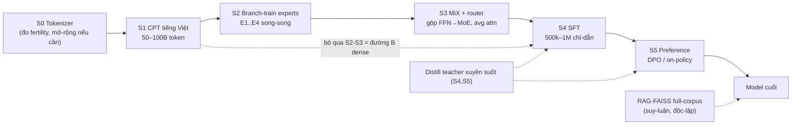
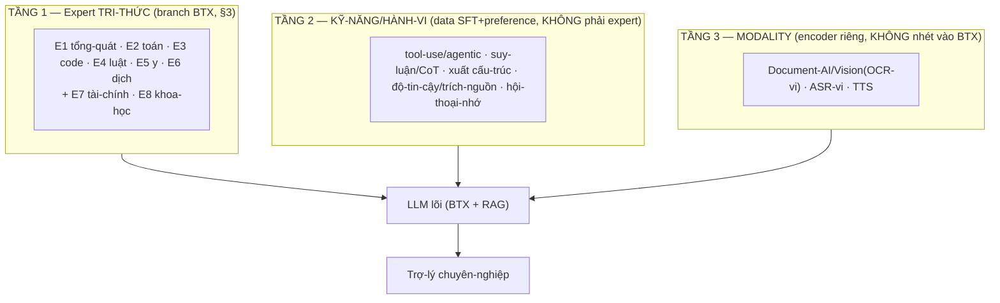

# TK_100 — Kế hoạch scale-up GPU: xây LLM tiếng Việt "lớn & mạnh"

> Soạn: 2026-09-04 · Nối tiếp TK_096–099 (Combiner-MoE + RAG đã kiểm-chứng trên M4)
> Trạng thái: **KẾ HOẠCH** (chưa thực thi) · Ngân sách: thuê GPU đám mây
> Người soạn: Claude (Opus 4.8) theo yêu cầu nghiên cứu nghiêm túc

---

## 0. TL;DR — chốt nhanh để đọc trước

- **Đừng train from-scratch.** Với một ngôn ngữ, **tiếp-tục-pretrain (CPT)** một base mở mạnh rẻ hơn ~20–100× mà chất-lượng cao hơn. Từ-scratch một model 7B cần ~1–2T token (~$0.5–2M); CPT chỉ cần ~30–100B token tiếng Việt (~$5–40k).
- **Base khuyến nghị: Qwen3-8B** (Apache-2.0, đa-ngữ mạnh gồm tiếng Việt, ctx 128K). Bản nhỏ **Qwen3-1.7B** để lặp nhanh; bản **Qwen3-14B** cho tier "mạnh".
- **Ý tưởng "expert đóng-băng → mạng tổng-hợp" của anh là ĐÚNG HƯỚNG** và có phiên-bản học-thuật đã kiểm chứng ở quy-mô lớn: **Branch-Train-MiX (BTX, Meta, COLM 2024)**. Ta scale ý tưởng M4 của mình lên chính xác BTX.
- **Teacher distill: Qwen3-32B / Qwen3-235B** (CÙNG tokenizer với student → distill logit + on-policy sạch), + teacher hộp-đen (Claude / GPT / DeepSeek-V3) cho dữ-liệu suy-luận khó (tuỳ ToS).
- **6 giai đoạn:** tokenizer → CPT-tiếng-Việt → branch-train expert → MiX+router → SFT → preference (DPO/on-policy) — distill xuyên suốt; **giữ RAG-FAISS** làm đòn bẩy grounding độc-lập.
- **Ngân sách 3 tier:** Lean ~$15–30k · Serious ~$45–90k · Ambitious ~$150k+. Bắt đầu 1 node 8×H100.
- **Mục tiêu đo được:** vượt SeaLLM-7B-v2.5 (VMLU 53.3) ở 8B; tiệm-cận/vượt VNPTAI-14B (55.8) ở 14B.

---

## 1. Bối cảnh & mục tiêu

### 1.1 Ta đang ở đâu (kết-quả M4, TK_096–099)
- Đã **kiểm-chứng** kiến-trúc của anh: nhiều expert nơ-ron train riêng → đóng băng → **combiner học-được** trộn đầu ra. Combiner **tự học định-tuyến ngữ-nghĩa** (gate đường-chéo trội), `hybrid` mode tốt nhất.
- Đã kiểm-chứng **2 đòn bẩy chất-lượng cộng-dồn**: (a) **sức-base** (d256→d512 train đủ: fact-top1 10.6%→15.2%) + (b) **cỡ-kho RAG** (FAISS 8M: →18.2%). Xem `out/kien_truc_combiner_moe.md`.
- **Ranh giới thật:** vẫn quy-mô đồ-chơi (d≤512, vài chục M tham-số); "hiểu" & fact vẫn bịa khi sinh tự-do. Đường lên **đã thông và định-lượng** — giờ là lúc scale ngoài-M4.

### 1.2 "Lớn & mạnh" nghĩa là gì — định nghĩa mục tiêu
Đề xuất chốt mục-tiêu **đo được** (không mơ hồ):
1. **Kiến-thức tiếng Việt:** VMLU ≥ 55 (ngang top nội-địa 14B) ở bản 8–14B.
2. **Hội-thoại/chỉ-dẫn:** thắng SeaLLM/Vistral trên MT-Bench-vi & Arena-hard-vi (human/LLM-judge).
3. **Chuyên-miền có giá-trị-thật:** luật VN, toán, code — đạt ngưỡng dùng-được.
4. **Grounding:** RAG-FAISS full-corpus giảm bịa, có trích nguồn (nối [[tro-ly-cua-ta-hoan-chinh]]).
5. **Chạy được:** serve bằng vLLM, ctx ≥ 32K, tốc-độ chấp-nhận-được.

---

## 2. Quyết định kiến-trúc (có đánh-đổi thành thật)

### 2.1 Bốn con đường & khuyến nghị

| Đường | Mô tả | Chi phí | Rủi ro | Khi nào chọn |
|---|---|---|---|---|
| **A. From-scratch dense** | Tự train 7B từ đầu | Rất cao (~$0.5–2M, 1–2T token) | Cao, dễ thua base có sẵn | Gần như KHÔNG (một ngôn ngữ) |
| **B. CPT dense** ⭐ | Tiếp-pretrain base mở trên tiếng Việt + SFT + DPO | Thấp (~$15–40k) | Thấp | **Mặc định — ROI cao nhất** |
| **C. BTX (MoE từ expert)** ⭐ | B + branch expert theo miền → trộn thành MoE → finetune router | Trung (~$45–90k) | Trung (serve MoE phức tạp) | **Khi muốn "nhiều chuyên-gia" của anh** |
| **D. MoE joint from-scratch** | Train sparse-MoE đồng-thời (kiểu Mixtral) | Rất cao | Cao | Không, ở giai đoạn này |

**Khuyến nghị:** **B làm nền, C làm nâng-cấp.** Làm B trước (nhanh, chắc), rồi thêm C (BTX) để hiện-thực-hoá đúng ý-tưởng "chuyên-gia" của anh ở quy-mô lớn. C là **phiên-bản học-thuật đã-kiểm-chứng của combiner-MoE M4 của ta**.

### 2.2 Combiner-MoE (M4) → Branch-Train-MiX (GPU): ánh-xạ 1-1

Ý-tưởng của anh và BTX **cùng một khung**; BTX chỉ khác 2 điểm để serve/chất-lượng tốt hơn ở scale:

| Combiner-MoE của ta (M4) | Branch-Train-MiX (BTX) | Ghi chú |
|---|---|---|
| Train mỗi expert riêng trên 1 miền | Branch từ **1 seed chung** → train song-song mỗi miền | Seed chung = khởi-đầu tốt hơn train-riêng-từ-đầu |
| **Đóng băng toàn-bộ** expert, concat mọi hidden | Chỉ **FFN** thành "expert" trong tầng MoE; **attention/embedding lấy trung-bình** (dùng chung) | Rẻ khi serve hơn nhiều (không giữ K model đầy-đủ) |
| Combiner ngoài học gate + head | **Router bên-trong** học định-tuyến token top-2; finetune nhẹ | Router = "combiner" của ta, nhưng đặt trong model |
| Expert **đóng băng cứng** | MoE-finetune nhẹ (router + tuỳ chọn cả khối) để expert **đồng-thích-nghi** | 1 thay-đổi có nguyên-tắc; ta vẫn ablate bản đóng-băng-router làm baseline đã-chứng-minh |

→ **Ta không vứt bỏ gì.** BTX là combiner-MoE "lớn lên": cùng triết-lý (branch-train-merge + router học-được), chỉ merge thông-minh hơn (share attention) để chạy thật. **RAG-kNN vẫn cắm vào như expert tri-thức lúc suy-luận** (đòn bẩy độc-lập, đã kiểm-chứng).

### 2.3 Chọn base cụ-thể

| Vai | Model | License | Vì sao |
|---|---|---|---|
| **Student chính** | **Qwen3-8B** | Apache-2.0 | Đa-ngữ mạnh (119 ngôn-ngữ, 36T token pretrain), tiếng Việt tốt sẵn, ctx 128K, không giới-hạn thương-mại |
| Student tier-mạnh | Qwen3-14B | Apache-2.0 | Khi cần đấu top VMLU |
| Student lặp-nhanh | Qwen3-1.7B | Apache-2.0 | Thử pipeline/hyperparam rẻ trước khi đốt tiền |
| **Teacher (white-box)** | Qwen3-32B / 235B-A22B | Apache-2.0 | **CÙNG tokenizer** → distill logit + on-policy SẠCH (không lệch từ-vựng) |
| Teacher (black-box) | Claude / GPT / DeepSeek-V3 | (theo ToS) | Sinh dữ-liệu suy-luận khó nhất; chỉ dùng nơi ToS cho phép distill |

> **Kiểm lại lúc khởi-động:** đến lúc thuê GPU, kiểm bản Qwen mới nhất (Qwen3.x), Gemma 4 (đã Apache-2.0), Llama 4 (license cộng-đồng, giới-hạn 700M MAU). Ưu-tiên **Apache-2.0** để tự-do thương-mại và để teacher–student cùng họ (distill sạch).

---

## 3. Các mạng chuyên-gia cụ-thể (BTX branches)

Branch từ **seed = Qwen3-8B đã CPT-tiếng-Việt** (Stage 1). Mỗi branch continue-train trên miền của nó, rồi gộp FFN → tầng MoE (top-2), attention lấy trung-bình.

| # | Chuyên-gia | Miền / vai | Nguồn dữ-liệu chính | Tại sao |
|---|---|---|---|---|
| E1 | **Kiến-thức tổng-quát VN** | wiki, tin, sách, bách-khoa | CulturaX-vi, wiki-vi, Binhvq news, sách | Lõi tri-thức & văn-phong (thay 4 expert "địa/sử/khoa" M4 bằng 1 expert mạnh) |
| E2 | **Toán & suy-luận** | math, logic, giải-bài | OpenMathInstruct-2, MetaMathQA-vi, GSM8K/MATH-vi | Suy-luận là điểm yếu nhất của model nhỏ VN |
| E3 | **Code** | lập-trình + chú-thích Việt | The Stack v2 (lọc), code có comment tiếng Việt | Năng-lực code + kỷ-luật suy-luận có cấu-trúc |
| E4 | **Luật & hành-chính VN** | văn-bản pháp-luật, thủ-tục | VBPL/thuvienphapluat (dedup, tôn-trọng ToS), QA luật | **Giá-trị thương-mại thật, cầu cao, ít đối-thủ** |
| E5* | **Y-sinh/sức-khoẻ VN** | y-khoa phổ-thông | tài-liệu y-tế công, QA sức-khoẻ | Tuỳ chọn tier B; miền cầu cao, cần cẩn-trọng an-toàn |
| E6* | **Dịch thuật Vi↔En** | song-ngữ, dịch 2 chiều | PhoMT, MTet, OPUS, back-translation | Tuỳ chọn — **xem §12**; thường làm bằng data+SFT trước, chỉ tách expert riêng khi dịch là sản-phẩm lõi |

`*` E5/E6 tuỳ tier. **Bắt đầu 3–4 expert** (BTX gốc dùng 3–4: knowledge/math/code) — hợp bài-học M4 của ta: *giá-trị đến từ ĐỘ CHUYÊN-BIỆT, đa-dạng của expert, không từ việc có nhiều expert dư-thừa* (Phase-1 expert trùng data → combiner = trộn-đều). Đừng nhân expert trùng miền.

> Ghi chú so với M4: ở M4 ta tách "địa/sử/khoa" thành các expert nhỏ để **chứng-minh routing**. Ở scale, một base mạnh đã nuốt gọn các miền wiki đó; nên gộp thành **E1 tổng-quát** và dành slot expert cho miền **thật khác biệt** (toán/code/luật) — nơi routing thắng đậm.

---

## 4. Nguồn dữ-liệu (cụ-thể, có cỡ & license)

### 4.1 CPT tiếng Việt (Stage 1) — mục-tiêu **50–100B token** sau dedup

| Nguồn | Quy-mô (vi) | License | Vai |
|---|---|---|---|
| **CulturaX** (vi) | hàng chục B token (tổng 6.3T/167 ngôn-ngữ) | ODC-BY / CC hỗn-hợp | Xương-sống web sạch |
| **MADLAD-400** (vi, clean) | lớn (tổng 3T/419 ngôn-ngữ, đã audit) | theo nguồn CC | Bổ-sung đa-dạng đã kiểm |
| **FineWeb-2** (vi) nếu có | lớn, chất-lượng cao | ODC-BY | Ưu-tiên nếu bản vi tốt |
| **Wikipedia-vi** (dump mới) | ~1–2 GB | CC-BY-SA | Bách-khoa chuẩn |
| **Binhvq News Corpus** | ~20 GB | công-khai | Báo-chí, văn-phong tin |
| **OSCAR-23xx** (vi) | lớn | CC | Bổ-sung web |
| **The Stack v2** (subset) | tuỳ | permissive-only | Giữ code cho E3 |
| **Văn-bản luật VN** | tuỳ crawl | tôn-trọng ToS | E4 |
| **Sách/văn-học** (public-domain + có phép) | tuỳ | hỗn-hợp | Văn-phong dài, mạch-lạc |
| **Replay tiếng Anh** (từ phân-phối base) | ~5–10% mix | — | **Chống quên thảm-khốc** |

**Xử-lý bắt-buộc:** dedup MinHash-LSH (datatrove); lọc chất-lượng fastText-vi + heuristic (độ dài, tỉ-lệ ký-tự lạ, lặp); **khử nhiễm (decontaminate)** với VMLU/eval; tokenize shard (Megatron mmap / Mosaic streaming). Nối bài-học M4: [[nut-that-long-form-la-du-lieu]] (đóng-gói đoạn dài bật mạch-lạc) — ưu-tiên tài-liệu dài, nguyên-đoạn.

### 4.2 SFT (Stage 4) — ~**500k–1M** hội-thoại/chỉ-dẫn tiếng Việt

| Nguồn | Cỡ | License | Ghi chú |
|---|---|---|---|
| **Aya** (vi native, người viết) | vài chục k | Apache-2.0 | **Vàng** — người Việt viết thật |
| OpenHermes-2.5 (dịch+lọc) | ~1M (gốc) | mở | Đa-dạng tác-vụ; lọc chất-lượng sau dịch |
| UltraChat-200k (dịch) | 200k | MIT | Hội-thoại nhiều lượt |
| Tulu-mix / ShareGPT (dịch) | vài trăm k | hỗn-hợp | Kiểm ToS ShareGPT |
| VLSP / UIT datasets | tuỳ | học-thuật | Tác-vụ NLP-vi chuẩn |
| **Synthetic distill (Magpie/Evol-vi)** | tuỳ sinh | tự-tạo | Teacher sinh chỉ-dẫn+đáp tiếng Việt chất-lượng cao |
| OpenMathInstruct-2 (dịch) | lớn | mở | E2 toán |

Bài-học M4 [[qlora-data-da-dang]]: **data hẹp làm HỎNG model** (quên dịch/email). Trộn ≥ 12 kiểu tác-vụ + neo sự-thật + repetition-penalty. Giữ nguyên tắc đó ở scale.

### 4.3 Preference (Stage 5)
- **UltraFeedback** (dịch) ~61k cặp chosen/rejected.
- **On-policy tự-dựng:** student sinh → teacher/reward-model chấm → tạo cặp (chất-lượng cao nhất, khớp phân-phối student).
- Aya preference nếu có.

> **Cảnh-báo license/ToS:** ưu-tiên nguồn permissive (Aya Apache-2.0, distill từ Qwen Apache-2.0). Dữ-liệu dịch từ GPT/Claude ràng-buộc ToS teacher — rà-soát pháp-lý trước khi dùng thương-mại. Crawl luật/tin: tôn-trọng robots/ToS.

---

## 5. Chiến-thuật train từng giai-đoạn (có hyperparam)

### S0 — Tokenizer
- **Đo fertility** (token/từ) của tokenizer Qwen3 trên tiếng Việt trước. Nếu ≲ 1.4× → **giữ nguyên** (không phải train lại embedding, nhanh & an-toàn).
- Nếu cao → mở-rộng ~8–16k merge tiếng Việt; init embedding mới = trung-bình các mảnh subword cũ; hâm-nóng embedding ở đầu Stage 1. Nối [[nut-that-long-form-la-du-lieu]] & TK_041.

### S1 — Continual Pre-Training (CPT)
| Tham-số | Giá-trị đề-xuất |
|---|---|
| precision | bf16 (+ FSDP/TP) |
| seq len | 8192 (nới 32K cuối Stage bằng RoPE-scaling/long-ctx pack) |
| tokens | 50–100B (vi) + 5–10% replay Anh |
| LR | ~1e-4 → 1e-5 (cosine hoặc WSD), warmup 1–2% |
| epoch | ~1–2 lượt qua data vi |
| batch (global) | ~2–4M token/step |
| framework | **Megatron-LM / TorchTitan / NeMo** |
| checkpoint | resume-safe (nối bài-học opt-state TK_095) |
- **Go/no-go:** VMLU sau CPT > base gốc; loss ổn-định; không tụt kỹ-năng Anh (kiểm nhanh).

### S2 — Branch-train experts (song-song, "embarrassingly parallel")
- Từ seed CPT: 4 branch × ~10–20B token miền/branch, **chạy song-song độc-lập** (không đồng-bộ → throughput cao).
- LR ~5e-5, cosine ngắn; mỗi branch chỉ chuyên-hoá, không quên nền (giữ ít replay tổng-quát).

### S3 — MiX + finetune router (bước "combiner" ở scale)
- Gộp **FFN mỗi expert → tầng MoE top-2**; **average** self-attention + embedding + norm giữa các expert.
- **MoE-finetune** ~1–5B token trên data trộn để router học định-tuyến token. (Đây là combiner của ta, đặt trong model.)
- Ablation bắt-buộc (khoa-học, nối M4): (a) router học-được vs (b) router đóng-băng đều-trọng-số — chứng-minh lại "routing thắng" như gate đường-chéo ở M4 (`analyze_gate.py` phiên-bản MoE).

### S4 — SFT
| Tham-số | Giá-trị |
|---|---|
| epoch | 2–3 |
| LR | 5e-6 – 2e-5, cosine, warmup 3% |
| đóng-gói | packing + chat template Qwen3 |
| data | §4.2 (~500k–1M) + neo sự-thật |
| framework | **Axolotl / LLaMA-Factory / TRL** |
- Kiểm-chứng lại luận-điểm M4: **SFT dạy KHUÔN, không dạy KIẾN-THỨC** ([[mamba-ssm-tren-m4]], TK_095) → kiến-thức phải vào ở S1/CPT & RAG, SFT chỉ dạy định-dạng+hành-vi.

### S5 — Preference (căn-chỉnh)
- **DPO/ORPO** (đơn-giản, ổn): β≈0.1, LR ~5e-7, 1–2 epoch. Framework: TRL/OpenRLHF.
- Hoặc **on-policy (GRPO/GKD)** cho polish suy-luận (xem §6).

### RAG (song-song, giữ nguyên tài-sản ta)
- Dựng lại datastore FAISS bằng **hidden của base mới, full-corpus** (kế-thừa `build_faiss_datastore.py`, `KnnExpertFAISS`, `make_knn`, `--backbone`). Nhớ `omp_set_num_threads(1)` + `KMP_DUPLICATE_LIB_OK`. Đòn bẩy grounding độc-lập, cộng-dồn với sức-base (đã chứng-minh TK_099).

---

## 6. Distillation (chi-tiết) — dệt xuyên S4/S5

Ba lớp, từ dễ→mạnh:

1. **Distill dữ-liệu (sequence-KD) — làm ngay, teacher nào cũng được (kể cả hộp-đen):**
   Teacher sinh chỉ-dẫn+đáp / lời-giải-từng-bước tiếng Việt chất-lượng cao (Magpie, Evol-Instruct, reasoning traces) → nạp vào S4. Rẻ, hiệu-quả, không cần logit.

2. **Distill logit (white-box) — cần teacher CÙNG tokenizer:**
   Dùng **Qwen3-32B/235B** làm teacher; thêm mất-mát KL (forward/​reverse) trên phân-phối token trong lúc SFT. **Cùng họ Qwen ⇒ từ-vựng khớp ⇒ distill sạch** (đây là lý-do chọn teacher cùng họ ở §2.3).

3. **On-policy distillation (GKD/OPD) — chất-lượng cao nhất, polish cuối:**
   Student **tự sinh** rollout → teacher chấm phân-phối token → tối-ưu **reverse-KL** (mode-seeking). Cho tín-hiệu dày ở đúng phân-phối student, **chữa exposure-bias** mà SFT off-policy không chữa được. Dùng cho suy-luận/toán/hội-thoại ở bước cuối. Framework: TRL GKD trainer / DistiLLM / verl-OPD.

> Chiến-lược teacher kép: **Qwen3 mở** cho logit+on-policy (sạch, không ToS phiền); **frontier hộp-đen** chỉ để sinh *dữ-liệu* miền khó nhất (§1 lớp 1), nơi ToS cho phép.

---

## 7. Ngân-sách, compute & tiến-độ

**Ước-tính FLOPs (quy-tắc 6·N·D):** CPT 8B trên 50B token ≈ 6·8e9·5e10 ≈ 2.4e21 FLOPs. H100 bf16 ~40% MFU ≈ 4e14 FLOP/s ≈ 1.44e18 FLOP/H100-giờ → **~1,700 H100-giờ** cho 50B token. Trên 1 node 8×H100 ≈ **~9 ngày**. Giá thuê H100 ~$2–3/giờ (Lambda/RunPod/Voltage Park/Crusoe…).

| Tier | Phạm-vi | H100-giờ (ước) | Chi-phí (ước) | Thời-gian (1–2 node) |
|---|---|---|---|---|
| **A — Lean** (chứng-minh pipeline) | Qwen3-8B, CPT 30–50B, đường B dense, SFT+DPO, distill-dữ-liệu | ~5–8k | **~$15–30k** | ~2–3 tuần |
| **B — Serious** ⭐ | 8–14B, CPT 80–100B, **BTX 4 expert**, SFT+DPO+**logit-distill**, RAG full | ~15–25k | **~$45–90k** | ~4–8 tuần |
| **C — Ambitious** | 14B+/MoE lớn, 200B+ token, on-policy distill đầy-đủ | 50k+ | **~$150k+** | 2–3 tháng |

**Khuyến nghị khởi-động:** thuê **1 node 8×H100** (đủ 8B/14B với FSDP+TP), làm **Tier A trước để rã băng pipeline** rồi mở lên B. Đừng thuê cụm lớn trước khi pipeline chạy sạch trên bản 1.7B.

---

## 8. Đánh-giá (eval) — cổng go/no-go mỗi giai-đoạn

| Bộ | Đo gì | Ngưỡng-đích |
|---|---|---|
| **VMLU** (10,880 MCQ, 58 môn) | kiến-thức tiếng Việt | > 53.3 (SeaLLM) → tiệm-cận 55.8 (VNPTAI-14B) |
| VLSP / ViMMRC / ViGLUE / VSMEC | NLP-vi chuẩn | vượt base |
| **MT-Bench-vi / Arena-hard-vi** | sinh/hội-thoại (LLM-judge) | thắng Vistral/SeaLLM |
| GSM8K-vi / MATH-vi | toán (E2) | lift rõ sau BTX |
| HumanEval-vi / MBPP | code (E3) | lift rõ sau BTX |
| **fact_eval (của ta)** | fact-top1/5 token nội-dung | > baseline; đo lực RAG |
| RAG grounding | trích nguồn, giảm bịa | cải-thiện có nguồn |
| **FLORES-200 / PhoMT / MTet** (§12) | dịch Vi↔En (2 chiều) | **COMET-22 + COMETKiwi** + chrF/BLEU vượt base & NLLB-vi |

- **Khử nhiễm** eval khỏi data train (bắt-buộc; nối bài-học rò-rỉ seed TK_097).
- Harness: `lm-eval-harness` + VMLU official (`ZaloAI-Jaist/VMLU`) + `fact_eval.py` của ta; serve eval bằng **vLLM**.

---

## 9. Hạ-tầng & kỹ-thuật

| Khâu | Công-cụ đề-xuất |
|---|---|
| Pretrain/CPT | **Megatron-LM / TorchTitan / NeMo** (FSDP + TP/PP) |
| Data pipeline | **datatrove** (lọc+dedup MinHash), fastText-vi, tokenize shard |
| SFT/DPO | **Axolotl / LLaMA-Factory / TRL** |
| On-policy/RL | **OpenRLHF / verl / TRL-GKD** |
| Distill | TRL GKD / DistiLLM / custom |
| Serve & eval | **vLLM** + lm-eval-harness + VMLU |
| RAG | kế-thừa `train_combiner.py`/`build_faiss_datastore.py` (FAISS IVFPQ) |
| Theo-dõi | WandB; checkpoint lên S3/R2, resume-safe |

**Kế-thừa bài-học M4:** opt-state resume (TK_095); khử-nhiễm datastore↔eval (seed rời); FAISS+OpenMP `omp_set_num_threads(1)`; **KHÔNG push binary** ([[git-history-da-don]]) — checkpoint để cloud storage, không vào git.

---

## 10. Rủi-ro & ranh-giới thành-thật

| Rủi-ro | Giảm-thiểu |
|---|---|
| **Quên thảm-khốc** (mất kỹ-năng Anh/nền) | 5–10% replay + LR vừa-phải + kiểm eval Anh mỗi cổng |
| Tokenizer fertility cao | Đo trước; mở-rộng vocab chỉ khi cần |
| **License/ToS** (ShareGPT, distill hộp-đen, crawl luật) | Ưu-tiên permissive (Aya, Qwen Apache); rà pháp-lý trước thương-mại |
| Serve MoE phức-tạp | Có thể dừng ở **B dense** nếu serve đơn-giản quan-trọng hơn |
| Nhiễm eval | Decontaminate bắt-buộc |
| Vượt ngân-sách | Tier hoá + cổng go/no-go; thử 1.7B trước |
| **Kỳ-vọng "hiểu thật"** | Base 8–14B + RAG là *tốt & dùng-được*, **chưa** phải frontier; đặt kỳ-vọng đúng |

**Thành-thật cốt-lõi:** đây là con đường **chắc-chắn ra một LLM tiếng Việt dùng-được, cạnh-tranh top nội-địa**, dựng trên đúng ý-tưởng "chuyên-gia + tổng-hợp" của anh (qua BTX) + RAG của ta. Nó **không** biến ta thành GPT-4; muốn thế cần scale gấp nhiều lần (data + compute + team). Nhưng mọi đòn bẩy ở đây **đã được ta kiểm-chứng ở nhỏ** và có bằng-chứng học-thuật ở lớn.

---

## 11. Cột-mốc (milestones) & bước kế-tiếp cụ-thể

| Mốc | Nội-dung | Cổng go/no-go | Tuần |
|---|---|---|---|
| **M0** | Hạ-tầng + data pipeline + quyết tokenizer + eval harness; thử toàn-trình trên **Qwen3-1.7B** | Pipeline chạy sạch end-to-end trên 1.7B | 1–2 |
| **M1** | CPT Qwen3-8B trên 30–50B token vi | VMLU > base gốc; không tụt Anh | 3–4 |
| **M2** | SFT + DPO → bản chat 8B (đường B) | Thắng SeaLLM trên VMLU + MT-bench-vi | 5–6 |
| **M3** | BTX: branch E1–E4 → MiX → router; ablation routing | Lift rõ toán/code/luật; routing > trộn-đều | 7–9 |
| **M4** | Distill on-policy + RAG-FAISS full-corpus + polish | Đạt mục-tiêu §1.2; grounding có nguồn | 10–12 |

**Việc làm ngay (trước khi thuê GPU lớn):**
1. Chốt **tier ngân-sách** (A/B/C) và **nhà cung-cấp GPU**.
2. Chốt **base** (kiểm bản Qwen mới nhất tại thời-điểm khởi-động).
3. Rà **license** các nguồn data & teacher (permissive-first).
4. Dựng **data pipeline** (datatrove + dedup + decontam) — làm được ngay tại-chỗ, không tốn GPU.
5. Chạy **toàn-trình trên Qwen3-1.7B** (M0) để rã băng, rồi mới mở 8B.

---

## 12. Bổ-sung: năng-lực dịch thuật Vi↔En

> Hỏi thêm (2026-09-04): "bổ-sung dịch thuật tiếng Anh thì làm thế nào?"

### 12.1 Nguyên-tắc: KHÔNG cần expert riêng để bắt-đầu
Base Qwen3 **đã đa-ngữ** (En & Vi mạnh sẵn) → dịch đã có nền. Ta **bơm dịch vào 3 chỗ** của pipeline hiện-có, chi-phí thêm gần-như bằng 0 (tái-dùng data-mix + SFT). **Chỉ tách expert E6 riêng khi dịch là sản-phẩm lõi** (throughput/chất-lượng dịch là KPI chính).

| Chỗ chèn | Làm gì | Chi-phí thêm |
|---|---|---|
| **(1) CPT (S1)** | Trộn ~2–5% **cặp song-ngữ** + văn-bản En chất-lượng vào CPT → **căn-chỉnh xuyên-ngữ** (cross-lingual alignment) tốt hơn, nền dịch chắc | ~0 (nằm trong ngân-sách CPT) |
| **(2) SFT (S4) — CHÍNH** | Thêm **tác-vụ dịch 2 chiều** dạng chỉ-dẫn ("Dịch sang tiếng Anh: …" / "Dịch sang tiếng Việt: …", cả câu & cả đoạn) | rẻ (nằm trong SFT) |
| **(3) BTX expert E6** *(tuỳ)* | 1 branch song-ngữ chuyên dịch → MoE-router tự định-tuyến token dịch | ~vài trăm H100-giờ |

**Khuyến nghị:** làm (1)+(2) trong Tier A/B — đủ để có model dịch tốt. E6 chỉ khi cần "bản dịch chuyên-nghiệp" làm sản-phẩm.

### 12.2 Dữ-liệu song-ngữ Vi↔En (cụ-thể, có cỡ)

| Nguồn | Cỡ | Ghi-chú |
|---|---|---|
| **MTet** (VietAI) | **4.2M** cặp | Lớn nhất công-khai, **đa-miền** (giáo-dục, UI phần-mềm, tin, phụ-đề, wiki, TED) |
| **PhoMT** (VinAI) | **3.02M** cặp | Chất-lượng cao, có **test-set chuẩn** để đo |
| VLSP2020 EN-VI | ~4M | Từ nguồn công-khai |
| IWSLT'15 En-Vi | 133k | Kinh-điển, TED talks; test-set quen-thuộc |
| **OPUS** (OpenSubtitles, WikiMatrix, **CCMatrix**, **ParaCrawl**, **NLLB**) | rất lớn (khai-thác CC) | Cần lọc mạnh (nhiễu cao) |
| **VietMix** | vừa | **Code-mixed** Vi-En (chèn tiếng Anh trong câu Việt) — thực-tế đời-thường |
| **Back-translation tự-sinh** | tuỳ | Dùng model của ta / NLLB-200 dịch **đơn-ngữ** (kho vi/En khổng-lồ) → cặp giả, tăng lượng & phủ miền |

**Lọc chất-lượng bắt-buộc** (cặp song-ngữ CC rất bẩn): **Bicleaner-AI / LaBSE / COMETKiwi** chấm độ tương-đồng nghĩa; lọc tỉ-lệ độ-dài; khử-trùng; lọc **off-target** (dịch sai ngôn-ngữ). → *ít-mà-sạch thắng nhiều-mà-bẩn* (khớp bài-học [[qlora-data-da-dang]]).

### 12.3 Kỹ-thuật train dịch
- **Định-dạng chỉ-dẫn 2 chiều** trong SFT (En→Vi và Vi→En), câu lẫn đoạn.
- **Document-level** (dịch cả đoạn, giữ ngữ-cảnh + thuật-ngữ nhất-quán) — LLM dịch tốt hơn hẳn câu-lẻ; hợp bài-học [[nut-that-long-form-la-du-lieu]].
- **Back-translation** để bơm lượng & phủ miền hiếm.
- **Neo miền:** dịch chuyên-ngành **luật (E4)/y (E5)** — giá-trị cao, tái-dùng data miền.
- **Đa-dạng ngôn-ngữ giúp** (nghiên-cứu 2025): thêm vài ngôn-ngữ khác lúc FT-dịch cải-thiện cả zero-shot — nhưng ưu-tiên Vi↔En trước.

### 12.4 Distill cho dịch
- **Data distill:** teacher **Qwen3-235B** / **NLLB-200-3.3B** / model MT mạnh **tinh-chỉnh (refine)** bản dịch thô → cặp chất-lượng cao cho SFT.
- **On-policy + reward = COMET:** student sinh bản dịch → chấm bằng **COMET/COMETKiwi** làm phần-thưởng → RL (GRPO). Đây là cách hiện-đại đẩy chất-lượng dịch vượt SFT thuần.

### 12.5 Đánh-giá dịch
- **Tập test:** **FLORES-200 devtest** (2 chiều, chuẩn đa-ngữ) + **PhoMT test** + **MTet test** + IWSLT'15.
- **Chỉ-số:** **COMET-22** (chính, neural, khớp người) + **COMETKiwi** (QE **không cần tham-chiếu**) + chrF + BLEU (từ-vựng, để so báo-cáo cũ) + **BLEURT**. Dùng **COMET-strict** (phạt off-target về 0) để bắt lỗi dịch-sai-ngôn-ngữ.
- **Mốc go/no-go:** vượt base Qwen3 gốc & **NLLB-200** trên FLORES Vi↔En; tiệm-cận model MT chuyên (envit5/VietAI) trên PhoMT.

### 12.6 Chi-phí & ưu-tiên
Dịch là **bổ-sung rẻ nhất** trong ticket: (1)+(2) **không cần GPU thêm đáng-kể** (nằm trong CPT+SFT). E6 tuỳ chọn. → Đưa dịch vào **ngay Tier A** ở mức data+SFT; cân-nhắc E6 + reward-COMET ở Tier B/C nếu dịch thành sản-phẩm lõi.

> **Cảnh-báo ta đã học:** [[qlora-data-da-dang]] — data hẹp từng làm model **QUÊN dịch/email**. Vì vậy **luôn giữ tác-vụ dịch trong SFT-mix tổng** (đừng train dịch tách-biệt rồi để rơi khỏi mix) → giữ năng-lực dịch bền.

---

## 13. Kiến-trúc trợ-lý chuyên-nghiệp: 3 tầng năng-lực

> Hỏi thêm (2026-09-04): "một LLM đa-chức-năng, trợ-lý chuyên-nghiệp cần thêm expert gì?"

**Nguyên-tắc lõi (bài-học M4 đã trả giá):** giá-trị đến từ **ĐỘ CHUYÊN-BIỆT (phân-phối data khác biệt)** của expert, KHÔNG từ *số-lượng* expert — expert trùng miền làm gate nhoè, combiner thoái-hoá thành trộn-đều ([[combiner-moe-experts]]). Vì vậy **đừng biến mọi thứ thành expert.** Phân theo 3 tầng, mỗi tầng có cơ-chế hiện-thực KHÁC nhau:

### Tầng 1 — Expert TRI-THỨC nên THÊM (chỉ khi phân-phối thật khác biệt)
| Expert | Vì sao đáng tách riêng | Nguồn data | Chi-phí |
|---|---|---|---|
| **E7 Tài-chính/Kế-toán/Thuế VN** | từ-vựng + số-học + quy-định rất riêng (VAS/IFRS, luật thuế, báo-cáo TC) | văn-bản thuế/kế-toán VN, báo-cáo DN công-bố, QA tài-chính | ~1 branch BTX (~vài trăm H100-giờ) |
| **E8 Khoa-học/Kỹ-thuật** *(tuỳ đối-tượng)* | lý-luận kỹ-thuật khác văn wiki | giáo-trình, arXiv-vi/dịch, tài-liệu kỹ-thuật | ~1 branch |

> KHÔNG tách "kinh-doanh/văn-phòng, giáo-dục, marketing" thành expert — đó là **văn-phong**, không phải tri-thức riêng → làm ở Tầng 2 (SFT). Nhồi expert trùng miền = phí GPU + nhoè gate.

### Tầng 2 — KỸ-NĂNG/HÀNH-VI (là DATA, không phải expert) — **khoảng-cách lớn nhất hiện-tại**
Đây mới là thứ biến "model biết tiếng Việt" thành **trợ-lý chuyên-nghiệp**. Phần lớn **không cần GPU-expert thêm**, chỉ cần data + SFT/preference:

| Năng-lực | Vai-trò | Nguồn data / cách làm |
|---|---|---|
| **Tool-use / gọi-hàm / agentic** ⭐ | trợ-lý *làm việc*: gọi API, lịch, tìm-kiếm, chạy code | `xlam-function-calling-60k`, `glaive-function-calling-v2`, **ToolACE** (26k API), APIGen-MT → SFT + JSON có kiểm |
| **Suy-luận / CoT** ⭐ | phân-tích, lập-kế-hoạch | **distill reasoning-traces** từ teacher (Qwen3 có "thinking mode") — KHÔNG cần expert |
| **Xuất có cấu-trúc** (JSON/bảng/SQL) | nối vào phần-mềm, xử-lý dữ-liệu | SFT + **constrained decoding** lúc suy-luận (vLLM guided) |
| **Độ-tin-cậy: trích-nguồn, giảm-bịa, từ-chối đúng** ⭐ | chuyên-nghiệp = *đáng-tin* | SFT + preference (DPO) + **RAG (đã có)**; eval hallucination |
| Hội-thoại nhiều-lượt / trí-nhớ / persona | giữ mạch phiên dài | SFT hội-thoại + long-context (đã trong plan) |

⭐ = ba đòn tạo khác-biệt lớn nhất cho "trợ-lý pro" mà plan gốc chưa nhấn.

### Tầng 3 — MODALITY (kiến-trúc KHÁC — encoder + projector, **không** phải FFN-expert)
Dân chuyên-nghiệp sống trong **PDF/hợp-đồng/hoá-đơn/cuộc-họp** → đây thường là đòn bẩy giá-trị *lớn nhất*, nhưng phải làm như **track riêng**, ghép vào LLM lõi:

| Modality | Dùng để | Cách làm / mốc VN |
|---|---|---|
| **Document-AI / Vision (OCR-vi, bảng, biểu-đồ)** ⭐ | đọc hợp-đồng, hoá-đơn, báo-cáo, scan; DocVQA | VLM = vision-encoder + projector + LLM lõi; tham-chiếu **Vintern-1B**, **CATI-VLM** (VN, top DocVQA) |
| **ASR tiếng Việt** (speech→text) | ghi-âm họp, đọc-chép | finetune **PhoWhisper** / Whisper-v3 (data ViVOS, Common-Voice-vi, VietSuperSpeech) |
| **TTS** (text→speech) | trợ-lý giọng-nói | model TTS-vi riêng, ghép cuối |

### Thứ-tự ưu-tiên cho "trợ-lý chuyên-nghiệp"
1. **Tool-use/agentic** (T2) — biến "biết" → "làm". Rẻ, tác-động lớn nhất.
2. **Document-AI/Vision-OCR** (T3) — dân pro ngập tài-liệu; khác-biệt-hoá mạnh, **giá-trị thương-mại rõ nhất**.
3. **Suy-luận distill + độ-tin-cậy/trích-nguồn** (T2) — chất-lượng & niềm-tin.
4. **E7 Tài-chính/Kế-toán/Thuế** (T1) — miền cầu cao, ít đối-thủ.
5. **ASR** (T3) — họp/giọng-nói.

**Chốt:** khoảng-cách thật giữa "LLM biết tiếng Việt" và "trợ-lý chuyên-nghiệp" nằm ở **Tầng 2 (agentic + tin-cậy)** và **Tầng 3 (đa-modal tài-liệu)** — KHÔNG phải ở việc thêm expert tri-thức. Thêm expert tri-thức có lợi-ích giảm dần; thêm tool-use + đọc-tài-liệu có lợi-ích bùng-nổ cho ca dùng nghề-nghiệp.

---

## 14. Danh-mục nguồn dữ-liệu chuyên-nghiệp (repo HF + cỡ + license)

> Hỏi thêm (2026-09-04): "data train-set thì sao, tìm luôn các nguồn chuyên-nghiệp."
> **Quy-tắc chọn:** ưu-tiên license permissive (Apache/MIT/CC-BY/ODC-BY); dedup MinHash; lọc chất-lượng (fastText/COMETKiwi/LaBSE); **khử-nhiễm với eval**; đa-dạng tác-vụ ([[qlora-data-da-dang]]). **Cảnh-báo lineage:** dataset sinh từ GPT/OpenAI (đánh dấu ⚠️GPT) ràng ToS OpenAI → rà pháp-lý trước khi thương-mại.

### 14.1 Pretraining / CPT tiếng Việt (Stage 1)
| Nguồn (repo HF) | Cỡ (vi) | License | Ghi-chú |
|---|---|---|---|
| **`HuggingFaceFW/fineweb-2`** ⭐ | phần vi của 20TB/1000+ ngôn-ngữ | ODC-BY | **Ưu-tiên số 1** — vượt CulturaX/mC4/CC-100; pipeline datatrove |
| `epfml/FineWeb2-HQ` | tập con chất-lượng-cao | ODC-BY | Bản lọc kỹ hơn, tốt cho CPT tinh |
| `uonlp/CulturaX` (vi) | hàng chục B token | ODC-BY / CC hỗn-hợp | Bổ-sung; đã dùng ở nhiều model VN |
| `allenai/madlad-400` (vi, clean) | lớn (đã audit) | theo nguồn CC | Đa-dạng, đã kiểm |
| `wikimedia/wikipedia` (20231101.vi) | ~1–2 GB | CC-BY-SA | Bách-khoa chuẩn |
| **Binhvq News Corpus** (`binhvq/news-corpus`) | ~20 GB | công-khai | Báo-chí, văn-phong tin |
| `bigcode/the-stack-v2` (smol-ids 17 ngôn-ngữ / full-ids 600+) | 67TB tổng | permissive-only | Code cho pretrain + E3; StarCoder2 dùng |
| Replay tiếng Anh (sample từ `HuggingFaceFW/fineweb`) | 5–10% mix | ODC-BY | Chống quên thảm-khốc |

### 14.2 Data cho expert theo miền (Stage 2)
| Expert | Nguồn (repo HF) | Cỡ | License | Ghi-chú |
|---|---|---|---|---|
| **E2 Toán** | `nvidia/OpenMathInstruct-2` | 14M cặp | CC-BY-4.0 | Bản 1M/2M/5M có sẵn; dịch sang vi |
| | `5CD-AI/Vietnamese-meta-math-MetaMathQA-40K-gg-translated` | 40K | mở | Đã có tiếng Việt (dùng ở M4) |
| **E3 Code** | `nvidia/OpenCodeInstruct` | 5M | CC-BY-4.0 | Lớn nhất, permissive; 500k đã vượt Llama-3-instruct |
| | `ise-uiuc/Magicoder-OSS-Instruct-75K` + `…-Evol-Instruct-110K` | 75K+110K | ⚠️GPT (other) | Chất-lượng cao nhưng lineage GPT-3.5 |
| **E4 Luật VN** | `GreenNode/zalo-ai-legal-text-retrieval-vn` | 61.4K corpus | mở | Có query+nhãn liên-quan (RAG luật) |
| | `YuITC/Vietnamese-Legal-Documents`, `pdt590/…`, `vohuutridung/…` | tuỳ | công-khai | Nguồn thuvienphapluat.vn — **tôn-trọng ToS** |
| | TVPL benchmark | 224K passage | học-thuật | Retrieval luật quy-mô lớn |
| **E5 Y-tế VN** | `hungnm/vietnamese-medical-qa`, `urnus11/Vietnamese-Healthcare` | tuỳ | mở | QA từ vinmec/health-web |
| | VHCor (26K, 28 chuyên-khoa), ViMedAQA, ViMQ, ViHERMES | tuỳ | học-thuật | QA/NER/quy-định y-tế; **cẩn-trọng an-toàn** |
| **E7 Tài-chính/Kế-toán/Thuế** | *(mở còn MỎNG — cần tự dựng)* | — | — | **Chiến-lược:** (a) luật thuế/kế-toán ⊂ E4 (mục thuế trên thuvienphapluat); (b) crawl BCTC công-bố (cafef/vietstock/HOSE/HNX — ToS); (c) **synthetic QA distill** từ teacher neo trên tài-liệu đó |
| **E8 Khoa-học** | wiki-khoa-học + arXiv (dịch) + giáo-trình | tuỳ | hỗn-hợp | Tách chỉ khi đối-tượng kỹ-thuật |

### 14.3 SFT chỉ-dẫn tiếng Việt (Stage 4)
| Nguồn (repo HF) | Cỡ | License | Ghi-chú |
|---|---|---|---|
| **`CohereForAI/aya_dataset` / `aya_collection`** ⭐ | vài chục K (vi) | Apache-2.0 | **Người Việt viết thật** — vàng |
| `bkai-foundation-models/vi-alpaca` (+`-input-output-format`) | 50K / 25K | ⚠️GPT | GPT-4/3.5 sinh, chất-lượng khá |
| `5CD-AI/Vietnamese-Multi-turn-Chat-Alpaca` | nhiều-lượt | ⚠️GPT | Hội-thoại nhiều lượt vi |
| `MBZUAI/Bactrian-X` (vi) | 67K | mở (dịch) | alpaca+dolly dịch máy |
| `tmnam20/vi_instruct` | tuỳ | mở | Tổng-hợp chỉ-dẫn vi |
| Dịch+lọc: `teknium/OpenHermes-2.5`, `HuggingFaceH4/ultrachat_200k`, `allenai/tulu-3-sft-mixture` | lớn | mở/⚠️ | Đa-dạng tác-vụ (lọc sau dịch) |

### 14.4 Suy-luận / CoT (distill vào SFT — Tầng 2)
| Nguồn (repo HF) | Cỡ | License | Ghi-chú |
|---|---|---|---|
| `open-thoughts/OpenThoughts3-1.2M` (+`OpenThoughts-114k`) | 1.2M | mở | Recipe reasoning tốt nhất hiện có |
| `open-r1/Mixture-of-Thoughts` | 350K (toán/code/khoa) | mở | Traces đã kiểm; gồm Nemotron |
| Tự distill từ teacher reasoning (Qwen3-thinking / QwQ / R1-lineage) | tuỳ sinh | — | Sinh CoT vi rồi lọc-đúng |

### 14.5 Tool-use / agentic (Tầng 2)
| Nguồn (repo HF) | Cỡ | License | Ghi-chú |
|---|---|---|---|
| `Salesforce/xlam-function-calling-60k` | 60K | CC-BY (kèm điều-kiện) | Gọi-hàm chuẩn |
| `glaiveai/glaive-function-calling-v2` | lớn | mở | Kinh-điển, phổ-biến |
| `Team-ACE/ToolACE` | 26K API | mở | Đa-dạng API, tự-tiến-hoá |
| APIGen-MT (xLAM) | 5K+ | mở | Trajectory nhiều-bước, verify được |

### 14.6 Preference / DPO (Stage 5)
| Nguồn (repo HF) | Cỡ | License | Ghi-chú |
|---|---|---|---|
| `HuggingFaceH4/ultrafeedback_binarized` | 61K | MIT | Chuẩn DPO |
| `nvidia/HelpSteer2` (+ **HelpSteer3-Preference**) | lớn | CC-BY-4.0 | Người chấm, **đa-ngữ, thương-mại OK** |
| `allenai/tulu-3-pref-*` (Tulu-3 preference mix) | lớn | ODC-BY | Đã tái-sinh chất-lượng cao |
| On-policy vi tự-dựng | tuỳ | — | Student sinh → teacher/RM chấm → cặp |

### 14.7 Dịch Vi↔En (§12) & Modality (Tầng 3)
- **Dịch:** `vietgpt/…`/MTet (4.2M), PhoMT (3M), IWSLT'15, OPUS (CCMatrix/ParaCrawl/NLLB), VietMix (code-mixed) — chi-tiết §12.
- **ASR:** `vivos`, `mozilla-foundation/common_voice` (vi), `VietAudio-team/Vietnamese-asr-leaderboard` (gộp bud500, vivoice 100K, gigaspeech2, vlsp…), model nền `vinai/PhoWhisper` / `nguyenvulebinh/wav2vec2-base-vietnamese-250h`.
- **Vision/DocVQA:** `5CD-AI/Viet-OCR-VQA` (137K ảnh), `5CD-AI/Viet-Doc-VQA` (51,856 trang SGK lớp 1–12), `5CD-AI/Viet-Handwriting-OCR`, ViOCRVQA (28K ảnh/120K QA), ViTextVQA, ViInfographicVQA; VLM nền `5CD-AI/Vintern-1B`.

### 14.8 Ba việc data làm NGAY (không tốn GPU)
1. **Dựng pipeline** `datatrove`: tải FineWeb-2-vi + CulturaX-vi → dedup MinHash → lọc fastText-vi → khử-nhiễm VMLU → shard token. Đây là phần nặng nhất & làm được tại-chỗ.
2. **Gom SFT-mix vi** (Aya + vi-alpaca + dịch OpenHermes/UltraChat + reasoning + tool-use) → lọc chất-lượng, khử trùng, cân tỉ-lệ tác-vụ.
3. **Rà license** từng nguồn (đánh-dấu ⚠️GPT) → chốt tập "thương-mại-an-toàn" vs "chỉ nghiên-cứu".

---

## 15. Lộ-trình 1-GPU: train MODEL RIÊNG from-scratch (hybrid ~1.3B)

> Quyết-định (2026-09-04): chỉ thuê **1 GPU** + **train model của riêng ta từ-scratch** (KHÔNG QLoRA, KHÔNG dùng base ngoài). Chọn: **~1.3B** · **kiến-trúc hybrid Mamba+Attention của ta** ([[mamba-ssm-tren-m4]]).

### Vì sao ~1.3B (toán compute Chinchilla trên 1×H100)
`D≈20·N` token, `C≈120·N²`; 1×H100 ≈ 3-4×10¹⁴ FLOP/s. Ngân-sách 1 tuần (~2.4e20 FLOP) → **N≈1.3B, D≈26B token, ~$500**. Full-training 1.3B ≈ 21GB (16 byte/tham-số) — vừa 80GB thoải-mái. Lớn hơn M4 (~vài chục M) **~30×** → small-LLM THẬT (cỡ Pythia-1.4B), coherent, kiến-thức thật; **không** đấu Qwen3-8B (nó ăn ~1000× data).

### Phần-cứng đã CHỐT: **FPT GPU Container 1× H100 80GB** (78.592 ₫/giờ ~$3)
- Đủ full-train tới ~3B; 80GB dư ctx dài + batch. H200/B300 đắt 2,2× cho VRAM không cần. 1-GPU **không cần SXM/NVLink** (NVLink chỉ lợi đa-GPU).
- **GPU Container + Persistent disk** (Advanced settings → Volume tới 3TB, Path `/workspace`) → data+checkpoint **sống qua stop/restart**. Ổ Container mặc-định "Temporary" (mất khi stop) → mọi thứ cần-giữ để dưới `/workspace`. Provision ~**100-150GB** (data 26-52GB + checkpoint 1.3B ~15,6GB/bản × 2-3). Phí đĩa 6 ₫/GB/giờ (~$25/tháng cho 150GB lúc stop).
- **Template:** chọn image có **CUDA-devel (`nvcc`)** để build `mamba-ssm` kernel; Jupyter/PyTorch template OK nếu có nvcc, không thì **Custom template → NGC PyTorch** `nvcr.io/nvidia/pytorch:24.xx-py3`. Kiểm: `nvcc --version && python -c "import torch;print(torch.cuda.is_available())"`.
- **Workflow nhiều-phiên tiết-kiệm:** train ~24h → **STOP container** (ngừng phí GPU, `/workspace` giữ nguyên) → hôm sau start + `--init-from` resume liền mạch. 1.3B/26B ≈ 7 phiên 24h thay vì thuê liên-tục.
- **Dựng môi-trường 1 lệnh:** `bash scripts/setup_container.sh` (cài mamba-ssm + Claude Code + trỏ cache/config sang `/workspace`).
- Eval VMLU: dùng chính máy (vLLM/transformers) hoặc ½ H100 riêng (34.171 ₫/giờ).

**Vì sao FPT (dù đắt hơn global ~40-50%):** DC Hà-Nội → upload data từ VN nhanh/ổn + data-residency; **hoá-đơn VND/VAT**; đỡ ma-sát thanh-toán. Tham-khảo giá 1×H100 on-demand 2026 (USD/giờ) cho đợt sau: Vast.ai ~$1,5-1,9 · Lium ~$1,5 · RunPod $1,99(PCIe)/$2,69(SXM) · FPT $3,02 · median $3,41 · Lambda ~$4. Trainer **có resume** → dùng được tier rẻ-gián-đoạn (Vast/spot) khi muốn tối-ưu tiền; cả đợt 1.3B chênh FPT↔rẻ-nhất chỉ ~$200-250.

### Kiến-trúc & script: `scripts/train_hybrid_scale.py` (đã dựng & smoke-test)
Tái-dùng khối **Mamba + Attention của ta** (`train_mamba.MambaBlock`/`RMSNorm`), nâng cho GPU:
- **Đường CUDA nhanh:** dùng `mamba-ssm` (kernel selective-scan) khi cài; KHÔNG có → fallback khối thuần-PyTorch của ta (đúng, chạy MPS/CPU để test). **Cài trên H100:** `pip install mamba-ssm causal-conv1d`.
- Attention = **RoPE + SDPA (FlashAttention) + GQA**; bf16 · grad-checkpoint · fused-AdamW · cosine-LR+warmup · grad-accum · grad-clip · resume opt-state · eval bits · log tok/s+MFU.
- Dataloader đọc **shard uint16** từ `build_pretrain_pipeline.py`, gói ngữ-cảnh liền mạch.
- Config đích ~1.3B: `--d 2048 --layers 48 --attn-every 8 --heads 16 --d-state 16` (in ra số tham-số thật để chỉnh).

### Recipe 1-GPU (thứ-tự)
1. **Đổ data:** `build_pretrain_pipeline.py --sources fineweb2 culturax wiki --limit … --out data/pretrain_vi` → ~26-30B token sạch (tokenizer `bpe_v1`, fertility 1.24, **không cần vocab mới**).
2. **Smoke GPU 5-10 step** (xác-nhận kernel `mamba-ssm` khớp + tok/s + MFU) TRƯỚC khi chạy dài.
3. **Pretrain from-scratch**: `train_hybrid_scale.py --data data/pretrain_vi --ctx 2048 --bs 8 --grad-accum 8 --tokens 18e9 --out checkpoints/hybrid_1p3b.pt` (resume liền mạch nếu gián-đoạn). **ĐÍNH-CHÍNH (TK_102, đo thật H100):** KHÔNG dùng `--grad-ckpt`/`--compile` — cả hai CHẬM hơn baseline (torch.compile gãy quanh kernel Mamba; grad-ckpt đổi tốc lấy VRAM vốn dư 64/80GB). Thực-tế **~24-26K tok/s, MFU ~20%** → 18.8B token ≈ **~8.7 ngày ≈ ~$630** (không phải ~1 tuần/$500 như ước ban-đầu — MFU thật thấp hơn giả-định).
4. **SFT:** `train_hybrid_sft.py --init-from <pretrain>.pt --data data/sft_vi/sft_mix.jsonl` (nạp pretrain → mask loss chỉ token assistant, khuôn Hỏi:/Đáp:/<EOS>).
5. **RAG-FAISS** grounding (tái-dùng `build_faiss_datastore.py` với backbone mới).
6. **Đo:** `eval_vmlu.py` mỗi mốc; bits held-out trong lúc train.

### Smoke đã đạt (tại-chỗ, MPS, fallback)
Model dựng · đọc 3 shard · forward/backward/step · LR warmup→cosine · bits giảm 14.99→14.71 · save+**resume liền mạch** ✓. Đường-ống sẵn-sàng; chỉ cần đổi sang H100 + `mamba-ssm` là chạy quy-mô thật.

### Ranh-giới thành-thật
1 GPU + from-scratch = **một foundation-model tiếng Việt RIÊNG cỡ 1.3B** — coherent, có kiến-thức, vượt xa toy M4; **không** phải model tỷ-đô. Muốn mạnh hơn: kéo dài token (giảm dần lợi-ích), hoặc thêm GPU (mở lại đường BTX §2-3).

---

## Phụ-lục: nguồn tham-khảo (đã tra 2026-09)
- Qwen3 / base mở tốt nhất 2026 — [HF: Open-Source LLMs 2026](https://huggingface.co/blog/daya-shankar/open-source-llms), [Best Open-Source LLMs 2026](https://acecloud.ai/blog/best-open-source-llms/)
- Branch-Train-MiX (BTX) — [arXiv 2403.07816](https://arxiv.org/abs/2403.07816), [OpenReview COLM 2024](https://openreview.net/forum?id=nqLAuMOF6n)
- Corpora tiếng Việt — [CulturaX](https://www.researchgate.net/publication/401322623_CulturaX_A_Cleaned_Enormous_and_Multilingual_Dataset_for_Large_Language_Models_in_167_Languages), [Sailor (SEA)](https://arxiv.org/pdf/2404.03608), [Vi-Mistral-X CPT](https://arxiv.org/pdf/2403.15470)
- VMLU benchmark — [GitHub ZaloAI-Jaist/VMLU](https://github.com/ZaloAI-Jaist/VMLU), [ACL 2025](https://aclanthology.org/2025.acl-long.563/)
- On-policy distillation / GKD — [GKD (arXiv 2306.13649)](https://arxiv.org/pdf/2306.13649), [MiniLLM (2306.08543)](https://arxiv.org/pdf/2306.08543), [Awesome On-Policy Distillation](https://github.com/nick7nlp/Awesome-LLM-On-Policy-Distillation)
- SFT/preference data — [PhoGPT](https://arxiv.org/pdf/2311.02945), [DPO methods (HF)](https://huggingface.co/blog/pref-tuning)
- Dịch Vi↔En — [PhoMT (arXiv 2110.12199)](https://arxiv.org/abs/2110.12199), [MTet (arXiv 2210.05610)](https://arxiv.org/pdf/2210.05610), [VietMix code-mixed (2505.24472)](https://arxiv.org/pdf/2505.24472), [OPUS](https://opus.nlpl.eu/)
- Eval & FT dịch bằng LLM — [FLORES-200](https://www.emergentmind.com/topics/flores-200-benchmark-dataset), [Language diversity khi FT dịch (2505.13090)](https://arxiv.org/html/2505.13090v2)
- Tool-use / agentic (Tầng 2) — [xLAM (NAACL 2025)](https://aclanthology.org/2025.naacl-long.578.pdf), [ToolACE (arXiv 2409.00920)](https://arxiv.org/abs/2409.00920)
- Modality VN (Tầng 3) — [PhoWhisper ASR (arXiv 2406.02555)](https://arxiv.org/pdf/2406.02555), [VLM cho tiếng Việt (review)](https://www.techscience.com/cmc/v89n1/68373/html)
- Data pretraining/code/math (§14) — [FineWeb-2 (HF)](https://huggingface.co/datasets/HuggingFaceFW/fineweb-2), [The Stack v2 (HF)](https://huggingface.co/datasets/bigcode/the-stack-v2), [OpenMathInstruct-2 (HF)](https://huggingface.co/datasets/nvidia/OpenMathInstruct-2), [OpenCodeInstruct (HF)](https://huggingface.co/datasets/nvidia/OpenCodeInstruct)
- Data VN chuyên-miền (§14) — [vi-alpaca (bkai)](https://huggingface.co/datasets/bkai-foundation-models/vi-alpaca), [Zalo legal retrieval](https://huggingface.co/datasets/GreenNode/zalo-ai-legal-text-retrieval-vn), [vietnamese-medical-qa](https://huggingface.co/datasets/hungnm/vietnamese-medical-qa), [Viet-Doc-VQA (5CD-AI)](https://huggingface.co/datasets/5CD-AI/Viet-Doc-VQA)
- Reasoning & preference (§14) — [OpenThoughts2-1M](https://huggingface.co/datasets/open-thoughts/OpenThoughts2-1M), [Mixture-of-Thoughts (open-r1)](https://huggingface.co/datasets/open-r1/Mixture-of-Thoughts), [HelpSteer3-Preference (arXiv 2505.11475)](https://arxiv.org/html/2505.11475v2)
