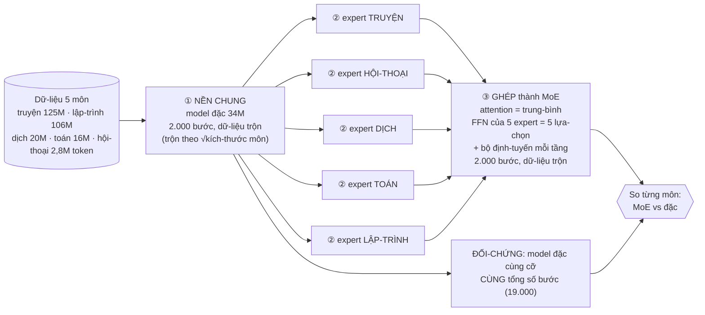
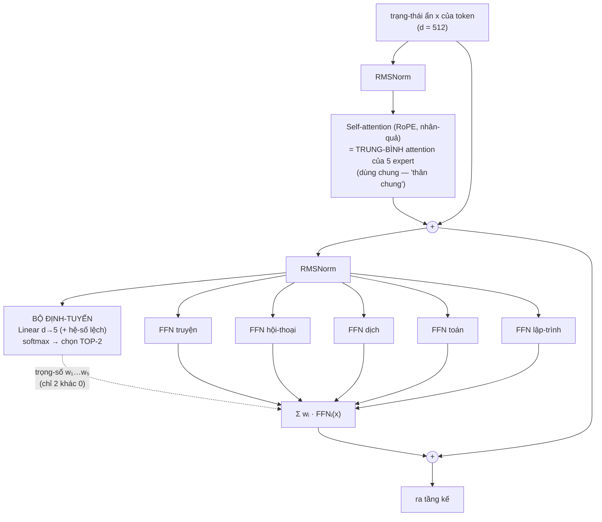
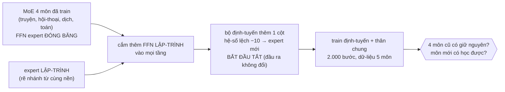
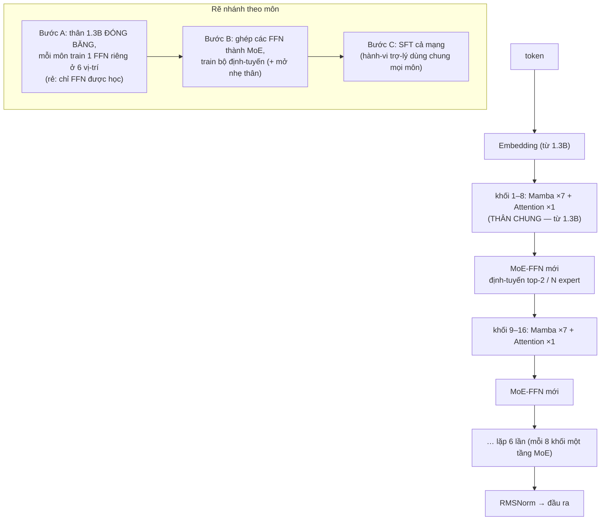

# TK_104 — Nghiên-cứu "Đứa trẻ học lên lớp": học theo lớp, ôn bài, nghĩ nhiều vòng, lớn dần

> Bắt đầu 2026-10-01. Nối tiếp [[TK_103_VAST_TRAIN_HANDOFF.md]] (model 1.3B tạm dừng — mục-tiêu giờ là NGHIÊN-CỨU).
> Code: `curriculum/gen_toan.py` (dữ-liệu), `curriculum/loop_lm.py` (model + thí-nghiệm), `curriculum/analyze.py` (bảng).
> Kết-quả thô: `out/curriculum/*.json` (+ log trong `out/curriculum/logs/`).

## 1. Câu hỏi nghiên-cứu

1. Học theo lớp (dễ → khó) có tốt hơn trộn ngẫu-nhiên, khi cùng dữ-liệu và cùng compute?
2. Ôn bài cũ giảm quên được bao nhiêu?
3. Cho model "nghĩ nhiều vòng" hơn có giải được bài khó hơn không?
4. "Lớn dần" (thêm tầng khi lên lớp) có tiết-kiệm compute so với model cố-định cỡ không?

## 2. Thiết-kế

- **Môn Toán tiểu-học tổng-hợp bằng code** (`gen_toan.py`): đề + lời giải từng bước, đáp-số kiểm-chứng tuyệt-đối.
  Lớp 1 (1 bước, phạm-vi 10) → lớp 5 (4 bước, số đến 1.000, 4 phép); **lớp 6 (5–6 bước) không bao giờ train** — chỉ để đo khả-năng vượt chương-trình. 40K bài train + 500 test/lớp, test không trùng train, đã kiểm lại toàn-bộ phép tính.
- **Model lõi-lặp** (`loop_lm.py`, 4,74M tham-số, mã-hoá ký-tự): mở-đầu 2 tầng → **lõi 2 tầng lặp r vòng** (nhắc lại đề mỗi vòng: `s = lõi(s + e)`) → kết 2 tầng. Train r ngẫu-nhiên 1..R. Khối Transformer (RoPE, SwiGLU); lõi Mamba để sau (trên Mac quét tuần-tự quá chậm).
- **Đo:** giải tham-lam, đúng = "Đáp số: N" khớp tuyệt-đối, 300 đề/lớp, ở r = 1, 2, 4, 8(, 16).
- **Hạ-tầng:** 1×H100 (700W), chạy 9–10 thí-nghiệm SONG-SONG (model nhỏ chỉ dùng một phần GPU), 6.000 bước × lô 64, ~15–50 phút/đợt. Bẫy: 10 thí-nghiệm chấm bài cùng lúc với lô 250 → tràn 80GB → hạ lô chấm xuống 100.

## 3. Kết-quả vòng 1 (2026-10-01)

**Câu 1 — % cuối, r=4, TB 2 hạt-giống:**

| Lịch (6.000 bước) | Lớp 1 | Lớp 2 | Lớp 3 | Lớp 4 | Lớp 5 | Lớp 6 |
|:---|:---|:---|:---|:---|:---|:---|
| **Trộn ngẫu-nhiên** | **100** | **100** | **100** | **97** | **97** | 6 |
| Theo lớp + ôn 30% | 100 | 93 | 96 | 14 | 19 | 2 |
| Theo lớp, không ôn | 4 | 2 | 6 | 1 | 35 | 2 |

**Câu 2 — quên** (lớp k: ngay sau khi học xong → cuối): không ôn lớp 1 **100→4%**, lớp 3 **99→3%**; ôn 30% lớp 1 **100→100%**, lớp 3 **97→94%**.

**Câu 3 — số vòng lúc dùng (lời giải viết từng bước):** model train 1–4 vòng gần như phẳng theo r (lớp 4: 13/17/14/10% ở r=1/2/4/8), lớp 6 ~1% ở mọi r. Model train cố-định 1 vòng lại tốt hơn ở lớp 4–5 (38–46% ở r=1) nhưng sụp khi r>1.

**Câu 4 — lớn dần trên lịch theo-lớp+ôn:** lõi 1→2 tầng (compute 89%) nằm giữa cố-định 1 tầng (72%) và 2 tầng (100%) — tiết-kiệm bao nhiêu mất độ-chính-xác bấy nhiêu.

## 4. Kết-quả vòng 2 (sửa thiết-kế theo vòng 1)

**1b — lên lớp khi thi đỗ** (kiểm-tra 100 câu tách riêng mỗi 200 bước; đỗ ≥95% hoặc kẹt >2.400 bước thì lên; ôn 30%):
lớp 1–5 = 100 / 92 / 79 / 19 / 2% — vẫn thua xa ngẫu-nhiên. Lớp 1 đỗ ở bước 400–600, lớp 2 mất ~2.000–2.400 bước, lớp 4 không đỗ nổi (một hạt phải "hết hạn" ở 73%) → gần như không kịp học lớp 5.

**3b — nghĩ thầm (chỉ ghi "Đáp số: N", bỏ lời giải):**

| Cách làm bài | Lớp 3 | Lớp 4 | Lớp 5 |
|:---|:---|:---|:---|
| **Viết lời giải từng bước** | **100** | **97** | **97** |
| Nghĩ thầm, tốt nhất (train 1 vòng, r=1) | 58 | 4 | 3 |
| Nghĩ thầm, train 1–8 vòng: r=1 → r=16 | 39 → **44** | 3 | 2–3 |

Chỉ model train 1–8 vòng có dấu-hiệu yếu "nghĩ lâu hơn → tốt hơn" (kể cả r=16 vượt mức đã train), nhưng mọi model lặp vẫn kém model 1 vòng thường.

**4b — lớn dần trên lịch ngẫu-nhiên:** compute **89%**, lớp 3–5 = 100 / 98,7 / 96,8% so với cố-định 100 / 97,0 / 97,0% → **tiết-kiệm ~11% compute, không mất độ-chính-xác.**

## 5. Kết-luận (sau 2 vòng)

1. **Học theo lớp KHÔNG giúp** mạng học bằng gradient ở bài này (cả chia đều thời-gian lẫn lên lớp khi đỗ); trộn ngẫu-nhiên thắng rõ. Khả-dĩ: bài khó vẫn học được TRỰC-TIẾP nên đi vòng qua bài dễ chỉ tốn bước. Khớp các kết-quả BabyLM.
2. **Nếu học theo lớp thì BẮT-BUỘC ôn bài** — không ôn thì quên sạch (100→4%).
3. **"Nghĩ bằng chữ" (viết lời giải từng bước) mạnh hơn "nghĩ thầm" rất nhiều** (97% so với 3% ở bài 4 bước). Lặp lõi chỉ cho tín-hiệu yếu. → Với mục-tiêu suy-luận sâu, đòn-bẩy lớn nhất là dạy model TRÌNH BÀY lời giải.
4. **Lớn dần có lợi thật** (~11% compute) khi lịch học tốt.

**Giới-hạn:** một môn (toán tổng-hợp), model 4,7M, 1–2 hạt-giống/cấu-hình, thiết-kế lõi-lặp đơn-giản (cộng dồn, không adapter như Huginn), lớp 6 thất-bại có thể do lời giải DÀI hơn mọi thứ đã thấy (tổng-quát-hoá độ-dài) hơn là thiếu chiều-sâu.

## 6. Hướng tiếp

- Kiểm nơi học theo lớp CÓ THỂ giúp: kỹ-năng KHÔNG học thẳng được từ đầu (vd chỉ train lớp 5 từ đầu có học nổi không; chuỗi dài lớp 6+).
- Lõi-lặp tốt hơn: tiêm đầu-vào kiểu Huginn (nối + adapter), lan-truyền-ngược cắt-ngắn, train lâu hơn.
- Môn thứ hai: **giao-tiếp tiếng Việt – tiếng Anh theo cấp-độ**, áp-dụng bài học: trộn dữ-liệu chất-lượng, dạy trình-bày từng bước, lớn dần.

## 7. Vòng 3 — độ mềm-dẻo theo tầng (ý-tưởng của user, 2026-10-01 tối)

**Giả-thuyết:** chia mạng thành tầng có độ "cứng" khác nhau — tầng dưới gần như đứng yên (giữ kiến-thức cũ), tầng trên thay-đổi tự-do (học cái mới) → học theo lớp mà không quên. Gần với layer-wise LR decay (ULMFiT), FreezeOut, giai-đoạn then-chốt ở não.
**Thiết-kế:** lớp 1 mọi tầng học tự-do (giai-đoạn then-chốt); từ lớp 2: (a) **giảm-dần** — tốc-độ học 6 khối ×0,01 → ×1 từ dưới lên; (b) **khoá-dần** — xong lớp k thì khoá k khối dưới cùng. Bảng-từ (dùng chung với tầng xuất) để tự-do. Có/không ôn 30%. (`--plasticity lrdecay|freeze`)

| Cách học | Lớp 1 | Lớp 2 | Lớp 3 | Lớp 4 | Lớp 5 |
|:---|:---|:---|:---|:---|:---|
| Theo lớp, không ôn | 4 | 2 | 6 | 1 | 35 |
| + giảm-dần theo tầng | 3 | 2 | 6 | 1 | 2 |
| + khoá-dần | 11 | 3 | 7 | 3 | 2 |
| Theo lớp + ôn 30% | **100** | **93** | **96** | **14** | **19** |
| + ôn + giảm-dần | 99 | 6 | 13 | 1 | 1 |
| + ôn + khoá-dần | 99 | 61 | 64 | 2 | 2 |

Học bài mới (lớp k đo ngay khi học xong): giảm-dần lớp 2 chỉ **4%** (đối-chứng 70%); khoá-dần lớp 2 64% nhưng lớp 4 còn **5%** khi đã khoá 3/6 khối.

**Kết-luận: ÂM TÍNH.** Làm cứng tầng dưới KHÔNG giữ được bài cũ (vẫn quên 100→3–11%) mà còn làm mất khả-năng học bài mới; kết-hợp với ôn còn TỆ hơn ôn một mình. Lý-do khả-dĩ: kiến-thức "lớp 1" không nằm ở tầng dưới — nó trải khắp mạng (cả bảng-từ/tầng xuất vẫn tự-do), còn tầng dưới lúc học lớp 1 chỉ mang đặc-trưng CỦA lớp 1 (số ≤10, chỉ +/−), chưa phải đặc-trưng chung → khoá lại là khoá sai thứ.
→ Hướng sửa (vòng 4): để tầng dưới học đặc-trưng CHUNG THẬT trước (mẫu-giáo: đọc đề mọi lớp, không lời-giải) rồi mới khoá; kiến-thức mới có CHỖ RIÊNG (mỗi lớp mọc khối mới, khoá khối cũ — kiểu LLaMA-Pro).

## 8. Vòng 4 — tách "đặc-trưng chung" khỏi "kiến-thức từng lớp" (2026-10-02 rạng sáng)

Sửa vòng 3 theo gợi-ý của user ("tầng dưới giữ đặc-trưng chung"):
- **Mẫu-giáo** (`--preschool 600 --freeze-bottom`): 600 bước đầu (trong ngân-sách 6.000) chỉ ĐỌC đề của mọi lớp (mô-hình-hoá ngôn-ngữ trên đề, KHÔNG lời-giải) → khoá VĨNH-VIỄN bảng-từ + 2 khối mở-đầu.
- **Mọc khối** (`--expand 1 --K 1`): mỗi khi lên lớp, khoá mọi khối cũ, thêm 1 khối mới (khởi-tạo đồng-nhất) trên đỉnh — kiến-thức mới có chỗ riêng (ý LLaMA-Pro).

| Cách học (% cuối, r=4) | Lớp 1 | Lớp 2 | Lớp 3 | Lớp 4 | Lớp 5 |
|:---|:---|:---|:---|:---|:---|
| Trộn ngẫu-nhiên | 100 | 100 | 100 | 97 | 97 |
| **Mẫu-giáo + khoá tầng đọc, trộn ngẫu-nhiên** | **100** | **97** | **99** | 74 | 67 |
| Theo lớp + ôn 30% | 100 | 93 | 96 | 14 | 19 |
| Mẫu-giáo + khoá tầng đọc, ôn 30% | 100 | 82 | 87 | 20 | 15 |
| Mọc khối, ôn 0% / 10% / 30% | 4 / 54 / 95 | 1–2 | 3–5 | 1–2 | 0–1 |

**Kết-luận:**
1. **Đặc-trưng chung có thật và tách được.** Tầng dưới chỉ học ĐỌC (không bao giờ thấy lời-giải) rồi khoá vĩnh-viễn — phần trên vẫn giải lớp 1–3 ở 97–100%. Đây là ủng-hộ đầu-tiên cho ý "tầng dưới = nền chung, đứng yên được". (Lớp 4–5 giảm còn 67–74%: một phần do mất 10% số bước cho mẫu-giáo.)
2. **Mọc khối trên đỉnh thất-bại cả hai chiều:** một khối trên đỉnh không học nổi lớp mới (lớp 2: 3%) VÀ vẫn đè mất lớp cũ (mọi bài đều đi qua nó). Kiến-thức mới phải chen vào GIỮA tính-toán, và cần cơ-chế ĐỊNH-TUYẾN để khối mới chỉ bật với bài mới.
3. **Phát-hiện lỗi phương-pháp:** tốc-độ học cosine giảm dần suốt quá-trình → khi học theo lớp, lớp 4–5 rơi vào lúc tốc-độ học ≈ 0 (lớp 4 chỉ học được 18–27% trong giai-đoạn của nó). Mọi so-sánh "theo lớp vs ngẫu-nhiên" ở vòng 1–4 đều thiên-vị cho ngẫu-nhiên → vòng 5 kiểm lại với lịch công-bằng.

## 9. Vòng 5 — lịch tốc-độ học công-bằng: ĐẢO NGƯỢC kết-luận câu 1

`--lr-sched wsd` = phẳng, chỉ giảm 10% cuối (cho cả hai cách học); `--lr-sched stage` = mỗi lớp một chu-kỳ (khởi-động lại tốc-độ học như một năm học mới). `--only-level 5` = chỉ train lớp 5 từ đầu.

| Cách học (% cuối, r=4) | Lớp 1 | Lớp 2 | Lớp 3 | Lớp 4 | Lớp 5 |
|:---|:---|:---|:---|:---|:---|
| Trộn ngẫu-nhiên, cosine | 100 | 100 | 100 | 97 | 97 |
| Trộn ngẫu-nhiên, phẳng | 100 | 100 | 100 | 98 | 97 |
| Theo lớp + ôn 30%, cosine (vòng 1) | 100 | 93 | 96 | 14 | 19 |
| **Theo lớp + ôn 30%, phẳng** | **100** | **100** | **100** | **99** | **99** |
| Theo lớp + ôn 30%, mỗi lớp 1 chu-kỳ | 100 | 99 | 100 | 94 | 89 |
| Chỉ lớp 5 từ đầu | 3 | 1 | 5 | 2 | 99 |

**Kết-luận:**
1. **"Học theo lớp thua" ở vòng 1–2 là ẢO** — do lịch cosine dồn lớp khó vào lúc tốc-độ học ≈ 0. Với lịch công-bằng, học theo lớp + ôn 30% **ngang/nhỉnh hơn** trộn ngẫu-nhiên (lớp 4–5: 99% vs 97%). Bài học phương-pháp: mọi thí-nghiệm chương-trình-học phải tách lịch tốc-độ học khỏi thứ-tự dữ-liệu (khớp nghiên-cứu 2025 về LR-decay "lãng-phí" dữ-liệu tốt nhất khi xếp cuối).
2. **Ôn bài vẫn bắt-buộc** (xem vòng 6 cho lượng ôn tối-thiểu).
3. **Lớp dưới KHÔNG phải tiên-quyết ở bài này:** train thẳng lớp 5 đạt 99%. → Toán tổng-hợp này "học thẳng được"; muốn thấy giá-trị tích-luỹ thật cần bài mà kỹ-năng cao chỉ học được khi đã có kỹ-năng thấp (vd lớp cao KHÔNG có lời-giải chi-tiết cho bước con).
4. Các so-sánh TƯƠNG-ĐỐI trong cùng lịch cosine (vòng 3 phân-tầng, vòng 4 mọc khối) vẫn hợp-lệ.

## 10. Vòng 6 — lượng ôn, ít dữ-liệu, lõi Mamba (lịch phẳng)

| Cách học (% cuối, r=4) | Lớp 1 | Lớp 2 | Lớp 3 | Lớp 4 | Lớp 5 | Lớp 6 |
|:---|:---|:---|:---|:---|:---|:---|
| Trộn ngẫu-nhiên (2 hạt) | 100 | 100 | 100 | 97,5 | 96,2 | 0,8 |
| **Theo lớp + ôn 30% (2 hạt)** | **100** | **99,8** | **100** | **98,8** | **97,8** | 1,0 |
| Theo lớp + ôn 10% | 100 | 97 | 99 | 85 | 93 | 0,7 |
| Theo lớp, không ôn | 4 | 2 | 9 | 2 | 88 | 3 |
| **Ít dữ-liệu (2.000 bài/lớp): ngẫu-nhiên** | 100 | 100 | 100 | **94** | **89** | 2 |
| Ít dữ-liệu: theo lớp + ôn 30% | 100 | 90 | 95 | 44 | 43 | 1 |
| Lõi attention, ngẫu-nhiên (cosine) | 100 | 100 | 100 | 97 | 97 | 5,8 |
| Toàn Mamba2 (5,8M tham-số) | 100 | 100 | 100 | 99,3 | 99,3 | 1,0 |
| Lai: Mamba2 + 1 khối attention | 100 | 100 | 100 | 98,7 | 96,7 | 1,7 |

**Kết-luận:**
1. Lịch công-bằng: theo lớp + ôn 30% ≥ ngẫu-nhiên (xác-nhận 2 hạt-giống). Ôn 10% chưa đủ; không ôn quên sạch.
2. **ÍT DỮ-LIỆU thì học theo lớp THUA ĐẬM** (lớp 4–5: 44% vs 89–94%): mỗi lớp 2.000 bài bị nhồi trong 1.200 bước (~38 lần lặp/bài) → học-thuộc thay vì học cách làm; trộn ngẫu-nhiên giãn đều sự lặp lại (hiệu-ứng giãn-cách / spacing). Ngược trực-giác "ít dữ-liệu thì học tuần-tự".
3. **Mamba nhỉnh hơn ở lớp 4–5 nhưng lớp 6 vẫn ~1%** → thất-bại lớp 6 không phải do mã-hoá vị-trí của attention.
4. **Chẩn-đoán lớp 6:** model tính ĐÚNG từng phép nhưng chỉ viết tối-đa 4 bước (= dài nhất từng thấy): bỏ/gộp câu cho vừa khuôn → lỗi THEO DÕI TIẾN-TRÌNH, không phải tính-toán. Vd đề 6 bước → model: "132 - 7 = 125. 125 - 15 = 110. 110 : 2 = 55. 55 - 1 = 54" (nhảy câu, ghép số câu này với phép câu kia). → thử lời-giải TRÍCH CÂU (`--quote`): mỗi bước nhắc lại câu đề đang xử-lý.

## 11. Vòng 7 — CHIỀU SÂU: giải bài DÀI HƠN mọi bài đã học (lớp 6 = 5–6 bước, train ≤ 4 bước)

Chẩn-đoán (vòng 6): model tính đúng từng phép nhưng bỏ/gộp câu cho vừa khuôn ≤ 4 bước → lỗi THEO DÕI TIẾN-TRÌNH.
Thử 4 cách "làm từng câu như người", tất cả trộn ngẫu-nhiên + lịch phẳng, 6.000 bước; đo % lớp 6 (r=4):

| Cách trình-bày lời-giải | Lớp 5 | **Lớp 6** | Lớp 7–8 |
|:---|:---|:---|:---|
| Chỉ phép tính (đối-chứng, 2 hạt) | 96 | 0,8 | 0–2 |
| **Trích câu đề mỗi bước** ("Lan làm rơi mất 57 quả: 92 - 57 = 35.") — attention, 2 hạt | 92–96 | **14 / 30** | 0–1 |
| Trích câu — toàn Mamba2 | 99 | 0,7 | — |
| Trích câu — lai Mamba2 + 1 attention | 97 | 3 | — |
| Nhãn câu điểm-bắt-đầu-ngẫu-nhiên + trích câu (2 hạt) | 95 | 14 / 14 | — |
| Chỉ nhãn câu (không trích) | 93 | 1,7 | — |
| Trích câu + đề có 0–4 câu THỪA (2 hạt) | 93–97 | 10 / 1 | — |

**Kết-luận:**
1. **Trích câu là đòn-bẩy thật duy-nhất** cho chiều sâu: lớp 6 từ ~1% → 14–30% (×15–30). Nhưng chưa ngoại-suy xa: lớp 7–8 vẫn ~0.
2. **Trích câu cần ATTENTION** (tra-cứu nội-dung): Mamba thuần giỏi nhất trong-phân-bố (lớp 4–5: 99–100%) nhưng KHÔNG dùng được trích câu (0,7%) — khớp điểm yếu "chép/tra-cứu" đã biết của SSM. → kiến-trúc lai đúng hướng về nguyên-tắc, nhưng 1 khối attention ở đáy là chưa đủ.
3. Phân-tích lỗi (nhãn + trích, 100 đề lớp 6): 58 thiếu bước, 21 sai tính, 21 đúng. Model viết NHÃN tuần-tự đúng (30, 31, 32…) nhưng NỘI-DUNG chép sau "(31)" lại là câu (32) → vẫn tra theo VỊ-TRÍ chứ không theo nhãn. Câu thừa (tách số-câu khỏi số-bước) không phá được lối tắt này.
4. **Hướng tiếp đề-xuất — "viết lại đề sau mỗi bước"** (như người gạch câu đã làm): mỗi bước model viết lại phần đề CÒN LẠI với số mới ("Còn: Lan có 102 quả. Sau đó …") → mỗi bước luôn là "xử-lý câu ĐẦU của một đề ngắn dần" — bước nào cũng giống bài đã học. Đắt (lời-giải dài ~bậc hai) nhưng là cách có cơ-sở nhất cho ngoại-suy tuỳ-ý độ dài; cần chấm có KV-cache.

### 11b. Chiều sâu — các thử thêm (2026-10-02)

| Model (trích câu, trộn ngẫu-nhiên, lịch phẳng) | Lớp 5 | Lớp 6 | Lớp 7 | Lớp 8 |
|:---|:---|:---|:---|:---|
| Trích câu (6.000 bước) | 92–96 | 14–30 | 0–1 | 0–1 |
| **+ vị-trí ngẫu-nhiên** (Ruoss 2023), 2 hạt | 89–90* | **32–37** | 0–1 | 0 |
| + vị-trí ngẫu-nhiên, train 12.000 bước | 99 | 19 | 0 | 0 |
| + vị-trí ngẫu-nhiên, rộng hơn (d=384) | 86 | 15 | 1 | 0 |
| Viết lại đề còn lại sau mỗi bước | 95 | 0,5 | — | — |

*đo bằng `eval_deep.py`; lúc kết-thúc train cùng model đo 61–67% (vị-trí ngẫu-nhiên khác nhau → dao-động lớn ở lớp 5).

**Kết-luận chiều sâu:**
- Model mang **"thói quen số lượng"**: luôn ép lời-giải về số bước / số câu đã thấy — kể cả khi viết lại đề (bỏ câu khi chép cho phần còn lại ≤ 3 câu như lúc train).
- Vị-trí ngẫu-nhiên + trích câu là tốt nhất (lớp 6 ~35%) nhưng **không ngoại-suy xa** (lớp 7–8 = 0).
- **Train lâu hơn / model rộng hơn làm ngoại-suy TỆ đi** (lớp 6: 37 → 19 / 15%) dù lớp 5 tốt lên — khớp độ-dài-đã-thấy càng chặt càng mất khả-năng vượt. Ngoại-suy đạt đỉnh SỚM.
- → "Suy nghĩ sâu hơn mức đã học" KHÔNG đến từ thêm train/thêm cỡ ở quy-mô này. Hướng còn lại có cơ-sở: (a) cho thấy MỘT ÍT bài dài hơn ("học vượt" — thực-tế là cách người học), (b) kiến-trúc có vòng-lặp/đệ-quy thật (model gọi lại chính nó cho bài con), (c) công-cụ ngoài (máy tính/bộ nhớ ghi chép).

## 12. Môn GIAO-TIẾP Việt–Anh (2026-10-01 → 02)

**Dữ-liệu:** TinyStories song-song en/vi (`nampdn-ai/tinystories-vietnamese`, 300K truyện) + **DailyDialog dịch sang khẩu-ngữ bằng Gemma 4 26B** (`curriculum/giaotiep/translate_dd.py` → `data/giaotiep/dd_envi.jsonl`, **12.196 hội-thoại**, 179 bỏ vì lệch số lượt) + cặp dịch 2 chiều (truyện + từng lượt). Kho 148M token, BPE byte-level 16K (3,9 ký-tự/token). Model GPT (khối Transformer của `loop_lm.py`), 8.000 bước × 64 × 512, trộn ngẫu-nhiên.

**BẪY ĐÁNH-GIÁ:** DailyDialog có **43% hội-thoại test trùng lượt nói với train** — model chép NGUYÊN câu gốc ("We met them in Bermuda last May."). `eval_gt.py` chỉ chấm **535/937 hội-thoại SẠCH** (không lượt ≥4 từ nào có trong train). Điểm trên bộ bẩn bị thổi-phồng (`*_eval_bam.json`).

**Kết-quả trên bộ SẠCH** (Gemma chấm 1–5; câu gốc ≈ 4,8–4,9; chrF = dịch từng lượt):

| Model | Hội-thoại train | Tự-nhiên Việt | Hợp ngữ-cảnh Việt | Tự-nhiên Anh | chrF Anh→Việt | chrF Việt→Anh |
|:---|:---|:---|:---|:---|:---|:---|
| v1 · chỉ tiếng Việt 33M | 4,4K ×8 | 2,49 | 2,41 | — | — | — |
| v1 · song-ngữ 33M | 4,4K ×8 | 2,86 | 2,79 | 2,48 | 14,5 | 16,9 |
| v1 · song-ngữ 100M | 4,4K ×8 | 2,87 | 2,66 | 2,30 | 14,9 | 19,2 |
| v1 · lớn dần 33M | 4,4K ×8 | 2,75 | 2,71 | 2,37 | 13,7 | 17,0 |
| v2 · song-ngữ 33M | **10,3K ×3** | 2,77 | 2,73 | **2,90** | 18,9 | 19,5 |
| v2 · lớn dần 33M (−25% compute) | 10,3K ×3 | 3,20 | 3,11 | 2,47 | 16,4 | 16,8 |
| **v2 · song-ngữ 100M** | 10,3K ×3 | **3,32** | **3,24** | 2,76 | **19,4** | **24,3** |

**Kết-luận:**
1. **Song-ngữ GIÚP tiếng Việt** (trên bộ sạch): 2,49 → 2,86 tự-nhiên ở cùng cỡ 33M — học thêm tiếng Anh không làm hại mà còn chuyển-giao sang tiếng Việt (khác kết-luận vội trên bộ bẩn).
2. **Dữ-liệu hội-thoại nhiều hơn + lặp ít hơn** (4,4K×8 → 10,3K×3) là đòn-bẩy lớn nhất: dịch +4–5 chrF; model 100M tiếng Việt 2,87 → 3,32. Với 4,4K×8 model lớn HỌC-THUỘC (val tăng) nên không hơn model nhỏ; đủ dữ-liệu thì model lớn mới phát-huy.
3. **Lớn dần** lần thứ hai cho kết-quả tốt: v2 33M lớn-dần (tiếng Việt 3,20) ≈ gần 100M (3,32), hơn rõ 33M thường (2,77) với ít compute hơn — nhưng kém ở tiếng Anh và dịch.
4. Còn xa câu gốc (3,3 vs 4,9): hay lạc đề ("được gợi-ý đi Washington, New York" → "Thế thì nhất định mình sẽ đi Malaysia rồi."), dịch mới được ý chính câu ngắn.

**Hướng tiếp giao-tiếp:** thêm hội-thoại (Gemma sinh hội-thoại MỚI theo chủ-đề — không trùng test; bộ tiếng Việt gốc), model 100M+ train lâu hơn, SFT nhỏ theo định-dạng trợ-lý; chấm theo nhiều lượt.

## 13. Kiến-trúc BTX — ghép các mạng chuyên-môn (ý-tưởng của user, 2026-10-02)

> Ý-tưởng: mỗi môn một mạng chuyên-gia (expert) — lập-trình, truyện/văn-phong, email, toán, hội-thoại, khoa-học… →
> đóng băng → ghép qua một tầng nối → train trên dữ-liệu trộn. Trong nghiên-cứu gọi là **BTX — Branch-Train-MiX**
> (Meta 2024); biến-thể ghép mô-hình đóng băng qua tầng nối: **CALM** (Google 2024). Bản nhỏ trước đây trên M4:
> [[combiner-moe-experts]] (thắng thật — bộ tổng-hợp tự học định-tuyến theo ngữ-nghĩa).
> Code: `curriculum/btx/btx.py` · lịch chạy: `/workspace/run_btx.sh` trên box.

### 13.1 Quy-trình 3 bước

- Bước ②: mỗi expert **rẽ nhánh từ CÙNG nền** (để chung nền ngôn-ngữ), học ≤ 3.000 bước CHỈ môn của mình, **dừng sớm** ở mốc tốt nhất trên môn đó.
- Bước ③ có 2 biến-thể: **(a) đóng băng FFN expert** — chỉ học bộ định-tuyến + attention + chuẩn-hoá (đúng ý "đóng băng rồi ghép"); **(b) mở toàn-bộ** (BTX gốc).

### 13.2 Bên trong MỘT tầng của mạng ghép (định-tuyến TỪNG TOKEN)

- **Cổng ghép KHÔNG cần là Mamba/attention**: việc hiểu ngữ-cảnh do phần thân chung làm; bộ định-tuyến chỉ là một lớp tuyến-tính nhỏ đọc trạng-thái ẩn và quyết-định "token này giao cho expert nào". Định-tuyến **từng token, từng tầng** (BTX, Mixtral) mạnh hơn chọn cả một model cho cả câu — vì một câu thường pha nhiều môn ("viết email báo-cáo kết-quả bài toán").
- Cân-bằng tải: thêm loss phụ kiểu Switch (0,01 × E × Σ fᵢ·pᵢ) để không expert nào bị bỏ đói.
- Toàn mạng: `Embedding → 8 × [tầng trên] → RMSNorm → đầu ra (chung trọng-số với Embedding)` · 5 expert × 8 tầng.

### 13.3 Học tích-luỹ: CẮM THÊM môn mới không quên môn cũ

Đây là câu hỏi mà vòng 3 (tầng dưới cứng) và vòng 4 (mọc khối trên đỉnh) đều THẤT BẠI: kiến-thức mới viết đè lên cũ. Với
expert đóng băng, kiến-thức cũ nằm nguyên trong FFN cũ — chỉ còn rủi-ro ở bộ định-tuyến + thân chung.

### 13.4 Kết-quả sơ-bộ bước ② (expert vs model đặc, sai-số trên ĐÚNG môn — thấp hơn là tốt)

| Môn (kích-thước) | Expert riêng | Model đặc (14K/17K bước) |
|:---|:---|:---|
| Truyện (125M) | **1,60** | 1,68 |
| Toán (16M) | 0,336 | 0,346 |
| Dịch (20M) | 2,07 | **1,85** |
| Hội-thoại (2,8M) | 2,82 | **2,71** |

- Expert chỉ thắng ở môn NHIỀU dữ-liệu; môn ít dữ-liệu học tốt hơn khi trộn (học ké từ môn khác) — khớp kết-quả song-ngữ §12.
- Mỗi expert **quên sạch môn khác** (expert toán: sai-số 14–20 trên văn) → bước GHÉP + định-tuyến là phần quyết-định.

### 13.4b Kết-quả bước ③ — ghép & cắm thêm (sai-số cuối, CÙNG bộ đoạn kiểm-tra; thấp hơn là tốt)

| Model | Truyện | Hội-thoại | Dịch | Toán | Lập-trình |
|:---|:---|:---|:---|:---|:---|
| **Model đặc đối-chứng** (19.000 bước, 34M) | **1,544** | **2,696** | **1,882** | 0,343 | **1,040** |
| Expert riêng (trên môn của nó) | 1,599 | 2,816 | 2,071 | **0,336** | 1,048 |
| Ghép 5 · ĐÓNG BĂNG expert (học 16,8M tham-số) | 1,687 | 2,907 | 2,092 | 0,342 | 1,148 |
| Ghép 5 · MỞ toàn-bộ (học 100,7M) | 1,664 | 2,827 | 2,032 | 0,338 | 1,126 |
| Ghép 4 (chưa có lập-trình) | 1,650 | 2,853 | 2,033 | 0,339 | 4,883 |
| **Ghép 4 + CẮM THÊM expert lập-trình** | 1,656 | 2,868 | 2,042 | 0,340 | 1,232 |

Định-tuyến tự học (tỉ-lệ token vào từng expert): hội-thoại → expert hội-thoại **92%**; toán → expert toán **72–84%**;
truyện → truyện 54% + dịch 29% (cùng là văn xuôi song-ngữ). Ngay sau khi ghép sai-số vọt lên (truyện 2,72) do attention
lấy trung-bình của các expert đã trôi khác nhau → 2.000 bước học lại.

**Kết-luận:**
1. **Ở cỡ nhỏ, model ĐẶC thắng BTX** ở mọi môn (trừ toán ~ngang): các môn hỗ-trợ nhau, model đặc học chung 19K bước còn
   MoE chỉ 2K bước chung; attention trung-bình không khớp. BTX gốc chỉ có lợi ở quy-mô tỷ tham-số + mỗi môn nhiều dữ-liệu.
2. **HỌC TÍCH-LUỸ THÀNH CÔNG LẦN ĐẦU:** cắm expert lập-trình → 4 môn cũ gần như giữ nguyên (+0,001…+0,015) và môn mới
   học được (4,88 → 1,23). Vòng 3 (tầng dưới cứng) và vòng 4 (mọc khối trên đỉnh) đều thất-bại ở đúng điểm này →
   **expert ĐÓNG BĂNG + bộ định-tuyến là lời-giải đầu-tiên cho "học thêm mà không quên"**.
3. **Đóng băng rồi ghép (ý của user) gần bằng mở toàn-bộ** (kém 0,02–0,08) với ít hơn ~6 lần tham-số phải học.
4. Dùng thực-tế: cần một model giỏi đều nhiều môn → train chung; cần THÊM môn dần-dần không train lại, không quên → ghép
   expert đóng băng.

### 13.5 Mở rộng lên model 1.3B của ta — phải khác Jamba

Model 1.3B (HybridLM) = **42 khối Mamba + 6 khối attention, KHÔNG có khối FFN** → không có chỗ "tách FFN thành expert" như BTX/Jamba.
Biến chính khối Mamba thành expert cũng không ổn: Mamba giữ trạng-thái chạy liên-tục qua MỌI token, chọn lọc theo token làm đứt mạch.
Phương-án đề-xuất — **chèn tầng MoE-FFN** vào thân Mamba/attention có sẵn:

- **SFT không làm expert riêng**: SFT dạy HÀNH-VI (đúng khuôn, trung-thực, lịch-sự) cần có ở mọi môn → SFT cả mạng sau khi ghép. **Văn-phong** (email trang-trọng / chat thân-mật / kể chuyện) thì đúng là việc của các expert; SFT dạy KHI NÀO dùng văn-phong nào.
- Chi-phí: mỗi token chỉ qua 2 expert → tính-toán ≈ 1.3B + 2 FFN; bộ-nhớ tăng theo số expert.
- Dữ-liệu cần gom thêm cho bản 1.3B: lập-trình (đã có 106M token mở), email/văn-phòng, khoa-học tiếng Việt.

## 14. Bồi đắp model 1.3B của ta (2026-10-02) — hướng chính: KHÔNG dùng model nguồn mở

Mọi bản đều xuất-phát từ checkpoint 1.3B của ta (pretrain 18,8 tỷ token tiếng Việt → SFT). Checkpoint cũ giữ nguyên;
mỗi bản mới là file riêng (`checkpoints/hf_hybrid/`). Chấm: eval_v1 (158 câu sạch, Gemma chấm) + bộ chấm hội-thoại chung
(`curriculum/giaotiep/eval_chat.py`: 100 hội-thoại DailyDialog SẠCH × 2 ngôn-ngữ + 275 bài "nhớ chi-tiết").

### 14.1 Các bản 1.3B trên eval_v1

| Bản | Tự-nhiên / hữu-ích | Sự-kiện: đúng / không-biết / SAI | Thực-thể bịa: nhận / bịa | Toán | Văn-phòng |
|:---|:---|:---|:---|:---|:---|
| SFT gốc (bước 5.216) | 4,29 / 2,04 | 2% / 0% / **98%** | 0% / **100%** | 0% | 2,5 |
| **SFT v2** (trung-thực + bám nguồn + toán từng bước) | 3,96 / 2,04 | 5% / 75% / 20% | 70% / 30% | 6% | 2,5 |
| Giao-tiếp v1 (hội-thoại, ôn 10K SFT v2) | 4,28 / 1,64 | 2% / 92% / 5% | 80% / 20% | 0% | **1,2** |
| Giao-tiếp v2 (+ CÂU DẶN tách chế-độ, ôn 20K) | 3,81 / 1,70 | 2% / 88% / 10% | 75% / 25% | 6% | 2,1 |
| Giao-tiếp v1 + expert lập-trình (cổng) | 4,19 / 1,56 | 2% / 90% / 8% | 85% / 15% | 0% | 1,2 |

- **SFT v2 đổi hẳn hành-vi trung-thực**: bịa sự-kiện 98% → 20%; nhận "không biết" với thực-thể bịa 0% → 70%. Kiến-thức KHÔNG tăng (đúng 2→5%) — SFT dạy biết mình không biết, không thêm hiểu-biết.
- **Giao-tiếp v1 đóng vai người chat cả khi được nhờ làm việc** ("Soạn mail…" → "Dạ, em sẽ gửi anh bản nháp qua email ngay ạ") → văn-phòng 2,5 → 1,2. Nguyên-nhân: người B trong DailyDialog chỉ NÓI, không LÀM.
- **Sửa bằng câu dặn hệ-thống** ("Hãy trò chuyện tự nhiên như người bạn." gắn vào mọi mẫu hội-thoại; không câu dặn = trợ-lý): văn-phòng hồi 1,2 → 2,1, soạn email đúng nghĩa trở lại. Giá: dịch 1,7 → 1,3, tự-nhiên 4,28 → 3,81.

### 14.2 Giao-tiếp: nền pretrain quyết-định (bộ chấm chung, cùng câu)

| Model | Nhớ chi-tiết (vi) | Tự-nhiên (vi) | Hợp ngữ-cảnh (vi) | Tự-nhiên (en) |
|:---|:---|:---|:---|:---|
| 33M tự train từ đầu | 0,7% | 3,28 | 3,18 | 2,81 |
| 100M tự train từ đầu | 1,5% | 3,61 | 3,62 | 2,86 |
| **1.3B + fine-tune giao-tiếp** | **50,5%** | **4,47** | **4,48** | 3,47 |
| *Câu gốc của người viết* | — | *4,86* | *4,97* | *4,39* |

220M từ đầu ≈ 100M (sai-số hội-thoại 2,641 vs 2,626) — kho 150M token không nuôi được model lớn hơn. Nền 18,8 tỷ token của 1.3B mới tạo khác-biệt.

### 14.3 Cắm expert LẬP-TRÌNH vào 1.3B (thân đóng băng, §13.5)

6 tầng GatedFFN (151M tham-số) chèn sau mỗi khối attention; A: FFN học code (25M token Magicoder); B: chỉ cổng học trên dữ-liệu trộn.

| Giai-đoạn | Sai-số code | Sai-số tiếng Việt/hội-thoại |
|:---|:---|:---|
| 1.3B gốc | 1,639 | 1,263 |
| A: FFN code luôn bật | **0,639** | 2,381 ❌ (quên) |
| **B: có cổng** | **0,640** | **1,273** (≈ gốc) |

Cổng mở TB 78% trên code, 20% trên tiếng Việt → **học tích-luỹ không quên ở quy-mô thật**; eval_v1 gần như giữ nguyên (§14.1 dòng cuối).
NHƯNG MBPP (100 bài Python, chạy test thật): gốc 0/100, + expert 0/100 — expert đưa câu trả-lời có hàm Python từ 16% → **100%** đúng khuôn/đúng tên hàm, nhưng LOGIC SAI. Học được HÌNH-THỨC, chưa có THỰC-CHẤT → thí-nghiệm §14.5.

### 14.4 Máy tính cho toán (không train lại, `scripts/math_calc.py`)

Lúc sinh chữ, hễ model viết xong "biểu-thức =" thì hệ-thống tính hộ và chèn kết-quả đúng.

| | GSM8K tiếng Việt (250 bài, phần TEST, Gemma dịch) | Toán eval_v1 (18) |
|:---|:---|:---|
| SFT v2 tự tính | 3,2% | 5,6% |
| **SFT v2 + máy tính** | **6,8%** | **16,7%** |
| Giao-tiếp v1 + máy tính | 6,0% | 5,6% |

×2–3 nhưng vẫn thấp: máy tính sửa lỗi TÍNH, không sửa lỗi ĐẶT PHÉP TÍNH (suy-luận).

**Bài-học chung:** 1.3B học HÌNH-THỨC rất nhanh (trình-bày, khuôn code, trung-thực, giọng hội-thoại); THỰC-CHẤT (logic code, suy-luận toán) bị giới-hạn bởi kiến-thức pretrain — fine-tune nhỏ và công-cụ không bù được.

### 14.5 Đang chạy: BỒI ĐẮP KIẾN-THỨC CODE ~1,1 tỷ token (`scripts/build_code_corpus.py`, `expert_ffn_1p3b.py trainPT`)

Kiểm giả-thuyết "thiếu thực-chất là do thiếu LƯỢNG dữ-liệu" theo công-thức Phi-1 (1.3B + code lọc kỹ → 50% HumanEval):
- Dữ-liệu: **900M token Python** (codeparrot-clean, lọc kiểu "giáo-trình": có hàm + docstring/chú-thích, không tự-sinh, không file nén — giữ 65%) + **236M token bài tập có lời-giải** (Magicoder 75K + CodeFeedback 157K + Evol-Instruct 78K, khuôn Hỏi/Đáp).
- FFN chuyên-gia **302M tham-số** (gấp đôi) cắm vào thân **giao-tiếp v2** đóng băng; trộn code:bài-tập 3:1; ảnh chụp 300M/600M/900M token → MBPP tự chấm → đường cong "lượng code → khả-năng code"; cuối: cổng + eval_v1 kiểm không-quên.

**Đường cong "lượng code → khả-năng code"** (MBPP 100 bài, chạy test thật; FFN chuyên-gia luôn bật; thân giao-tiếp v2):

| Token code đã học | Sai-số code giữ riêng (py / bài tập) | MBPP qua | Có hàm Python đúng khuôn |
|:---|:---|:---|:---|
| 0 (thân gốc) | 2,39 / 2,22 | 0% | 16% |
| 25M (§14.3, Magicoder) | — | 0% | 100% |
| **300M** | 0,97 / 0,86 | 7% (100 bài) · **4,0% (500 bài)** | 95% |
| 600M | 0,93 / 0,80 | 2% (100) · **2,6% (500)** | 100% |
| 900M | | | |
| 1,1 tỷ (+ giảm LR) | | | |

Chấm 100 bài nhiễu (±2–3 điểm) → chấm lại 500 bài. 300M → 600M GIẢM (4,0 → 2,6%, ~1,5 sai-số chuẩn) dù sai-số code
vẫn giảm: ảnh chụp lấy lúc LR còn cao (chưa giảm) và/hoặc FFN-chỉ-học-code nghiêng về "viết tiếp code" hơn "giải đúng đề" —
bản cuối (sau giảm LR) sẽ phân-biệt. Lần ĐẦU 1.3B viết code CHẠY ĐÚNG (vd `find_rect_num(n): return n * (n + 1)`). 25M → 0%, 300M → 7% ⇒ giả-thuyết "thiếu thực-chất là do thiếu LƯỢNG dữ-liệu" được ủng-hộ. Tốc-độ train 23.600 token/giây (H100, 680W).

## 15. Lộ trình trợ lý CODE + VĂN PHÒNG (chốt 2026-10-03)

**Đánh giá hướng đi.** Nguyên lý đã chứng minh: (1) expert có cổng cắm vào thân đóng băng → học thêm KHÔNG quên
(loss hội-thoại 1,317 → 1,253 sau 1,1 tỷ token code); (2) tri-thức tiếng Anh + cầu nối tiếng Việt mỏng (<1% dữ liệu)
→ 1.3B viết code kèm giải-thích tiếng Việt; (3) dữ liệu lọc kiểu Phi-1 → MBPP 0 → ~8%; (4) dạy trung-thực được.
Giới hạn thẳng thắn: chất lượng tuyệt đối còn thấp (Phi-1 cùng cỡ ~50% HumanEval với ~7 tỷ token "sách giáo khoa" +
train toàn model); cổng làm mất sức code; đọc-mà-không-nhớ sự kiện; suy-luận sâu là trần cứng của 1.3B.
→ Hướng ĐÚNG cho **trợ lý tiếng Việt chuyên biệt, rẻ, tự chủ**, không phải trợ lý đa-năng.

**Năm việc (người dùng duyệt "làm theo đề xuất"):**

| # | Việc | Công cụ | Trạng thái |
|:--|:--|:--|:--|
| 1 | Tập trung mảng **kiểm được**: code (test chạy thật), Excel (tính thật bằng `formulas`), văn phòng (Gemma chấm) | `gen_office.py` | đang sinh trên H100 |
| 2 | **Sách giáo khoa lập trình tiếng Việt kiểu Phi-1**: bài tập có assert chạy qua + bài giảng có ví dụ chạy được, ~70 chủ đề | `gen_code_textbook.py` | thử 40 mẫu |
| 3 | **Sửa cổng**: đo MBPP-500 code_VI cổng mở hẳn vs có cổng; train cổng cùng dữ liệu tiếng Việt ngay từ đầu; hoặc mở hẳn expert khi biết lĩnh vực | `--code-open` | đang đo |
| 4 | **Kỷ luật đo**: chỉ tin ≥500 bài; bộ chung MBPP-500 + HumanEval-164 + đề văn phòng giữ riêng + eval_v1 (không quên) | `expert_office_1p3b.py` (mbpp/humaneval/evaloff/evalv1) | đã dựng |
| 5 | Cầu nối Zamba2 (TK_105) chỉ là **nhánh nghiên cứu**, đi tiếp khi Bước 0 cho thấy trần cao hơn hẳn | `zamba_ceiling.py` | chạy tối nay |

**Expert văn phòng** (`expert_office_1p3b.py trainOFF`): GatedFFN thứ hai (hid 4096) cắm nối tiếp sau expert code (đóng băng)
ở 6 điểm; FFN + cổng học trên trộn văn phòng 50% · hội thoại 20% · code Việt 15% · code Anh 15%.
Mốc trước khi học: eval_v1 nhóm văn phòng 2,5/5 (Gemma 4,2).

### 15.1 Kết quả đợt 2026-10-03 (H100)

**Code** (thân chat v2 đóng băng; MBPP = 500 bài, HumanEval = 164 bài, chạy test thật):

| Bản | MBPP-500 | HumanEval | Ghi chú |
|:--|:--|:--|:--|
| chat v2 (không expert) | 0% (100 bài) | — | |
| pt_final — 1,1 tỷ token, không cổng | **8,4%** | 1,8% | đường cong: 300M 4,0% · 600M 2,6% · cuối (sau giảm LR) 8,4% |
| code_B — chỉ học cổng | 0,8% | — | cổng mở 64% trên code → mất sức code |
| **code_VI** — cầu nối tiếng Việt (8.195 bài dịch), FFN+cổng | 5,4% (cổng mở hẳn 4,6%) | **7,9%** (cổng mở) | trả lời tiếng Việt; cổng code 76% / trò chuyện 31% |

Mở hẳn cổng KHÔNG cứu MBPP của code_VI → không phải lỗi cổng: cầu nối đổi một ít "viết code thuần" lấy "làm theo
yêu cầu + tiếng Việt" (HumanEval 1,8 → 7,9%). eval_v1 của code_VI so thân chat v2: tự nhiên 3,81 → 4,45, đúng 1,70 → 1,66
→ KHÔNG quên. Tác dụng phụ còn lại: trung thực quá tay ("Thủ đô Việt Nam?" → từ chối).

**Văn phòng v1** (2.108 mẫu Gemma sinh, chưa qua giám khảo; GatedFFN 151M nối sau expert code; 700 bước):
loss val văn phòng 1,699 → 0,737; hội thoại 1,253 → 1,273; code Việt/Anh giữ nguyên. Cổng văn phòng mở 33% trên văn phòng,
11–15% trên code/hội thoại; cổng code 73–78% trên code, 29% trên văn phòng → hai expert tự phân công.

150 đề văn phòng GIỮ RIÊNG (Gemma chấm đúng/tự nhiên 1–5; Excel tính thật bằng `formulas`):

| Nhóm (n) | chỉ expert code | + expert văn phòng |
|:--|:--|:--|
| email (23) | 2,17 / 3,42 | **3,61 / 4,48** |
| thao tác Word/Excel (28) | 1,36 / 2,79 | **3,07 / 4,43** |
| văn bản (31) | 1,90 / 3,16 | **2,59 / 3,81** |
| biên tập (16) | 1,31 / 2,62 | **2,00 / 4,06** |
| tự động hoá (23) | 1,09 / 2,39 | **1,96 / 4,00** |
| Excel (27) | 1,04 / 2,74 | **1,93 / 4,59** |
| công thức Excel TÍNH ĐÚNG | 0/27 (chỉ 4/27 có công thức) | **6/27** (27/27 có công thức) |

Lỗi điển hình còn lại: Excel lấy SAI CỘT (AVERAGEIF(C…, F…) thay vì (A…, C…)), LEFT ↔ RIGHT; chen chi tiết không có trong
câu hỏi ("dự án bất động sản"). Đã sửa prompt sinh dữ liệu (chỉ dùng thông tin trong yêu cầu, Excel đúng cột) cho v2.
Bẫy đo: lần chấm đầu báo Excel 0/27 do tiến trình chấm chạy python hệ thống (thiếu `formulas`) — chấm Excel phải chạy
bằng `/workspace/zenv/bin/python`.

**Một checkpoint duy nhất:** `hybrid_1p3b_assistant_v2.pt` = thân chat v2 + expert code + expert văn phòng (mục `experts`
trong checkpoint; UI tự cắm, cổng tự định tuyến) — UI `hybrid-ui-code` (cổng 8795).

### 15.2 v3 (2026-10-04) — code v2 + văn phòng v2 + hiệu chỉnh trung thực → `hybrid_1p3b_assistant_v3.pt`

- **Code v2** (`trainCODE2`): học tiếp từ code_VI trên **2.473 bài sách giáo khoa tiếng Việt** (1.610 bài tập có assert chạy qua
  + 863 bài giảng có ví dụ chạy được; loại 482 bài test trượt) trộn ôn code Việt/Anh + hội thoại; FFN lr 1e-4, 1.000 bước.
  Loss sách giáo khoa 1,59 → 0,83; hội thoại 1,253 → 1,270; code cũ giữ.
- **Văn phòng v2**: 3.911 mẫu (prompt mới + Gemma lọc, giữ 98,5%) + **3.253 mẫu hiệu chỉnh** (2.677 câu phổ thông phải đáp
  + 576 thực thể bịa phải từ chối), 1.200 bước; bộ đề văn phòng GIỮ NGUYÊN (loại 148 đề trùng khỏi train).

| | v2 (code_VI + văn phòng v1) | **v3** |
|:--|:--|:--|
| easy20 (nhiệt độ 0): đúng / từ chối | 5 / 10 | **17 / 0** |
| văn phòng email / văn bản / thao tác | 3,61 / 2,59 / 3,07 | **3,71 / 3,53 / 3,18** |
| biên tập / tự động hoá / Excel | 2,00 / 1,96 / 1,93 | **2,56 / 2,35 / 2,37** |
| công thức Excel tính đúng | 6/27 | **11/27** |
| eval_v1 tự nhiên / đúng | 4,26 / 1,94 | **4,50 / 2,10** |
| eval_v1 sự kiện đúng / không biết / sai | 0 / 90 / 10% | 2 / 62 / **35%** |
| thực thể bịa: nhận / bịa | 75 / 25% | 70 / 30% |
| MBPP-500 / HumanEval | 5,4% / 7,9%* | 6,0% / 6,7% |

*HumanEval của code_VI đo khi cổng mở hẳn. **Đánh đổi:** chữa "trung thực quá tay" làm model mạnh dạn cả với sự kiện HIẾM →
sai tăng 10 → 35%; cần RAG cho sự kiện hoặc thêm mẫu "câu hiếm → nói không chắc". Excel vẫn hay lấy SAI CỘT (D → F) và bịa
"Kết quả".

### 15.3 v4 (2026-10-04) — bồi đắp kiến thức SGK + toán + code + chat nhiều lượt → `hybrid_1p3b_assistant_v4.pt`

Thầy **Gemma-4-31B FP8 qua vLLM** (2.169 token/giây, gấp ~13 lần Ollama 162). Dữ liệu (máy kiểm khi được): SGK GDPT 2018 1.264 bài
(bài học + 8.803 hỏi–đáp lặp nhiều kiểu + hội thoại giảng bài; trả lời 2–5 câu + câu hỏi mở theo ý người dùng); toán 6.953 bài
sinh (Python kiểm đáp số) + 7.398 Vi-GSM8K; hội thoại nhiều lượt 8.865; sách giáo khoa code 9.240; hiệu chỉnh viết lại cho đầy đủ.
Thêm **expert học thuật** (GatedFFN 302M) — tổng model **2,03B** (thân 1,277B + code 302M + văn phòng 151M + học thuật 302M);
bước cuối "chat dài" học lại cả 3 expert. Cổng: expert code mở 25–49% cả trên SGK/toán/hội thoại (thành "expert chung").

### 15.4 v5 (2026-10-05) — VÒNG THẦY CHAT–CHẤM–SỬA (ý người dùng) → `hybrid_1p3b_assistant_v5.pt`

Gemma-4-31B đóng vai người dùng chat 4–6 lượt với 1.3B (hội thoại đi tiếp bằng câu của CHÍNH 1.3B), chấm 0–10, viết bản sửa
(<8 điểm); 2 vòng × ~1.000 hội thoại = **9.487 lượt** → SFT chỉ lượt cuối (bản sửa + câu ≥9) + DPO (bản sửa ≻ câu kém, β 0,1).
Điểm thầy chấm (0–10, hội thoại mới mỗi vòng):

| | lượt 1 | 2 | 3 | 4 | 5 |
|:--|:--|:--|:--|:--|:--|
| v4 | 3,95 | 1,97 | 1,43 | 0,83 | 0,57 |
| v5r1 (sau vòng 1) | 6,06 | 2,81 | 1,99 | 1,43 | 1,08 |
| **v5r2 (cuối)** | **6,46** | **3,49** | **2,41** | **1,73** | **1,47** |

Lý do điểm thấp ở lượt sau (601 lượt ≤2): sai kiến thức 468 · lặp câu cũ 363 · vô nghĩa 113 · bịa 90. Tác dụng phụ: model học câu
"Mình thành thật xin lỗi…" nhưng vẫn lặp lỗi → vòng thầy sửa HÌNH THỨC tốt, THỰC CHẤT bị giới hạn bởi kiến thức của 1.3B.

**Bộ chấm chuẩn v3 → v4 → v5** (giám khảo Gemma-4-26B; văn phòng 150 đề giữ nguyên; Excel tính thật):

| | v3 | v4 | v5 |
|:--|:--|:--|:--|
| SGK 400 câu: đúng / sai | 30 / 44% | **53 / 33%** | 53 / 33% |
| toán sinh (200) · Vi-GSM8K (300) · eval_v1 (18) | 6,5% · 6,7% · 2 | **42%** · 6,7% · 0 | 40% · 5,0% · 1 |
| easy20 | 17 | **18** | 15 |
| văn phòng email / văn bản / thao tác | 3,71 / 3,53 / 3,18 | **3,83** / 3,31 / **3,32** | 3,50 / 3,19 / 3,07 |
| văn phòng Excel / tự động hoá / biên tập | 2,37 / 2,35 / 2,56 | **2,81 / 2,65** / 2,44 | 2,74 / 2,13 / 2,06 |
| Excel tính đúng | 11/27 | 10/27 | 11/27 |
| MBPP-500 / HumanEval | 6,0 / 6,7% | 5,0 / 7,3% | **5,6 / 8,5%** |
| chat 5 lượt cố định (1–5): lượt 1/2/3/4/5 | 1,92/1,45/1,35/1,49/1,50 | **4,23/3,28**/2,09/2,06/1,29 | **4,35**/3,15/**2,29/2,40/1,57** |
| eval_v1 tự nhiên / đúng | **4,50** / 2,10 | 4,34 / **2,23** | 4,17 / 2,14 |
| sự kiện hiếm sai · thực thể bịa: nhận | 35% · 70% | 55% · 50% | 58% · 55% |

**Kết luận:** v4 = bước nhảy lớn (SGK +23 điểm, toán dạng SGK ×6, chat lượt 1–2 ×2). v5 = cải thiện **giữ mạch hội thoại** (thầy
chấm lượt 2–5 ×1,7–2,6; probe cố định lượt 3–5 +0,2–0,3) và code nhích lên, NHƯNG **quên nhẹ văn phòng** (−0,1…−0,5), easy20 −3,
tự nhiên −0,17 — trộn dữ liệu ôn 50% chưa đủ khi học cả 3 expert. Trả lời dài hơn → **bịa nhiều hơn** với sự kiện hiếm/thực thể
không có thật (đánh đổi của yêu cầu "trả lời đầy đủ"). Toán nhiều bước (GSM8K) không tiến: học khuôn giải, chưa suy luận sâu.
**Bẫy hạ tầng:** `wait` trơn trong bash chờ cả máy chủ Ollama nền → treo 1,7 giờ (chờ đúng PID); vLLM 40GB + 4 tiến trình 1.3B
→ hết bộ nhớ (3 tiến trình + lịch sử ≤1.400 token); giết tiến trình cha `multiprocessing` để lại con mồ côi giữ GPU; DPO cần tắt vLLM.
**Hướng tiếp:** (1) vòng "sửa quên": học lại văn phòng/SGK/easy20 từ v5 (LR nhỏ, không dữ liệu thầy); (2) RAG cho sự kiện + dữ liệu
"không chắc thì nói không chắc" để kéo bịa xuống; (3) thầy sửa cả KIẾN THỨC: kèm bằng chứng (viwiki) khi chấm.
