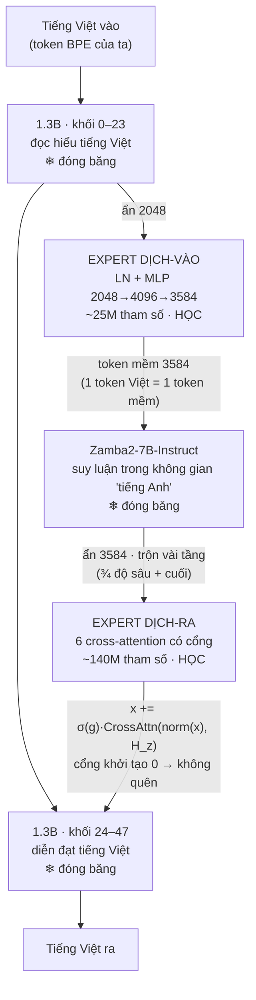

# TK_105 · Cầu nối ẩn 1.3B ↔ Zamba2 — "người nói tiếng Việt" + "bộ não tiếng Anh"

> Trạng thái: **THIẾT KẾ + Bước 0 (đo trần) đã sẵn script** · 2026-10-03
> Tiền đề: TK_104 (1.3B của ta: tiếng Việt tự nhiên 4,47/5 nhưng đúng 2,04/5, VMLU 24,6% = ngẫu nhiên, toán 0/18).
> Ghi rõ: hướng này **dùng thêm model nguồn mở** (Zamba2, Apache-2.0) làm khối kiến thức — do người dùng chọn
> 2026-10-03, bổ sung cho hướng "bồi đắp 1.3B" (TK_104 §14), không thay thế.

## 1. Ý tưởng

1.3B của ta nói tiếng Việt tốt nhưng biết ít; Zamba2-7B biết nhiều (vài nghìn tỷ token) nhưng gần như không
nói được tiếng Việt (pilot B: 1,6→2,6/5 sau LoRA). Ghép hai model thành **một mạng**, nối nhau bằng **trạng
thái ẩn** — không truyền văn bản qua lại. "Dịch" trở thành hai **expert cầu nối** bên trong kiến trúc.

Khác BTX (TK_104 §13): BTX ghép các expert cùng gốc (chung bộ token, chung không gian ẩn) nên router chọn theo
token được. Ở đây hai model khác bộ token (BPE Việt 32K vs bộ token Anh), khác chiều ẩn (2048 vs 3584) → phải
có lớp **chiếu** giữa hai không gian, không dùng router chọn expert được.

Tiền lệ: LangBridge (2024) và MindMerger (2024) nối model đa ngữ vào LLM tiếng Anh qua lớp chiếu, nâng suy luận
ở ngôn ngữ ít tài nguyên; CALM (Google DeepMind, 2024) ghép 2 model đóng băng bằng cross-attention học được.

## 2. Kiến trúc

**Chạy song song từng bước (lockstep).** Mỗi token tiếng Việt (câu hỏi lẫn câu trả lời đang sinh) đi qua
dịch-vào thành một token mềm cho Zamba2. Zamba2 là Mamba2 → trạng thái cố định, nên "nghĩ theo" từng chữ rất
rẻ. Ẩn của Zamba2 tại vị trí t chứa ý "điều tiếp theo nên nói" (theo không gian khái niệm tiếng Anh của nó);
dịch-ra đọc ẩn đó để 1.3B nói tiếp bằng tiếng Việt.

**Mặt nạ.** Vị trí t của 1.3B nhìn được: toàn bộ ẩn Zamba2 của phần câu hỏi + ẩn phần trả lời ≤ t. Vì ánh xạ
1 token ↔ 1 token mềm nên mặt nạ nhân quả đơn giản, không cần căn chỉnh hai bộ token.

**Điểm đặt.** Dịch-vào lấy ẩn sau khối 23 (giữa thân — ngữ nghĩa, ít hình thái chữ). Dịch-ra cắm 6 điểm cạnh
6 khối attention của 1.3B (7, 15, …, 47; chỉ những điểm ≥ 23 nhận tín hiệu hữu ích — thử cả 3 điểm trên cùng).
Đều cấu hình được.

**Tham số học được ≈ 165M**, tất cả còn lại đóng băng → 1.3B không quên (cùng cơ chế expert code TK_104 §14).

## 3. Dạy expert dịch — 3 giai đoạn

| Gđ | Học gì | Dữ liệu | Tín hiệu |
|:--|:--|:--|:--|
| 1 · dịch-vào | câu Việt → token mềm mà Zamba2 **hiểu đúng ý** | cặp Việt–Anh (PhoMT, OPUS, DailyDialog dịch, code dịch) | Zamba2 nhận token mềm, phải viết đúng bản tiếng Anh (lan truyền ngược qua Zamba2 đóng băng) |
| 2 · dịch-ra | ẩn Zamba2 → 1.3B nói tiếng Việt đúng ý | cùng cặp, chiều ngược | Zamba2 đọc câu Anh (token thật); 1.3B chỉ thấy cross-attn, phải viết bản Việt |
| 3 · đầu-cuối | hỏi Việt → Zamba2 nghĩ → đáp Việt | SFT v2 (trung thực), chat v2, Vi-GSM8K, QA có đáp án | loss trên câu trả lời Việt; train cả 2 cầu cùng lúc |

Biến thể cho toán (TK_104: *viết lời giải >> nghĩ thầm*): **"nghĩ nháp bằng tiếng Anh"** — Zamba2 tự sinh chuỗi
suy luận tiếng Anh (ẩn, không hiện cho người dùng), rồi 1.3B nói lời giải tiếng Việt, cross-attend vào các ẩn
đó. Thử ở giai đoạn 4 nếu lockstep không đủ cho toán nhiều bước.

## 4. Bước 0 — đo trần (trước khi xây gì)

Cầu tốt nhất cũng chỉ chuyển được những gì Zamba2 biết. Đo bằng `scripts/zamba_ceiling.py`:

1. `translate` (Mac, Gemma): eval_v1 (158 câu) + VMLU validation (744 câu) → bản tiếng Anh chuẩn.
2. `gen` (H100, venv riêng `/workspace/zenv`): Zamba2-7B-Instruct trả lời 2 kiểu — **vi** (đọc thẳng tiếng Việt)
   và **en** (đọc bản dịch chuẩn = cầu-nối-hoàn-hảo). VMLU chấm bằng log-xác-suất chữ cái; eval_v1 sinh tự do.
3. `judge` + `report`: chấm bằng đúng prompt eval_clean, so với 1.3B (sftv2).

**Tiêu chí quyết định**

| Kết quả Zamba2 đọc bản Anh (en) | Kết luận |
|:--|:--|
| sự kiện đúng ≫ 1.3B, toán ≥ 50%, VMLU ≥ 40% | **ĐI TIẾP** — kiến thức có, chỉ thiếu cầu ngôn ngữ |
| en ≈ vi và cả hai cao | Zamba2 đã hiểu tiếng Việt đầu vào → dịch-vào ít quan trọng, dồn sức cho dịch-ra |
| en thấp (VMLU gần 25–30%) | **DỪNG** — Zamba2 không biết loại kiến thức này (VMLU thiên về Việt Nam) → dồn sang RAG |

Cột "môn lệch nhất (en−vi)" trong báo cáo cho biết môn nào kiến thức có sẵn nhưng bị chặn bởi ngôn ngữ.

## 5. Rủi ro

1. **Trần = HỢP hai model**, không phải riêng Zamba2: tầng 1.3B vẫn chạy đầy đủ, cổng chỉ cộng thêm tín hiệu
   Zamba2. Nhưng hiện 1.3B **đã đọc mà chưa nhớ** kiến thức Việt: sự kiện eval_v1 (từ viwiki, có trong pretrain)
   đúng 2/40, VMLU 24,6% (+RAG 24,1%) — sự kiện chỉ gặp vài lần trong 18,8B token thì không lưu được. Kiến thức
   đặc thù Việt Nam (sử, địa, luật) Zamba2 cũng biết ít → cần thêm hướng **bồi đắp kiến thức Việt có lặp lại**
   cho 1.3B (viwiki/SGK → nhiều dạng hỏi–đáp, mỗi sự kiện nhiều lần), giống đợt code TK_104 §14.
   Báo cáo Bước 0 so từng môn VMLU 1.3B vs Zamba2 để thấy phần nào là kiến thức Việt riêng.
2. **Zamba2 chưa từng nhận token mềm** từ model khác — giai đoạn 1 là chỗ dễ hỏng nhất; đo sớm bằng BLEU của
   "Zamba2 viết lại bản Anh từ token mềm".
3. **Ẩn tại t ≠ đáp án đầy đủ.** Lockstep cho Zamba2 "đoán điều tiếp theo" chứ không cho nó tự viết hết lời
   giải → có thể yếu ở suy luận nhiều bước (xem biến thể nghĩ nháp).
4. **Tài nguyên.** Lan truyền ngược qua 7B đóng băng: H100 80GB đủ (checkpointing, lô nhỏ). M4 24GB không train
   được; suy luận trên M4 chỉ thực tế với Zamba2-2.7B. Tốc độ sinh ≈ một model 7B.

## 6. Ước lượng GPU (H100)

| Bước | Việc | Giờ |
|:--|:--|:--|
| 0 | đo trần | ~1 |
| 1 | dịch-vào + kiểm "Zamba2 hiểu đúng ý" | ~3 |
| 2 | dịch-ra + đo chất lượng dịch | ~3 |
| 3 | đầu-cuối + so 1.3B một mình | ~3–4 |

## 7. KẾT QUẢ Bước 0 (2026-10-03, H100) — **ĐI TIẾP**

Bẫy kỹ thuật: transformers 5.16.1 nạp Zamba2-7B lỗi `tie_weights_keys` — chọn khối dùng chung theo `layer_id % 2`
thay vì THỨ TỰ tầng lai (hybrid_layer_ids 6, 11, 17… xen lẻ/chẵn) → adapter LoRA theo tầng gắn nhầm khối.
Vá `modeling_zamba2.py` (venv `/workspace/zenv`): `block_id = (số tầng lai đứng trước) % num_mem_blocks` → nạp sạch
(0 thiếu / 0 thừa). Bản 2.7B không dính vì thứ tự tầng lai trùng chẵn lẻ.

| | sự kiện đúng / không biết / sai | thực thể bịa: nhận / bịa | toán (18) | VMLU (743) |
|:--|:--|:--|:--|:--|
| 1.3B sft v2 | 5% / 75% / 20% | 70% / 30% | 6% | 24,6% |
| Zamba2-7B đọc **tiếng Việt** | 8% / 28% / **65%** | 50% / 50% | 50% | 38,0% |
| Zamba2-7B đọc **bản Anh** (= cầu hoàn hảo) | **28%** / 35% / 38% | **75%** / 25% | **100%** | **55,5%** |

- Theo tiêu chí §4: sự kiện ≫ 1.3B (28 vs 5%), toán ≥ 50% (100%), VMLU ≥ 40% (55,5%) → **ĐI TIẾP**.
- Khoảng cách en − vi = **+17,5 điểm VMLU, +50 điểm toán** = phần cầu dịch-vào có thể khai thác; đọc thẳng tiếng Việt
  Zamba2 còn **bịa nhiều** (sai 65%) — hiểu sai câu hỏi rồi trả lời tự tin.
- **HỢP** (1.3B đúng hoặc Zamba2-en đúng) = 499/743 = 67%; 1.3B góp thêm 87 câu nhưng phần lớn là may (đoán bừa 25%):
  ngay cả môn đặc thù Việt Nam (Đảng CSVN thành lập: 1.3B 4/13 vs Zamba2-en 10/13; Atlat địa lí 4 vs 7) Zamba2-en vẫn hơn
  → giả thuyết "1.3B đã có kiến thức Việt" chưa đúng ở hiện tại; nó đọc mà chưa nhớ.
- Sự kiện hiếm từ viwiki (bọ Adoretus, Binh đoàn Duyên hải): Zamba2 cũng sai → vẫn cần RAG.

**Bước tiếp:** dựng giai đoạn 1 (dịch-vào: token mềm từ tầng 23 của 1.3B → Zamba2 viết lại bản Anh), đo BLEU
"Zamba2 hiểu đúng ý" trước khi làm dịch-ra.

## 8. Giai đoạn 1 v1 — cầu dịch-vào THẤT BẠI (2026-10-04)

`scripts/tk105_bridge.py` (MLP 23M, ẩn sau khối 23 của 1.3B → token mềm THAY câu Việt; 3.000 bước × 16 câu DailyDialog).

| Zamba2 nhận | DailyDialog test (300) BLEU / chrF | câu hỏi eval_v1 (158) BLEU / chrF |
|:--|:--|:--|
| token mềm (cầu v1) | **0,0 / 0,2** (sinh rỗng) | 0,0 / 0,0 |
| câu Việt thô (mốc) | 5,7 / 30,9 | **23,3 / 53,2** |

Gỡ lỗi (`tk105_debug.py`): độ lớn token mềm tự phình **×3,4** so với embedding thật (0,047 vs 0,014), không gần token
nào (cos ~0,1) → Zamba2 coi là nhiễu; loss dừng ~3,3 ≈ "đoán mò" bản Anh. Phát hiện phụ: Zamba2 **tự đọc tiếng Việt khá
hơn dự đoán** (câu hỏi văn phòng: BLEU 23) — yếu ở hội thoại đời thường có xưng hô.
→ **v2 kiểu MindMerger**: token mềm BỔ SUNG câu Việt thô (không thể tệ hơn mốc), độ lớn CỐ ĐỊNH bằng embedding thật, lr 1e-3.

## 9. Giai đoạn 2 — cầu dịch-ra THÀNH CÔNG (2026-10-04)

`scripts/tk105_bridge2.py`: 6 cross-attention có cổng (138M, lớp ra khởi tạo 0) cắm sau khối attention của 1.3B, đọc ẩn
Zamba2 trộn 3 tầng (40/60/81; học dồn về tầng giữa: 0,47/0,31/0,22). 1.3B KHÔNG thấy câu Anh — mọi ý đi qua cầu.
3.000 bước × 16, loss 3,78 → 1,10, cổng cross-attention ~0,1.

| Anh → Việt (DailyDialog test, 150 câu) | BLEU | chrF |
|:--|:--|:--|
| **1.3B nói qua cầu** | **18,8** | **36,4** |
| Zamba2 tự dịch sang tiếng Việt | 6,6 | 25,6 |

Ví dụ "How much would you like to change?" → 1.3B: "Anh muốn đổi bao nhiêu ạ?" · Zamba2: "Bạn muốn đổi được bao nhiêu?".
Lỗi còn: lệch ý vài chỗ ("too far" → "đắt quá"), bịa với từ hiếm ("RIB"). **"Zamba2 nghĩ, 1.3B nói" đã chứng minh.**

## 10. Giai đoạn 3 — ghép đầu-cuối (2026-10-04)

`scripts/tk105_stage3.py`: Zamba2 tự viết NHÁP lời giải tiếng Anh (ẩn) từ câu hỏi Việt (+ cầu dịch-vào v2 nếu BLEU vượt đọc
thô), 1.3B đọc ẩn Zamba2 trên [câu hỏi + nháp] qua cầu dịch-ra (khởi tạo từ gđ2) rồi đáp tiếng Việt. Train rẻ bằng cặp
GSM8K Anh–Việt (7.398 cặp khớp đáp số) + 30% câu dịch DailyDialog. Đo: Vi-GSM8K test 100 + toán eval_v1 18 + sự kiện/thực
thể bịa eval_v1, so 1.3B một mình và đáp số trong nháp Zamba2.

**Giai đoạn 1 v2 (bổ sung kiểu MindMerger) — cũng KHÔNG đạt:** 4.000 bước, lr 1e-3, độ lớn cố định; loss 2,82 → 2,97 (không
giảm); DailyDialog test: token mềm + câu thô **BLEU 2,2 / chrF 21,8** < câu thô một mình 5,7 / 30,9 → token mềm còn gây nhiễu.
Kết luận tạm: dạy Zamba2-7B ĐÓNG BĂNG hiểu token mềm của model khác bằng cầu nhỏ (23M) + gradient xuyên 7B là khó (LangBridge/
MindMerger dùng encoder đa ngữ lớn + nhiều dữ liệu hơn). Không chặn việc ghép: **đầu vào dùng câu Việt thô** (Zamba2 tự đọc
được, BLEU 23 câu hỏi văn phòng), **đầu ra dùng cầu dịch-ra** (đã thành công). gđ3 tự chọn không dùng cầu dịch-vào.

**Kết quả gđ3 v1** (Zamba2 đọc câu Việt thô; cross-attention train 1.500 bước ≈ 1 lượt GSM8K, ~0,3 giây/bước):

| | **ghép (1.3B đáp tiếng Việt)** | nháp Zamba2 (tiếng Anh, ẩn) | 1.3B một mình |
|:--|:--|:--|:--|
| Vi-GSM8K test (100) | **9** | 34 | 2 |
| toán eval_v1 (18) | **5** | 11 | 1 |

Sự kiện eval_v1 (40): đúng 0 · không biết 15 · sai 25. Thực thể bịa (20): nhận 14 · bịa 6 (nháp Zamba2 "I do not know"
được 1.3B chuyển đúng ý). → Ghép giúp toán ×4–5 so 1.3B một mình, lời giải tiếng Việt từng bước tự nhiên ("150 bi / 6
bi/túi = 25 túi … Đáp án: 20"), nhưng MẤT ~3/4 so với nháp: 1.3B chép sai số (16,50 × 3 → "48,50"), lặp câu, lan man tới
hết độ dài trước khi ra đáp số. Nháp Zamba2 đọc câu Việt thô (34/100) cũng thấp hơn khi đọc bản Anh (Bước 0: 18/18 eval_v1).
gđ3b: train tiếp 3.000 bước + phạt lặp + cho viết dài khi sinh.

**gđ3b** (train tiếp 3.000 bước từ gđ3, lr 5e-5, loss 0,25; đo có phạt lặp 1,15 + cho viết tới 480 token):

| | gđ3 | gđ3 + phạt lặp | **gđ3b** | nháp Zamba2 | 1.3B một mình |
|:--|:--|:--|:--|:--|:--|
| Vi-GSM8K test (100) | 9 | 12 | **15** | 34 | 1 |
| toán eval_v1 (18) | 5 | 4 | 4 | 11 | 0 |
| thực thể bịa: nhận / bịa | 14 / 6 | 14 / 6 | **16 / 4** | — | — |
| sự kiện: không biết / sai (40) | 15 / 25 | 16 / 24 | 19 / 21 | — | — |

## 11. Kết luận TK_105 (2026-10-04)

1. **Đầu ra — "Zamba2 nghĩ, 1.3B nói": ĐẠT.** Cầu dịch-ra (cross-attention 138M) cho 1.3B nói tiếng Việt từ ẩn Zamba2 tốt hơn
   Zamba2 tự viết (BLEU 18,8 vs 6,6); mạng ghép giải Vi-GSM8K **15/100** vs 1.3B một mình 1–2/100, lời giải tiếng Việt từng bước,
   giữ được "không biết" với thực thể bịa (80%).
2. **Đầu vào — token mềm: CHƯA ĐẠT** (v1 BLEU 0, v2 bổ sung 2,2 < đọc thô 5,7). Dùng câu Việt thô; Zamba2 tự đọc được phần lớn.
3. **Nút thắt còn lại:** mất ~55% từ nháp sang lời Việt (34 → 15): 1.3B chép sai số khi diễn đạt lại, lặp, lan man. Hướng sửa:
   máy tính (TK_104 §14.4) ngay trong lời giải ghép; dạy đáp ngắn "Đáp án: X" sớm; train nhiều lượt hơn; cho 1.3B chép thẳng
   số từ nháp (cơ chế sao chép). Nháp cũng thấp hơn khi Zamba2 đọc tiếng Việt (34/100) so với đọc tiếng Anh.
4. Mạng ghép ~9B tham số, sinh chậm (nháp + lời giải); chỉ thực tế trên GPU. Trợ lý 1.3B v3 (TK_104 §15.2) vẫn là sản phẩm nhẹ.

Trọng số: `checkpoints/hf_hybrid/tk105/{bridge_out,stage3b}_bf16.pt` (Mac) · kết quả `out/box_results/tk105/*.json`.
