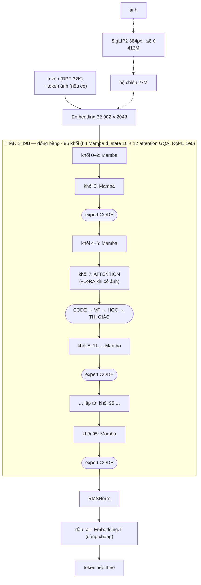
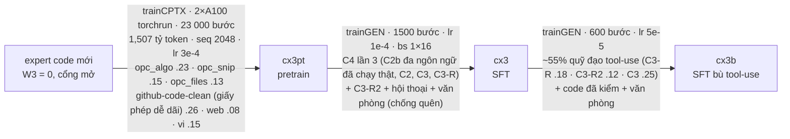

# TK_108 — Kiến trúc aivie cx3b (22/10/2026)

*Bản `aivie_2p6b_p3_cx3b_bf16.pt` (HF `donaldluong/nn-aivie-2p6b-p3-snap`). Số liệu đọc thẳng từ checkpoint. Quá trình làm ra bản này
xem `TK_108_CODE_TOOL_USE.md` §9–§13.*

## 1. Tổng quan

Một checkpoint duy nhất gồm:
- **thân** hybrid Mamba + attention 2,49 tỷ tham số, **đóng băng** từ P3 (TK_107);
- **4 expert GatedFFN có cổng**, cắm nối tiếp sau một số khối;
- **phần đọc ảnh**: SigLIP2 + bộ chiếu + LoRA trên 12 khối attention.

| Phần | Tham số | Học ở đâu | Trạng thái trong cx3b |
|---|---|---|---|
| Thân (96 khối, d = 2048, ctx 8192, từ vựng 32 002) | 2 488 M | P1–P3 (20 tỷ token + SFT bước 7676) | đóng băng |
| **Expert code** — 24 điểm × ẩn 8192 | **1 208 M** | **TK_108: pretrain 1,5 tỷ token (cx3pt) → SFT C4 lần 3 + C3-R2 (cx3) → SFT bù tool-use (cx3b)** | **mới** |
| Expert văn phòng (vp) — 12 điểm × ẩn 2048 | 151 M | P3 + sửa Excel (`p3r1xl_vp`) | đóng băng |
| Expert học thuật (hoc) — 12 điểm × ẩn 4096 | 302 M | P3 (`p3r1_hoc`) | đóng băng |
| Expert thị giác — 12 điểm × ẩn 2048 | 151 M | TK_106/107 | chỉ bật khi hội thoại có ảnh |
| SigLIP2 (ảnh 384 px, tối đa 8 ô) + bộ chiếu | 413 M + 27 M | TK_106/107 | chỉ chạy khi có ảnh |
| LoRA trên wq/wk/wv/wo của 12 khối attention | 12,6 M | TK_106/107 | chỉ bật khi có ảnh |
| **Tổng** | **≈ 4,75 tỷ** | | khi chat chữ chạy ≈ 4,15 tỷ (bỏ phần ảnh) |

## 2. Sơ đồ



**Một điểm cắm expert** (`GatedFFN`, `scripts/expert_ffn_1p3b.py`): đầu ra của khối đi qua từng expert theo thứ tự, mỗi expert cộng
thêm một phần dư có cổng theo **từng token**:

```text
h  = RMSNorm(x)
y  = W3 · ( SiLU(W1·h) ⊙ W2·h )          # SwiGLU, ẩn 8192 (code) / 4096 (hoc) / 2048 (vp, thị giác)
g  = sigmoid(w_g · h + b_g)               # 1 số cho mỗi token, khởi tạo b_g = −2 (gần đóng)
x' = x + g · y                            # W3 khởi tạo 0 → lúc chèn model y hệt thân
```

## 3. Vị trí cắm

| Khối | Loại khối | Expert cắm sau khối |
|---|---|---|
| 3, 11, 19, 27, 35, 43, 51, 59, 67, 75, 83, 91 | Mamba | code |
| 15, 31, 47, 63, 79, 95 | Mamba | code |
| 7, 23, 39, 55, 71, 87 | **attention** | code → vp → hoc → thị giác |
| 14, 30, 46, 62, 78, 94 | **attention** | vp → hoc → thị giác |

- Expert code nằm ở **mỗi 4 khối** (`range(3, 96, 4)`), tức 24 điểm, nên phủ đều cả chiều sâu thân.
- Expert cũ (vp, hoc, thị giác) nằm sau **12 khối attention** như từ P3.
- 6 khối attention 7, 23, 39, 55, 71, 87 có cả 4 expert xếp nối tiếp.

## 4. Cổng hoạt động thế nào (đo cuối SFT cx3b, giá trị cổng trung bình trên tập giữ riêng)

| Dữ liệu | Cổng code | Cổng vp | Cổng hoc |
|---|---|---|---|
| Quỹ đạo tool-use C3-R / C3-R2 / C3 | 0,79 | 0,03 | 0,05 |
| Code đã kiểm (c2bV) | 0,87 | 0,02 | — |

- Với nội dung code, expert code **mở khoảng 80–87%**, còn vp và hoc gần đóng.
- Với chat thường, cổng code khép lại, nên phần chat tiếng Việt và văn phòng giữ gần như nguyên: easy20 16/20, Excel 15/27 so với 16/27 ở cx3.

## 5. Expert code được học ra sao (3 bước, thân và các expert khác đóng băng)



Loss tập giữ riêng trong lúc pretrain, từ bước 0 đến bước 23 000:

| Nhóm | Bước 0 | Bước 23 000 |
|---|---|---|
| algo | 0,881 | 0,217 |
| snip | 0,744 | 0,155 |
| files | 1,192 | 0,469 |
| GitHub | 1,273 | 0,857 |
| web | 2,486 | 2,096 |
| tiếng Việt | 2,161 | 1,599 |

## 6. Kết quả (bộ đo `scripts/code_eval.py`, `code_eval_ml.py`, `office_probe_light.py`; UI ngữ cảnh 4096, khung công cụ v3)

| Bản | Tool-use (40 bài) | HumanEval | MBPP | MultiPL-E (7 ngôn ngữ) | Excel | easy20 |
|---|---|---|---|---|---|---|
| p3r1 (trước TK_108) | 0 | 6,1 | 5,1 | — | 9/27 | 16/20 |
| c4c (expert code nhỏ, 0,3B) | 45 | 11,0 | 9,7 | 2,4 | 16/27 | 15/20 |
| cx2 (pilot expert lớn, pretrain 321M token) | 47,5 | 13,4 | 15,6 | 5,7 | 14/27 | 17/20 |
| cx3 (pretrain 1,5 tỷ token) | 42,5 | 12,2 | 22,2 | 6,7 | 16/27 | 16/20 |
| **cx3b** | **55,0** | 13,4 | **23,3** (sau sửa 24,9) | — | 15/27 | 16/20 |

## 7. Giới hạn đã biết

- **Thân đóng băng** quyết định khả năng hiểu đề.
  - Thử trên M4 với 8 đề thực tế nhiều ràng buộc (hoá đơn VAT, phân tích log nginx, debug tham số mặc định, T-SQL báo cáo, Excel SUMIFS, debounce JS, tư vấn tối ưu .NET, email): cx2 chỉ làm tốt email.
  - Expert code thêm kiến thức code nhưng không làm thân đọc đề tốt hơn.
  - Bước tiếp theo nếu cần vượt trần: C6, tức học vào thân.
- **Chạy trên M4 24 GB:** phải dùng `--half` (bf16). Ở fp32 bản này cần khoảng 17 GB và bị tràn swap. Tốc độ khoảng 7–15 token/giây.
- **Tokenizer** tốn khoảng 1,5× token cho code so với Qwen-Coder (§8 của ticket).
