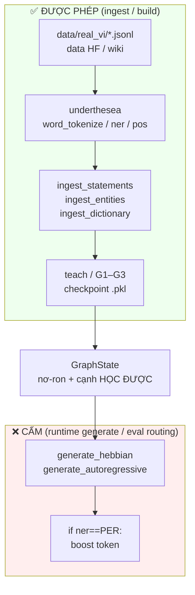
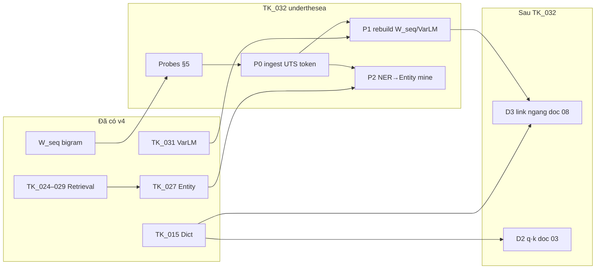

# 09 — UNDERTHESEA CHO TIẾNG VIỆT: INGEST SUBSTRATE, KHÔNG RUNTIME NLP

> Nguồn: phân tích underthesea 9.5.0 (`/Users/dlv/Documents/code/underthesea`), đối chiếu stack
> nn-aivie v4 (W_seq order-1, VarLM TK_031, fact crisp TK_019, retrieval TK_024–029, entity TK_027,
> từ điển HF TK_015). **Luật 0:** mọi NLP bên ngoài chỉ được dùng lúc **ingest/build**, không lúc
> `generate`.

## 0. Tóm tắt underthesea

### Kiến trúc

| Thành phần | Cơ chế | Ghi chú |
| :--- | :--- | :--- |
| **word_tokenize** | `regex_tokenize` → feature → **FastCRFSequenceTagger** (`ws_crf_vlsp2013_20230727`) | Ghép token `I-W` thành cụm đa từ; API `fixed_words` cho từ cố định |
| **pos_tag** | `word_tokenize` → CRF `pos_crf_2017_10_11.bin` | Nhãn VLSP (Nc, V, N, …) |
| **chunk** | CRF chunking trên POS | Tiền xử lý cho NER |
| **ner** | `chunk()` → CRF `ner_crf_2017_10_12.bin` | PER / LOC / ORG (+ O); `deep=True` → transformers |
| **sent_tokenize** | PunktSentenceTokenizer | Tách câu |
| **text_normalize** | Quy tắc `token_normalize` | Chuẩn hoá token trước CRF |
| **Từ điển UVD** | ~72k mục (`underthesea download-data`) | nn-aivie **đã** nạp qua HF `tsdocode/vietnamese-dictionary` — [`scripts/build_dict_checkpoint.py`](../../scripts/build_dict_checkpoint.py) |

- **Phiên bản:** 9.5.0  
- **Giấy phép:** Apache-2.0 (thư viện + model CRF trong `underthesea_core`)  
- **Offline:** CRF/Punkt chạy local sau khi tải model; không cần API cloud  
- **Phụ thuộc nặng:** `deep=True` NER cần transformers (không khuyến nghị cho pipeline ingest mặc định)

### Điểm then chốt cho nn-aivie

Underthesea là **công cụ phân tích văn bản có nhãn** (segment, POS, NER) — phù hợp **làm giàu
corpus lúc nạp** (token đúng cụm, nhãn PER/LOC, khung chunk), **không** phù hợp gọi trong vòng
`generate_autoregressive` ([`src/nn_aivie/hca/generate_hebbian.py`](../../src/nn_aivie/hca/generate_hebbian.py)).

---

## 1. So sánh với stack nn-aivie hiện tại

| Khía cạnh | nn-aivie hiện tại | underthesea | Hệ quả |
| :--- | :--- | :--- | :--- |
| **Tokenize ingest** | `tokenize()` = `text.strip().split()` — [`align.py`](../../src/nn_aivie/teaching/align.py) | CRF tách từ (vd `Lý Thái Tổ`, `báo tin`) | Cụm lịch sử/địa danh **một neuron** thay vì 2–3 token rời → W_seq/VarLM học ngữ cảnh dài hơn trên cùng câu |
| **Tokenize HF thật** | `tokenize_punct()` tách dấu câu — dùng trong [`ingest_dictionary.py`](../../src/nn_aivie/training/ingest_dictionary.py) | Không thay thế trực tiếp; có thể **kết hợp**: UTS segment → rồi tách punct theo R0 | Giữ frame `Hỏi:`/`Đáp:` và dấu câu độc lập |
| **Chuỗi LM phụ** | VarOrderLM ctx≤4 (TK_031) — [`varlm.py`](../../src/nn_aivie/core/varlm.py) | Token khác → bảng n-gram khác | Probe A/B: underthesea có giảm bits held-out không? (§5) |
| **Thực thể** | `Entity:title` từ `title` jsonl — [`ingest_entities.py`](../../src/nn_aivie/training/ingest_entities.py) | NER PER/LOC/ORG trong câu | Bổ sung span phụ, **không** thay title wiki; đo overlap §5 |
| **Từ điển** | HF Vietnamese dictionary → sense/POS hub (doc 08) | UVD ~72k (trùng nguồn gần) | **Không** nạp trùng; ưu tiên HF pipeline đã có |
| **Sinh văn** | W_seq bậc-1 + VarLM; không compose (TK_019) | Không dùng runtime | Chỉ cải thiện **substrate đã học**, không rule lúc sinh |

**Đau điểm đã biết (README §0.1, TK_031/019/024–027):**

- **A — Sinh từ rời:** W_seq order-1; VarLM TK_031 đã giảm ~0.21 bits trên corpus lớn nhưng vẫn trần data.
- **B — Ghép fact:** compose đa-fact bỏ (TK_019); cần một fact mượt / continuation tốt hơn.
- **C — Lạc ngữ cảnh retrieval:** TK_024–029 — relatedness, entity gate, WH removal.
- **D — Substrate từ điển / entity:** TK_015/027 — sense-neuron, `Entity:title`.

Underthesea **chạm mạnh nhất A và D** (token + span có nhãn lúc build), **gián tiếp B** (cụm token
đúng → VarLM/W_seq), **yếu C** (retrieval là đồ thị, không phải NER runtime).

---

## 2. Luật 0 — ranh giới được phép / cấm



| Được phép | Cấm |
| :--- | :--- |
| Gọi `word_tokenize` / `ner` trong script ingest, probe, build checkpoint | Gọi underthesea trong [`generate_hebbian.py`](../../src/nn_aivie/hca/generate_hebbian.py) hoặc readout |
| Lưu **kết quả** thành token-neuron / cạnh CO_ACTIVATION / nhãn `Entity:` lúc build | `if pos=="V":` hoặc parse NER string lúc chọn token kế |
| Probe đo lường (§5) trên corpus | Dùng NER để **định tuyến** fact lúc QA (vi phạm TK_012/025) |
| `fixed_words` cho danh sách tên riêng từ `title` jsonl | Hardcode danh sách tên trong runtime |

---

## 3. Ánh xạ vấn đề → giải pháp

### A — Sinh từ / văn rời (W_seq, VarLM)

| Vấn đề | Giải pháp underthesea (ingest) | File liên quan |
| :--- | :--- | :--- |
| Bigram mất cụm (`Thái` \| `Tổ` thay vì `Lý Thái Tổ`) | `word_tokenize` + optional `fixed_words` từ `title` | [`align.py`](../../src/nn_aivie/teaching/align.py) → wrapper ingest mới |
| VarLM học trên token sai ranh giới | Rebuild `.varlm.pkl` trên token UTS — [`build_varlm.py`](../../scripts/build_varlm.py) | Probe `varlm_bits_ab.py` |

### B — Ghép fact (TK_019 crisp)

| Vấn đề | Giải pháp | Ghi chú |
| :--- | :--- | :--- |
| Không nối đa fact | Underthesea **không** giải trực tiếp | Cải thiện **một** fact mượt qua VarLM + token đúng cụm |
| Cầu nối yếu | POS/chunk có thể làm **data** cho link ngang D3 (doc 08) — ingest only | Không bridge runtime |

### C — Lạc ngữ cảnh retrieval (TK_024–029)

| Vấn đề | Giải pháp | Ghi chú |
| :--- | :--- | :--- |
| Đồng-tự `Lý` | NER **không** tách triều vs lý thuyết | Vẫn cần `Entity:title` (TK_027) |
| Query drift | Không dùng NER lúc retrieve | Có thể mine thêm `Entity:` từ span NER **lúc build** |

### D — Từ điển / entity substrate

| Vấn đề | Giải pháp | File |
| :--- | :--- | :--- |
| Entity chỉ từ `title` | NER bổ sung span PER/LOC trong câu → neuron `Entity:` hoặc cạnh tới token | [`ingest_entities.py`](../../src/nn_aivie/training/ingest_entities.py) mở rộng |
| POS hub (doc 08 D1) | `pos_tag` trên corpus → cạnh `POS:` hub (đã có pattern sense) | [`ingest_dictionary.py`](../../src/nn_aivie/training/ingest_dictionary.py) |

---

## 4. Ma trận ưu tiên P0–P3

| Ưu tiên | Hạng mục | Effort | Impact | Phụ thuộc |
| :---: | :--- | :---: | :---: | :--- |
| **P0** | Probe + tài liệu (TK_032) — **đang làm** | Thấp | Cao (measure-first) | `pip install underthesea` |
| **P0** | `ingest_tokenize_uts()` wrapper: UTS + `tokenize_punct` R0 | Trung bình | Cao cho lịch sử VN | Probe tokenize Δ% |
| **P1** | Rebuild W_seq / VarLM trên token UTS cho `history_vi` + mở rộng HF | Trung bình | Cao (A) | Checkpoint vocab ổn định |
| **P1** | `fixed_words` từ `title` + danh sách vua/địa danh | Thấp | Trung bình | P0 wrapper |
| **P2** | Ingest NER span → gợi ý `Entity:` (overlap probe) | Trung bình | Trung bình (D) | `network_v7_history.pkl` |
| **P2** | POS trên corpus → wire `POS:` hub (doc 08 D1) | Cao | Trung bình | Dict substrate đã có |
| **P3** | UVD underthesea vs HF dict — diff audit | Thấp | Thấp | Đã có HF |
| **P3** | `deep=True` NER transformers | Cao | Chưa rõ | GPU, vi phạm gọn nhẹ Luật 0? (vẫn ingest-only) |

---

## 5. Probe scripts và kết quả

Chạy từ repo root:

```bash
pip install underthesea
export PYTHONPATH=src
python scripts/underthesea_probe/compare_tokenization.py
python scripts/underthesea_probe/ner_entity_overlap.py
python scripts/underthesea_probe/varlm_bits_ab.py
```

Chi tiết: [`scripts/underthesea_probe/README.md`](../../scripts/underthesea_probe/README.md).

### 5.1 Tokenization (`out/tk032_tokenize.log`)

| Metric | Giá trị |
| :--- | ---: |
| Corpus | `data/real_vi/history_vi.jsonl` |
| Số câu | 173 |
| TB token (whitespace) | 15.156 |
| TB token (underthesea) | 11.867 |
| Cụm đa từ (UTS) | 713 |
| Câu khác nhau | 173 (100%) |
| Giảm token | 569 (−21.7%) |

Ví dụ tiêu biểu: `Lý Thái Tổ`, `Thăng Long`, `Việt Nam`, `kháng chiến` thành **một token**; dấu câu tách riêng (`,`, `.`) thay vì dính `Nam,`.

### 5.2 NER vs Entity (`out/tk032_ner.log`)

| Metric | Giá trị |
| :--- | ---: |
| Checkpoint | `checkpoints/network_v7_history.pkl` |
| Số `Entity:` (≥2 ký tự) | 3040 (raw 3083) |
| Span NER (PER/LOC/ORG) | 316 |
| Span khớp Entity | 224 (70.9%) |
| `title` jsonl có trong NER | 73/173 (42.2%) |

Khớp tốt: `Nhà Lý`, `Lý Thái Tổ`, `Thăng Long`, `Lý Thường Kiệt`. Trượt / nhiễu: `năm 1009` (LOC), `Đại La` (chưa có Entity), `Việt Nam` → trúng bài dài về chất độc da cam (substring). Cần gate độ dài khi mine NER→Entity.

### 5.3 VarOrderLM A/B (`out/tk032_varlm.log`)

| Model | n | bits ↓ | MRR | top1 | top5 |
| :--- | ---: | ---: | ---: | ---: | ---: |
| Whitespace | 349 | **1.499** | **0.511** | **31.8%** | **75.6%** |
| Underthesea | 256 | 1.853 | 0.445 | 25.8% | 66.8% |
| **Δbits (uts − ws)** | | **+0.354** | | | |

_Protocol: train 80% / held-out 20% câu (139/34), `VarOrderLM` max_ctx=4 λ=0.45, log2-rank — cùng họ TK_031.
Corpus nhỏ (~174 câu) → số liệu **định tính**, không so sánh tuyệt đối với `out/tk031_ppm_probe.log` (167k câu). **Trên held-out lịch sử, whitespace thắng** — có thể do vocab thưa + cụm dài làm ctx hiếm; cần probe lại trên corpus lớn trước khi đổi tokenize toàn pipeline._

---

## 6. Giới hạn trung thực

1. **Corpus probe nhỏ:** `history_vi.jsonl` ~174 câu lịch sử — đủ thấy **hướng** token/NER, không đủ đại diện wiki 80k câu.
2. **Thay token = đổi vocab:** Checkpoint cũ không tương thích; cần re-ingest hoặc song song token mới (OOV cụm cũ).
3. **NER CRF ≠ title wiki:** Nhiều tên lịch sử là PER nhưng title là cụm khác (`Lý Thái Tổ` vs entity title); overlap không phải 100%.
4. **Không giải retrieval:** TK_024–027 vẫn cần đồ thị entity/relatedness; NER chỉ hỗ trợ **data**.
5. **Trùng từ điển:** HF dict đã nạp; UVD underthesea thêm ít giá trị trừ audit.
6. **Chi phí build:** POS/NER toàn corpus HF = chậm; nên batch ingest có log ([`util/progress`](../../src/nn_aivie/util/progress.py)).
7. **Luật 0.0:** Nhãn POS/NER phải thành **nơ-ron/cạnh**, không string rule lúc sinh.

---

## 7. Vị trí trong roadmap v4



TK_032 nằm **giữa data thô và substrate đã học** — cùng lớp với `ingest_dictionary` / `ingest_entities`,
**trước** D2/D3 (doc 08) và **song song** VarLM (không thay TK_031, bổ sung tokenization đúng).

---

## 8. Kết luận và bước tiếp

**Kết luận:** underthesea phù hợp nn-aivie như **lớp phân tích ingest** (Apache-2.0, offline CRF),
đặc biệt `word_tokenize` cho tiếng Việt lịch sử. Không dùng runtime. Giá trị cao nhất: **token
cụm đúng** → W_seq/VarLM; thấp hơn nhưng hữu ích: **NER span** bổ sung entity. Từ điển UVD trùng
hướng HF đã có — ưu tiên thấp.

**Bước tiếp (theo probe):**

1. **P0 tokenize:** §5.1 xác nhận 100% câu lịch sử khác token, −21.7% token, 713 cụm đa từ → triển khai `ingest_tokenize_uts` cho `history_vi` + mở rộng HF (lợi ích cấu trúc rõ).
2. **P1 VarLM:** §5.3 trên corpus nhỏ whitespace **thắng** (+0.354 bits) — **chưa** đổi tokenize toàn pipeline; probe lại trên `statements*.jsonl` trước rebuild `build_varlm.py`.
3. **P2 NER:** §5.2 overlap 70.9% nhưng có substring nhiễu (`Việt Nam` → bài dài) — mine Entity với gate độ dài + ưu tiên exact title.
4. Giữ guard QA/Para/Syn khi mọi thay đổi checkpoint ([`TK_031_VARLM.md`](../TK_031_VARLM.md) mẫu).

**Tài liệu tracking:** [`TK_032_UNDERTHESEA_VI_NLP.md`](../TK_032_UNDERTHESEA_VI_NLP.md) — `read-uts-code` ✅.
