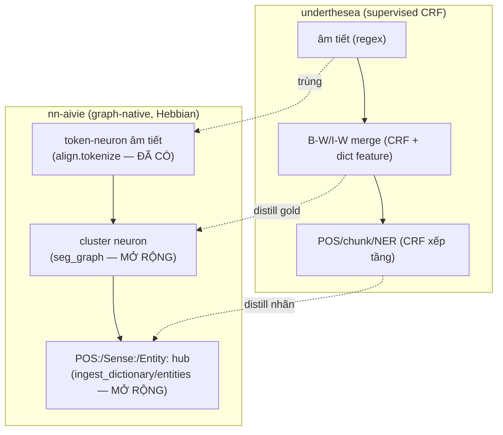

# 10 — NƠ-RON CỤM TỪ HỌC TỪ CƠ CHẾ UNDERTHESEA (segment-as-labeled-decision)

> Nguồn: đọc mã nguồn underthesea 9.5.0 (`../underthesea`) — `word_tokenize` / `pos_tag` /
> `chunk` / `ner`. Mục tiêu: **hiểu cách nó bóc-tách + đánh-nhãn**, rồi **tái đúc nguyên lý
> đó thành nơ-ron/cạnh trong nn-aivie** — KHÔNG gọi lại underthesea lúc `generate` (Luật 0).
> Nối tiếp [`09_UNDERTHESEA_VI_NLP.md`](09_UNDERTHESEA_VI_NLP.md) (khảo sát) và
> [`08_DICTIONARY_LABELED_SUBSTRATE.md`](08_DICTIONARY_LABELED_SUBSTRATE.md) (substrate nhãn).

## 0. Cốt lõi: underthesea coi TÁCH TỪ là chuỗi quyết định CÓ NHÃN, không phải split một-lần

Đọc [`word_tokenize/__init__.py`](../../../underthesea/underthesea/pipeline/word_tokenize/__init__.py)
và [`regex_tokenize.py`](../../../underthesea/underthesea/pipeline/word_tokenize/regex_tokenize.py):

```
văn bản
  │  (1) chuẩn hóa ký tự + token_map              text_normalize
  ▼
nguyên tử   ["Lý","Thái","Tổ","dời","đô","về","Thăng","Long","năm","1010","."]
  │  (2) CRF gán nhãn B-W / I-W cho từng nguyên tử   FastCRFSequenceTagger
  ▼  (3) ghép I-W vào token trước
TỪ          ["Lý Thái Tổ","dời đô","về","Thăng Long","năm","1010","."]
  │  (4..6) CRF xếp tầng: POS → chunk → NER (mỗi tầng thêm 1 cột nhãn)
  ▼
[("Lý Thái Tổ","Np","B-NP","B-PER"), ("Thăng Long","Np","B-NP","B-LOC"), …]
```

**Ba sự thật rút ra từ code (không phải README):**

1. **Nguyên tử = âm tiết** (regex `word=\w+`), y hệt `tokenize()` = `split()` của nn-aivie
   ([`align.py`](../../src/nn_aivie/teaching/align.py)) cho tiếng Việt có dấu cách. **Tầng
   nguyên tử của hai hệ TRÙNG NHAU.**
2. **Ghép từ = nhãn BIO trên nguyên tử.** Vòng lặp lõi:
   ```python
   if tag == "I-W" and num_words > 0:
       output[-1] = output[-1] + " " + token   # dính vào từ trước
   else:
       output.append(token)                      # từ mới
   ```
   Tức "từ" = **quyết định merge/no-merge có điều kiện ngữ cảnh** giữa hai âm tiết liền kề.
3. **Nhãn xếp tầng trên ĐƠN VỊ ĐÃ GHÉP**, không trên âm tiết rời:
   `pos_tag` gọi `word_tokenize` trước; `chunk` gọi `pos_tag`; `ner` gọi `chunk`
   ([`ner/__init__.py`](../../../underthesea/underthesea/pipeline/ner/__init__.py)).

## 1. CRF quyết định merge bằng gì (feature template thật)

`features.bin` của `ws_crf_vlsp2013_20230727` = **43 template**
([`tagged_feature.py`](../../../underthesea/underthesea/pipeline/pos_tag/tagged_feature.py)
định nghĩa cú pháp `T[i]`, `T[i,j]`, `.lower/.istitle/.isdigit/.is_in_dict`):

| Nhóm feature | Ví dụ | Ý nghĩa cho nn-aivie |
| :--- | :--- | :--- |
| Ngữ cảnh ±2 âm tiết | `T[-2]`, `T[-1,0]`, `T[0,2]` | cửa sổ giống VarLM ctx≤4 (TK_031) |
| Hạ thường | `T[0].lower` | fold-group (TK_012 `fold_group_id`) |
| **Viết hoa** | `T[0].istitle`, `T[0,1].istitle` | tín hiệu tên riêng (`Lý`+`Thái`+`Tổ`) — nn-aivie có `cap_class` |
| Chữ số | `T[0].isdigit` | năm/số (`1010`) |
| **Từ điển 72.547 mục** | `T[0].is_in_dict`, `T[0,1].is_in_dict`, `T[-1,1].is_in_dict` | "cặp/bộ-ba này có trong lexicon không" |

`dictionary.bin` = **72.547 cụm** (`dời đô`, `Thăng Long`, `triều đại`…). Đây **không** phải
rule cứng — là **feature boolean** cho CRF. Nghĩa là underthesea đã dùng đúng thứ nn-aivie
gọi là "substrate có nhãn" (doc 08), chỉ khác: **CRF supervised** thay **Hebbian co-occurrence**.

## 2. Vì sao đây là đòn bẩy: ĐO trên corpus thật

ISG hiện tại ([`seg_graph.py`](../../src/nn_aivie/core/seg_graph.py)) promote cặp `(a,b)`
thành cluster **chỉ khi** `bigram_count >= min_frequency` (mặc định 3). Đây là tiêu chí
**thuần tần suất** — mù với từ điển, viết hoa, ngữ cảnh.

Probe [`scripts/underthesea_probe/distill_segment_gold.py`](../../scripts/underthesea_probe/distill_segment_gold.py)
đo trên `data/real_vi/history_vi.jsonl` (173 câu) → `out/tk032_segment.log`:

| Metric | Giá trị |
| :--- | ---: |
| Cụm từ gold phân biệt (underthesea) | **347** |
| Lần xuất hiện cụm | 713 |
| Cạnh MERGE distill được (có hướng, cả lặp) | 838 |
| **ISG-discoverable** (mọi cặp trong ≥ 3) | **79 (22.8%)** |
| **ISG BỎ LỠ** (≥1 cặp < 3) | **268 (77.2%)** |

**Đọc số:** trên corpus lịch sử mỏng, **77.2% từ tiếng Việt đúng KHÔNG BAO GIỜ được ISG
phát hiện** vì cặp âm tiết bên trong xuất hiện < 3 lần. Ví dụ bỏ lỡ:

- `Đại Việt` (cặp `Đại|Việt`=2), `Khổng Tử` (1), `Như Nguyệt` (0), `Trần Cảnh` (0),
  `Kinh Bắc` (0), `Lý Chiêu Hoàng`, `nhường ngôi`, `xâm lược`…

Đây chính **giá trị của dictionary-seed / gold-distill**: bắt ngay 268 cụm mà tần suất không
bao giờ chạm tới. ISG bắt tốt các cụm tần cao (`Thăng Long`×14, `Việt Nam`×13, `nhà Lý`×10) —
**hai cơ chế bổ sung nhau, không thay thế.**

## 3. Ánh xạ 3 tầng underthesea → 3 lớp nơ-ron nn-aivie



### Lớp 1 — Nguyên tử (đã có, không đổi)
`Lý`, `Thái`, `Tổ` = token-neuron. Không cần làm gì — đây là input units chung.

### Lớp 2 — Cụm từ = cluster neuron (đòn bẩy chính)
Underthesea merge B-W/I-W → nn-aivie đã có hạ tầng cluster (`ClusterNeuron`, `CLUSTER_OFFSET`,
`promote_pair`, rewire toàn cục). **Thiếu duy nhất:** một đường promote **KHÔNG dựa tần suất**.

### Lớp 3 — Nhãn cấu trúc trên cụm
`ingest_dictionary.py` đã wire `Sense:`/`POS:` cho **token đầu** của từ khóa
([dòng 59–60](../../src/nn_aivie/training/ingest_dictionary.py)). Sau khi có cluster ở Lớp 2,
neo nhãn vào **cluster** thay token đơn → sửa gốc va chạm `Lý`(triều) vs `lý`(thuyết) TK_026/027.

## 4. Ba đường distill (Luật 0 SẠCH — chạy 1 lần lúc build, lưu thành cạnh)

> Nguyên tắc: underthesea chạy **lúc ingest**, kết quả **vật chất hóa thành nơ-ron/cạnh**.
> Lúc `generate`, mạng chỉ đọc cluster + cạnh đã học. Không import underthesea trong
> `generate_hebbian.py`. (README Mục 0: "lesson/curriculum/corpus" được phép tường minh.)

### D-seg-1 — Dictionary-seeded cluster (rẻ nhất, đòn bẩy cao nhất)
- Nạp 72k cụm (UVD underthesea **hoặc** HF `tsdocode/vietnamese-dictionary` đã có) →
  với mỗi cụm đa âm tiết, gọi `promote_pair` (hoặc chuỗi promote cho ≥3 âm tiết) **bỏ qua
  ngưỡng `min_frequency`**.
- Hiện thực: cờ mới `seg.seed_pairs: set[tuple[int,int]]`; trong `finalize_promotions`/
  `_check_promotions`, cặp thuộc `seed_pairs` promote dù `count < min_frequency`.
- Đo: chạy lại probe §2 → kỳ vọng ISG-coverage 22.8% → ~100% cho cụm có trong từ điển.

### D-seg-2 — Segment gold distill (cạnh MERGE có hướng)
- Trên corpus ingest (`history_vi`, `statements_doc`), chạy `word_tokenize` **1 lần** →
  chuỗi nhãn B-W/I-W → cặp âm tiết `(a,b)` có `I-W` = **gold merge**.
- Nạp thành cluster (như D-seg-1) **và/hoặc** cạnh có hướng `EdgeKind.SEG_MERGE` (mới) trọng
  số ∝ số lần gold merge — song song W_seq, làm tín hiệu "hai âm tiết này là một từ".
- 838 quyết định merge distill được từ 173 câu (§2) = curriculum, giống VarLM đếm n-gram.

### D-seg-3 — Nhãn POS/NER trên cluster (mở rộng D1 doc 08)
- Sau segment, chạy `pos_tag`/`ner` → wire `cluster ──POS_ANCHOR──► POS:Np`,
  `cluster ──CO_ACTIVATION──► Entity:title`.
- Chỉ thêm cạnh; readout lúc sinh lan qua cạnh (graph-native), **không** `if pos=="Np"`.

## 5. Điểm cắm code (không sửa runtime)

| Việc | File | Ghi chú |
| :--- | :--- | :--- |
| Cờ `seed_pairs` + promote bỏ ngưỡng | [`core/seg_graph.py`](../../src/nn_aivie/core/seg_graph.py) `finalize_promotions`/`_check_promotions` | additive, không đổi đường tần suất cũ |
| `EdgeKind.SEG_MERGE` | [`core/edge_kinds.py`](../../src/nn_aivie/core/edge_kinds.py) | loại cạnh mới |
| Script distill build-time | `scripts/build_segment_seed.py` (mới) | đọc dict + corpus → seed_pairs + SEG_MERGE, lưu checkpoint mới |
| Wrapper tokenize distill | `training/ingest_segment.py` (mới) | gọi underthesea **chỉ ở đây**, chỉ lúc build |
| Đo A/B | mở rộng [`scripts/underthesea_probe/`](../../scripts/underthesea_probe/) | probe §2 trước/sau seed |

## 6. Giới hạn trung thực (chống ảo tưởng)

1. **Underthesea cũng SAI.** Probe §2 lộ over-merge trên text lịch sử: `Lý mở`, `Lý lập Quốc
   Tử Giám`, `xây Văn Miếu`, `Lý do` — tên riêng `Lý` dính động từ sau. Gold-distill **không
   phải gold tuyệt đối**; cần lọc (ưu tiên cụm có trong từ điển 72k, hoặc `fixed_words` cho
   tên vua/triều đại từ `title`).
2. **Đổi tokenize = đổi vocab.** Cluster mới không phá token âm tiết (cluster nằm tầng trên,
   `CLUSTER_OFFSET`), nhưng W_seq/VarLM đo trên đơn-vị-cluster cần rebuild sidecar. Probe
   VarLM doc 09 §5.3 trên corpus nhỏ whitespace còn thắng → **đo lại sau seed** trước khi kết luận.
3. **77.2% là corpus lịch sử mỏng.** Corpus lớn (wiki 80k) tần suất dày hơn → ISG-coverage tự
   tăng; giá trị seed cao nhất ở **corpus mỏng / cụm hiếm / tên riêng**.
4. **Không giải retrieval drift.** Segment đúng giúp micro (văn mượt) + entity substrate, nhưng
   `Triều Lý`→Korea (TK_028/029) là nợ retrieval đa-tầng, trực giao với segment.
5. **Luật 0.0 (TK_012):** nhãn POS/NER phải thành nơ-ron/cạnh; cluster lưu token-id, không string.

## 7. Lộ trình đo được (measure-first, giữ guard 86/88/67)

| Phase | Việc | Đo bằng | Rủi ro |
| :--- | :--- | :--- | :---: |
| **S0** | Probe §2 (ĐÃ CHẠY: 77.2% miss) | `out/tk032_segment.log` | — |
| **S1** | D-seg-1 dictionary-seed cluster | probe §2 lại (coverage↑) + guard QA/Para/Syn | Thấp (additive) |
| **S2** | D-seg-2 SEG_MERGE + rebuild VarLM trên cluster | VarLM bits A/B (mẫu TK_031) | Trung bình (rebuild) |
| **S3** | D-seg-3 POS/Entity trên cluster | Syn probe + đồng-tự `Lý`/`lý` | Trung bình |

**Chốt:** S0 xong (dương, đo được). S1 rẻ + đòn bẩy cao nhất → làm trước. S2/S3 chỉ commit
nếu đo dương (kỷ luật sổ nợ v4 §3.5).

## 8. Kết luận

Underthesea dạy nn-aivie **một nguyên lý**, không phải một dependency: *tách từ tiếng Việt =
chuỗi quyết định merge CÓ NHÃN trên âm tiết, dùng từ điển + viết hoa + ngữ cảnh làm bằng chứng;
nhãn ngữ pháp gắn trên CỤM đã ghép, không trên âm tiết rời.* nn-aivie có sẵn hạ tầng cluster
(ISG) và hub nhãn (`POS:`/`Sense:`/`Entity:`) — chỉ thiếu **đường promote không-dựa-tần-suất**
(dictionary-seed) và **gold merge distill**. Đo cho thấy đòn bẩy rõ: **77.2% từ đúng bị ISG bỏ
lỡ** trên corpus lịch sử. Bước kế: S1 (dictionary-seeded cluster) — rẻ, additive, đo lại bằng
probe đã có.

**Ticket implement:** [`TK_033_DICTIONARY_SEED_CLUSTER.md`](../../TK_033_DICTIONARY_SEED_CLUSTER.md).
