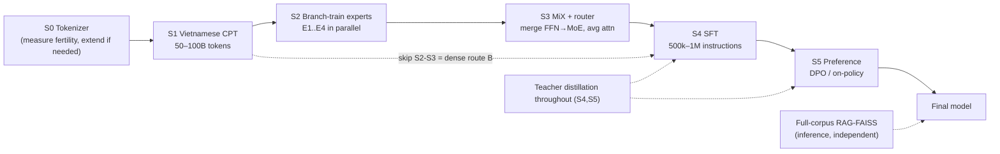
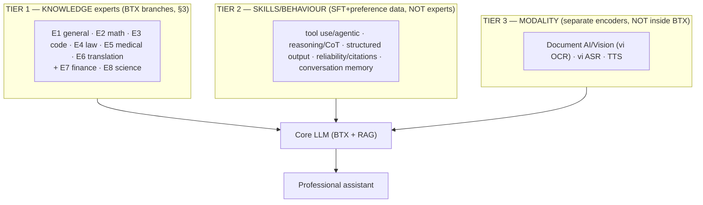

# TK_100 — GPU scale-up plan: building a "large & strong" Vietnamese LLM

*English translation of the Vietnamese original in the repository root.*

> Written: 2026-09-04 · Follows TK_096–099 (Combiner-MoE + RAG, verified on the M4)
> Status: **PLAN** (not yet executed) · Budget: rented cloud GPUs
> Author: Claude (Opus 4.8), at the request of a serious research effort

---

## 0. TL;DR — read this first

- **Don't train from scratch.** For a single language, **continued pretraining (CPT)** of a strong open base is ~20–100× cheaper and gives higher quality. Training a 7B model from scratch needs ~1–2T tokens (~$0.5–2M); CPT needs only ~30–100B Vietnamese tokens (~$5–40k).
- **Recommended base: Qwen3-8B** (Apache-2.0, strong multilingual including Vietnamese, 128K context). The small **Qwen3-1.7B** for fast iteration; **Qwen3-14B** for the "strong" tier.
- **Your idea of "frozen experts → a combining network" is the RIGHT DIRECTION**, and there is an academic version verified at large scale: **Branch-Train-MiX (BTX, Meta, COLM 2024)**. We scale our M4 idea up to exactly BTX.
- **Distillation teacher: Qwen3-32B / Qwen3-235B** (SAME tokenizer as the student → clean logit and on-policy distillation), plus black-box teachers (Claude / GPT / DeepSeek-V3) for hard reasoning data (subject to ToS).
- **6 stages:** tokenizer → Vietnamese CPT → branch-train experts → MiX + router → SFT → preference (DPO/on-policy), with distillation throughout; **keep RAG-FAISS** as an independent grounding lever.
- **3 budget tiers:** Lean ~$15–30k · Serious ~$45–90k · Ambitious ~$150k+. Start with 1 node of 8×H100.
- **Measurable target:** beat SeaLLM-7B-v2.5 (VMLU 53.3) at 8B; approach/beat VNPTAI-14B (55.8) at 14B.

---

## 1. Context & goals

### 1.1 Where we are (M4 results, TK_096–099)
- **Verified** your architecture: several neural experts trained separately → frozen → a **learned combiner** mixes their outputs. The combiner **learns semantic routing by itself** (a dominant diagonal gate); `hybrid` mode is best.
- Verified **2 additive quality levers**: (a) **base strength** (d256→d512 trained fully: fact-top1 10.6%→15.2%) + (b) **RAG store size** (FAISS 8M: →18.2%). See `out/kien_truc_combiner_moe.md`.
- **The real limit:** still toy scale (d≤512, tens of millions of parameters); "understanding" and facts are still invented in free generation. The way up is **open and quantified** — now is the time to scale beyond the M4.

### 1.2 What "large & strong" means — target definition
Proposed **measurable** targets (not vague):
1. **Vietnamese knowledge:** VMLU ≥ 55 (on par with the top domestic 14B) for the 8–14B version.
2. **Conversation/instructions:** beat SeaLLM/Vistral on MT-Bench-vi & Arena-hard-vi (human/LLM judge).
3. **Domains with real value:** Vietnamese law, math, code — reach a usable level.
4. **Grounding:** full-corpus RAG-FAISS reduces fabrication and cites sources (continues the "our complete assistant" work).
5. **Runnable:** served with vLLM, context ≥ 32K, acceptable speed.

---

## 2. Architecture decisions (with honest trade-offs)

### 2.1 Four routes & recommendation

| Route | Description | Cost | Risk | When to choose |
|---|---|---|---|---|
| **A. Dense from scratch** | Train a 7B ourselves from zero | Very high (~$0.5–2M, 1–2T tokens) | High, likely to lose to existing bases | Almost NEVER (one language) |
| **B. Dense CPT** ⭐ | Continue pretraining an open base on Vietnamese + SFT + DPO | Low (~$15–40k) | Low | **Default — highest ROI** |
| **C. BTX (MoE from experts)** ⭐ | B + branch domain experts → mix into an MoE → fine-tune the router | Medium (~$45–90k) | Medium (serving MoE is complex) | **When you want your "many experts"** |
| **D. Joint MoE from scratch** | Train a sparse MoE jointly (Mixtral style) | Very high | High | Not at this stage |

**Recommendation:** **B as the foundation, C as the upgrade.** Do B first (fast, safe), then add C (BTX) to realise your "experts" idea at scale. C is **the academically verified version of our M4 combiner-MoE**.

### 2.2 Combiner-MoE (M4) → Branch-Train-MiX (GPU): a 1-to-1 mapping

Your idea and BTX **share the same framework**; BTX differs in just 2 points for better serving/quality at scale:

| Our Combiner-MoE (M4) | Branch-Train-MiX (BTX) | Notes |
|---|---|---|
| Train each expert separately on 1 domain | Branch from **1 shared seed** → train each domain in parallel | A shared seed = a better start than training each from zero |
| **Freeze all** experts, concatenate every hidden state | Only the **FFNs** become "experts" in an MoE layer; **attention/embeddings are averaged** (shared) | Much cheaper to serve (no need to keep K full models) |
| An external combiner learns gate + head | An **internal router** learns top-2 token routing; light fine-tuning | Router = our "combiner", but placed inside the model |
| Experts **hard-frozen** | Light MoE fine-tuning (router + optionally the whole block) so experts **co-adapt** | 1 principled change; we still ablate the frozen-router version as the proven baseline |

→ **We throw nothing away.** BTX is the combiner-MoE "grown up": same philosophy (branch-train-merge + learned router), just a smarter merge (shared attention) so it runs for real. **RAG-kNN still plugs in as a knowledge expert at inference time** (an independent, verified lever).

### 2.3 Choosing the concrete base

| Role | Model | License | Why |
|---|---|---|---|
| **Main student** | **Qwen3-8B** | Apache-2.0 | Strong multilingual (119 languages, 36T pretraining tokens), already good Vietnamese, 128K context, no commercial restrictions |
| Strong-tier student | Qwen3-14B | Apache-2.0 | When we need to compete with the top of VMLU |
| Fast-iteration student | Qwen3-1.7B | Apache-2.0 | Test the pipeline/hyperparameters cheaply before burning money |
| **Teacher (white-box)** | Qwen3-32B / 235B-A22B | Apache-2.0 | **SAME tokenizer** → CLEAN logit + on-policy distillation (no vocabulary mismatch) |
| Teacher (black-box) | Claude / GPT / DeepSeek-V3 | (per ToS) | Generate the hardest reasoning data; only where the ToS allows distillation |

> **Re-check at kick-off:** when renting GPUs, check the latest Qwen (Qwen3.x), Gemma 4 (now Apache-2.0), Llama 4 (community license, 700M MAU limit). Prefer **Apache-2.0** for commercial freedom and so teacher and student are from the same family (clean distillation).

---

## 3. Concrete expert networks (BTX branches)

Branch from **seed = Qwen3-8B after Vietnamese CPT** (Stage 1). Each branch continues training on its domain, then the FFNs are merged → an MoE layer (top-2), attention averaged.

| # | Expert | Domain / role | Main data sources | Why |
|---|---|---|---|---|
| E1 | **General Vietnamese knowledge** | wiki, news, books, encyclopedias | CulturaX-vi, wiki-vi, Binhvq news, books | Knowledge core & style (replaces the 4 M4 "geography/history/science" experts with 1 strong expert) |
| E2 | **Math & reasoning** | math, logic, problem solving | OpenMathInstruct-2, MetaMathQA-vi, GSM8K/MATH-vi | Reasoning is the weakest point of small Vietnamese models |
| E3 | **Code** | programming + Vietnamese comments | The Stack v2 (filtered), code with Vietnamese comments | Coding ability + structured reasoning discipline |
| E4 | **Vietnamese law & administration** | legal documents, procedures | VBPL/thuvienphapluat (deduplicated, respecting ToS), legal QA | **Real commercial value, high demand, few competitors** |
| E5* | **Biomedical/health (VN)** | general medicine | public health documents, health QA | Optional for tier B; high-demand domain, needs safety care |
| E6* | **Vi↔En translation** | bilingual, two-way translation | PhoMT, MTet, OPUS, back-translation | Optional — **see §12**; usually done with data + SFT first, separate expert only when translation is the core product |

`*` E5/E6 depend on the tier. **Start with 3–4 experts** (the original BTX uses 3–4: knowledge/math/code) — consistent with our M4 lesson: *value comes from the SPECIALISATION and diversity of experts, not from having many redundant experts* (Phase-1 experts with overlapping data → combiner = uniform mixing). Don't multiply experts in the same domain.

> Note vs the M4: on the M4 we split "geography/history/science" into small experts to **prove routing**. At scale, a strong base already absorbs those wiki domains; so merge them into **E1 general** and spend the expert slots on **truly different** domains (math/code/law) — where routing wins big.

---

## 4. Data sources (concrete, with size & license)

### 4.1 Vietnamese CPT (Stage 1) — target **50–100B tokens** after dedup

| Source | Size (vi) | License | Role |
|---|---|---|---|
| **CulturaX** (vi) | tens of B tokens (6.3T total / 167 languages) | ODC-BY / mixed CC | Clean web backbone |
| **MADLAD-400** (vi, clean) | large (3T total / 419 languages, audited) | per CC source | Audited diversity |
| **FineWeb-2** (vi) if available | large, high quality | ODC-BY | Preferred if the vi part is good |
| **Wikipedia-vi** (new dump) | ~1–2 GB | CC-BY-SA | Standard encyclopedia |
| **Binhvq News Corpus** | ~20 GB | public | News, news style |
| **OSCAR-23xx** (vi) | large | CC | More web |
| **The Stack v2** (subset) | varies | permissive only | Keeps code for E3 |
| **Vietnamese legal texts** | per crawl | respect ToS | E4 |
| **Books/literature** (public domain + permitted) | varies | mixed | Long, coherent style |
| **English replay** (from the base's distribution) | ~5–10% of the mix | — | **Against catastrophic forgetting** |

**Mandatory processing:** MinHash-LSH dedup (datatrove); quality filtering with fastText-vi + heuristics (length, odd-character ratio, repetition); **decontamination** against VMLU/eval; tokenise into shards (Megatron mmap / Mosaic streaming). Continues the M4 lesson "the long-form bottleneck is DATA" (packing long passages switches on coherence) — prefer long, whole-passage documents.

### 4.2 SFT (Stage 4) — ~**500k–1M** Vietnamese conversations/instructions

| Source | Size | License | Notes |
|---|---|---|---|
| **Aya** (native vi, human-written) | tens of k | Apache-2.0 | **Gold** — written by real Vietnamese speakers |
| OpenHermes-2.5 (translated + filtered) | ~1M (original) | open | Task diversity; quality-filter after translation |
| UltraChat-200k (translated) | 200k | MIT | Multi-turn conversation |
| Tulu-mix / ShareGPT (translated) | a few hundred k | mixed | Check ShareGPT ToS |
| VLSP / UIT datasets | varies | academic | Standard Vietnamese NLP tasks |
| **Synthetic distillation (Magpie/Evol-vi)** | as generated | self-made | Teacher generates high-quality Vietnamese instructions + answers |
| OpenMathInstruct-2 (translated) | large | open | E2 math |

M4 lesson ("QLoRA: only diverse data helps"): **narrow data BREAKS the model** (it forgot translation/email). Mix ≥ 12 task types + factual anchoring + repetition penalty. Keep that principle at scale.

### 4.3 Preference (Stage 5)
- **UltraFeedback** (translated), ~61k chosen/rejected pairs.
- **Self-built on-policy:** student generates → teacher/reward model grades → pairs (highest quality, matches the student's distribution).
- Aya preference if available.

> **License/ToS warning:** prefer permissive sources (Aya Apache-2.0, distillation from Apache-2.0 Qwen). Data translated from GPT/Claude is bound by the teacher's ToS — get a legal review before commercial use. Legal/news crawling: respect robots/ToS.

---

## 5. Training tactics per stage (with hyperparameters)

### S0 — Tokenizer
- **Measure the fertility** (tokens/word) of the Qwen3 tokenizer on Vietnamese first. If ≲ 1.4× → **keep it** (no embedding retraining, fast & safe).
- If high → extend with ~8–16k Vietnamese merges; initialise new embeddings = mean of the old subword pieces; warm up embeddings at the start of Stage 1. See TK_041.

### S1 — Continual Pre-Training (CPT)
| Parameter | Proposed value |
|---|---|
| precision | bf16 (+ FSDP/TP) |
| seq len | 8192 (extend to 32K at the end of the stage with RoPE scaling / long-context packing) |
| tokens | 50–100B (vi) + 5–10% English replay |
| LR | ~1e-4 → 1e-5 (cosine or WSD), 1–2% warm-up |
| epochs | ~1–2 passes over the vi data |
| global batch | ~2–4M tokens/step |
| framework | **Megatron-LM / TorchTitan / NeMo** |
| checkpoint | resume-safe (continues the optimizer-state lesson of TK_095) |
- **Go/no-go:** VMLU after CPT > original base; stable loss; English skills don't drop (quick check).

### S2 — Branch-train experts (parallel, "embarrassingly parallel")
- From the CPT seed: 4 branches × ~10–20B domain tokens per branch, **run independently in parallel** (no synchronisation → high throughput).
- LR ~5e-5, short cosine; each branch only specialises without forgetting the base (keep a little general replay).

### S3 — MiX + router fine-tuning (the "combiner" step at scale)
- Merge **each expert's FFN → a top-2 MoE layer**; **average** self-attention + embeddings + norms across experts.
- **MoE fine-tune** ~1–5B tokens on mixed data so the router learns token routing. (This is our combiner, placed inside the model.)
- Mandatory ablation (scientific, continuing the M4 work): (a) learned router vs (b) frozen uniform-weight router — re-prove that "routing wins", like the diagonal gate on the M4 (an MoE version of `analyze_gate.py`).

### S4 — SFT
| Parameter | Value |
|---|---|
| epochs | 2–3 |
| LR | 5e-6 – 2e-5, cosine, 3% warm-up |
| packing | packing + Qwen3 chat template |
| data | §4.2 (~500k–1M) + factual anchoring |
| framework | **Axolotl / LLaMA-Factory / TRL** |
- Re-test the M4 thesis: **SFT teaches FORMAT, not KNOWLEDGE** (TK_095) → knowledge must enter in S1/CPT & RAG; SFT only teaches format + behaviour.

### S5 — Preference (alignment)
- **DPO/ORPO** (simple, stable): β≈0.1, LR ~5e-7, 1–2 epochs. Framework: TRL/OpenRLHF.
- Or **on-policy (GRPO/GKD)** to polish reasoning (see §6).

### RAG (in parallel, keep our existing assets)
- Rebuild the FAISS datastore with **the new base's hidden states, full corpus** (inherits `build_faiss_datastore.py`, `KnnExpertFAISS`, `make_knn`, `--backbone`). Remember `omp_set_num_threads(1)` + `KMP_DUPLICATE_LIB_OK`. An independent grounding lever, additive with base strength (proven in TK_099).

---

## 6. Distillation (details) — woven through S4/S5

Three layers, from easy → strong:

1. **Data distillation (sequence-KD) — do it now, any teacher works (including black-box):**
   The teacher generates high-quality Vietnamese instructions + answers / step-by-step solutions (Magpie, Evol-Instruct, reasoning traces) → fed into S4. Cheap, effective, no logits needed.

2. **Logit distillation (white-box) — needs a teacher with the SAME tokenizer:**
   Use **Qwen3-32B/235B** as teacher; add a KL loss (forward/reverse) on the token distribution during SFT. **Same Qwen family ⇒ matching vocabulary ⇒ clean distillation** (this is why §2.3 picks a same-family teacher).

3. **On-policy distillation (GKD/OPD) — highest quality, final polish:**
   The student **generates its own** rollouts → the teacher scores the token distribution → optimise **reverse KL** (mode-seeking). Gives a dense signal on exactly the student's distribution and **cures exposure bias**, which off-policy SFT cannot. Used for reasoning/math/conversation at the end. Frameworks: TRL GKD trainer / DistiLLM / verl-OPD.

> Dual-teacher strategy: **open Qwen3** for logit + on-policy (clean, no ToS hassle); **black-box frontier models** only to generate *data* for the hardest domains (layer 1), where the ToS allows.

---

## 7. Budget, compute & schedule

**FLOP estimate (6·N·D rule):** CPT of 8B on 50B tokens ≈ 6·8e9·5e10 ≈ 2.4e21 FLOPs. H100 bf16 at ~40% MFU ≈ 4e14 FLOP/s ≈ 1.44e18 FLOP per H100-hour → **~1,700 H100-hours** for 50B tokens. On 1 node of 8×H100 ≈ **~9 days**. H100 rental ~$2–3/hour (Lambda/RunPod/Voltage Park/Crusoe…).

| Tier | Scope | H100-hours (est.) | Cost (est.) | Time (1–2 nodes) |
|---|---|---|---|---|
| **A — Lean** (prove the pipeline) | Qwen3-8B, CPT 30–50B, dense route B, SFT+DPO, data distillation | ~5–8k | **~$15–30k** | ~2–3 weeks |
| **B — Serious** ⭐ | 8–14B, CPT 80–100B, **BTX with 4 experts**, SFT+DPO+**logit distillation**, full RAG | ~15–25k | **~$45–90k** | ~4–8 weeks |
| **C — Ambitious** | 14B+/large MoE, 200B+ tokens, full on-policy distillation | 50k+ | **~$150k+** | 2–3 months |

**Kick-off recommendation:** rent **1 node of 8×H100** (enough for 8B/14B with FSDP+TP), do **Tier A first to break in the pipeline**, then move up to B. Don't rent a big cluster before the pipeline runs cleanly on the 1.7B.

---

## 8. Evaluation — go/no-go gates for each stage

| Benchmark | Measures | Target |
|---|---|---|
| **VMLU** (10,880 MCQ, 58 subjects) | Vietnamese knowledge | > 53.3 (SeaLLM) → approach 55.8 (VNPTAI-14B) |
| VLSP / ViMMRC / ViGLUE / VSMEC | standard Vietnamese NLP | beat the base |
| **MT-Bench-vi / Arena-hard-vi** | generation/conversation (LLM judge) | beat Vistral/SeaLLM |
| GSM8K-vi / MATH-vi | math (E2) | clear lift after BTX |
| HumanEval-vi / MBPP | code (E3) | clear lift after BTX |
| **fact_eval (ours)** | fact-top1/5 on content tokens | > baseline; measures the RAG lever |
| RAG grounding | citations, less fabrication | improvement with sources |
| **FLORES-200 / PhoMT / MTet** (§12) | Vi↔En translation (both directions) | **COMET-22 + COMETKiwi** + chrF/BLEU beat the base & NLLB-vi |

- **Decontaminate** eval sets out of training data (mandatory; continues the seed-leak lesson of TK_097).
- Harness: `lm-eval-harness` + official VMLU (`ZaloAI-Jaist/VMLU`) + our `fact_eval.py`; serve evaluation with **vLLM**.

---

## 9. Infrastructure & engineering

| Step | Proposed tools |
|---|---|
| Pretrain/CPT | **Megatron-LM / TorchTitan / NeMo** (FSDP + TP/PP) |
| Data pipeline | **datatrove** (filtering + MinHash dedup), fastText-vi, shard tokenisation |
| SFT/DPO | **Axolotl / LLaMA-Factory / TRL** |
| On-policy/RL | **OpenRLHF / verl / TRL-GKD** |
| Distillation | TRL GKD / DistiLLM / custom |
| Serving & eval | **vLLM** + lm-eval-harness + VMLU |
| RAG | inherits `train_combiner.py`/`build_faiss_datastore.py` (FAISS IVFPQ) |
| Tracking | WandB; checkpoints to S3/R2, resume-safe |

**M4 lessons carried over:** optimizer-state resume (TK_095); datastore↔eval decontamination (separate seeds); FAISS+OpenMP `omp_set_num_threads(1)`; **DO NOT push binaries** to git — checkpoints go to cloud storage.

---

## 10. Risks & honest limits

| Risk | Mitigation |
|---|---|
| **Catastrophic forgetting** (losing English/base skills) | 5–10% replay + moderate LR + English eval at every gate |
| High tokenizer fertility | Measure first; extend the vocabulary only if needed |
| **License/ToS** (ShareGPT, black-box distillation, legal crawling) | Prefer permissive (Aya, Apache Qwen); legal review before commercial use |
| Complex MoE serving | Can stop at **dense B** if simple serving matters more |
| Eval contamination | Mandatory decontamination |
| Budget overrun | Tiers + go/no-go gates; try 1.7B first |
| **Expecting "real understanding"** | An 8–14B base + RAG is *good & usable*, **not yet** frontier; set the right expectations |

**Core honesty:** this is a route **that reliably yields a usable Vietnamese LLM competitive with the domestic top**, built on exactly your "experts + combiner" idea (via BTX) plus our RAG. It **won't** make us GPT-4; that would need many times more scale (data + compute + team). But every lever here **has been verified by us at small scale** and has academic evidence at large scale.

---

## 11. Milestones & concrete next steps

| Milestone | Content | Go/no-go gate | Weeks |
|---|---|---|---|
| **M0** | Infrastructure + data pipeline + tokenizer decision + eval harness; end-to-end trial on **Qwen3-1.7B** | Pipeline runs cleanly end to end on 1.7B | 1–2 |
| **M1** | CPT Qwen3-8B on 30–50B vi tokens | VMLU > original base; English doesn't drop | 3–4 |
| **M2** | SFT + DPO → 8B chat version (route B) | Beats SeaLLM on VMLU + MT-bench-vi | 5–6 |
| **M3** | BTX: branch E1–E4 → MiX → router; routing ablation | Clear lift on math/code/law; routing > uniform mixing | 7–9 |
| **M4** | On-policy distillation + full-corpus RAG-FAISS + polish | Meets the §1.2 targets; grounding with sources | 10–12 |

**To do now (before renting large GPUs):**
1. Decide the **budget tier** (A/B/C) and **GPU provider**.
2. Decide the **base** (check the latest Qwen at kick-off).
3. Review **licenses** of data sources & teachers (permissive first).
4. Build the **data pipeline** (datatrove + dedup + decontamination) — doable locally now, no GPU cost.
5. Run **end to end on Qwen3-1.7B** (M0) to break things in, then open 8B.

---

## 12. Addendum: Vi↔En translation ability

> Follow-up question (2026-09-04): "how do we add English translation?"

### 12.1 Principle: NO separate expert needed to start
The Qwen3 base is **already multilingual** (strong En & Vi) → translation already has a foundation. We **inject translation at 3 points** of the existing pipeline at almost zero extra cost (re-using the data mix + SFT). **Only split off a separate E6 expert when translation is the core product** (translation throughput/quality is the main KPI).

| Insertion point | What to do | Extra cost |
|---|---|---|
| **(1) CPT (S1)** | Mix ~2–5% **bilingual pairs** + quality English text into CPT → better **cross-lingual alignment**, a solid translation base | ~0 (inside the CPT budget) |
| **(2) SFT (S4) — MAIN** | Add **two-way translation tasks** as instructions ("Translate into English: …" / "Translate into Vietnamese: …", sentences & paragraphs) | cheap (inside SFT) |
| **(3) BTX expert E6** *(optional)* | 1 bilingual branch specialised in translation → the MoE router routes translation tokens | ~a few hundred H100-hours |

**Recommendation:** do (1)+(2) in Tier A/B — enough for a good translation model. E6 only when "professional translation" is a product.

### 12.2 Vi↔En bilingual data (concrete, with sizes)

| Source | Size | Notes |
|---|---|---|
| **MTet** (VietAI) | **4.2M** pairs | Largest public, **multi-domain** (education, software UI, news, subtitles, wiki, TED) |
| **PhoMT** (VinAI) | **3.02M** pairs | High quality, with a **standard test set** |
| VLSP2020 EN-VI | ~4M | From public sources |
| IWSLT'15 En-Vi | 133k | Classic, TED talks; familiar test set |
| **OPUS** (OpenSubtitles, WikiMatrix, **CCMatrix**, **ParaCrawl**, **NLLB**) | very large (mined from CC) | Needs heavy filtering (very noisy) |
| **VietMix** | medium | **Code-mixed** Vi-En (English inserted into Vietnamese sentences) — real everyday usage |
| **Self-generated back-translation** | varies | Use our model / NLLB-200 to translate **monolingual** text (huge vi/En corpora) → synthetic pairs, more volume & domain coverage |

**Mandatory quality filtering** (CC bilingual pairs are very dirty): **Bicleaner-AI / LaBSE / COMETKiwi** scoring of semantic similarity; length-ratio filtering; dedup; filter **off-target** outputs (wrong language). → *little-but-clean beats lots-but-dirty* (matches the "only diverse data helps" lesson).

### 12.3 Translation training techniques
- **Two-way instruction format** in SFT (En→Vi and Vi→En), sentences and paragraphs.
- **Document level** (translate whole passages, keeping context + consistent terminology) — LLMs translate much better than sentence by sentence; matches the "long-form bottleneck is data" lesson.
- **Back-translation** to add volume & cover rare domains.
- **Domain anchoring:** specialised **legal (E4) / medical (E5)** translation — high value, re-uses domain data.
- **Language diversity helps** (2025 research): adding a few other languages during translation fine-tuning improves even zero-shot — but prioritise Vi↔En first.

### 12.4 Distillation for translation
- **Data distillation:** teacher **Qwen3-235B** / **NLLB-200-3.3B** / a strong MT model **refines** raw translations → high-quality pairs for SFT.
- **On-policy + reward = COMET:** the student translates → scored by **COMET/COMETKiwi** as the reward → RL (GRPO). The modern way to push translation quality beyond pure SFT.

### 12.5 Translation evaluation
- **Test sets:** **FLORES-200 devtest** (both directions, multilingual standard) + **PhoMT test** + **MTet test** + IWSLT'15.
- **Metrics:** **COMET-22** (main, neural, human-aligned) + **COMETKiwi** (QE, **reference-free**) + chrF + BLEU (lexical, to compare with old reports) + **BLEURT**. Use **COMET-strict** (off-target scored as 0) to catch wrong-language output.
- **Go/no-go:** beat the original Qwen3 base & **NLLB-200** on FLORES Vi↔En; approach dedicated MT models (envit5/VietAI) on PhoMT.

### 12.6 Cost & priority
Translation is the **cheapest addition** in this ticket: (1)+(2) **need no significant extra GPU** (inside CPT+SFT). E6 is optional. → Put translation **into Tier A** at the data+SFT level; consider E6 + COMET reward in Tier B/C if translation becomes a core product.

> **Lesson we've learned:** narrow data once made the model **FORGET translation/email**. So **always keep translation tasks in the overall SFT mix** (don't train translation separately and let it drop out of the mix) → durable translation ability.

---

## 13. Professional assistant architecture: 3 capability tiers

> Follow-up question (2026-09-04): "what experts does a multi-purpose LLM / professional assistant need?"

**Core principle (an M4 lesson we paid for):** value comes from the **SPECIALISATION (distinct data distribution)** of an expert, NOT from the *number* of experts — overlapping experts blur the gate and the combiner degenerates into uniform mixing. So **don't turn everything into an expert.** Split into 3 tiers, each implemented by a DIFFERENT mechanism:

### Tier 1 — KNOWLEDGE experts to ADD (only when the distribution is truly different)
| Expert | Why it deserves its own branch | Data sources | Cost |
|---|---|---|---|
| **E7 Vietnamese finance/accounting/tax** | very specific vocabulary + arithmetic + regulations (VAS/IFRS, tax law, financial statements) | Vietnamese tax/accounting texts, published company reports, financial QA | ~1 BTX branch (~a few hundred H100-hours) |
| **E8 Science/engineering** *(depends on audience)* | technical reasoning differs from wiki prose | textbooks, arXiv (vi/translated), technical documents | ~1 branch |

> DON'T split "business/office, education, marketing" into experts — those are **style**, not separate knowledge → handle in Tier 2 (SFT). Stuffing overlapping experts = wasted GPU + a blurred gate.

### Tier 2 — SKILLS/BEHAVIOUR (DATA, not experts) — **the biggest current gap**
This is what turns "a model that knows Vietnamese" into **a professional assistant**. Mostly **no extra GPU experts**, just data + SFT/preference:

| Capability | Role | Data source / approach |
|---|---|---|
| **Tool use / function calling / agentic** ⭐ | an assistant that *does work*: calls APIs, calendars, search, runs code | `xlam-function-calling-60k`, `glaive-function-calling-v2`, **ToolACE** (26k APIs), APIGen-MT → SFT + validated JSON |
| **Reasoning / CoT** ⭐ | analysis, planning | **distil reasoning traces** from a teacher (Qwen3 has a "thinking mode") — NO expert needed |
| **Structured output** (JSON/tables/SQL) | plug into software, data processing | SFT + **constrained decoding** at inference (vLLM guided) |
| **Reliability: citations, less fabrication, correct refusals** ⭐ | professional = *trustworthy* | SFT + preference (DPO) + **RAG (already have)**; hallucination eval |
| Multi-turn conversation / memory / persona | keep long sessions coherent | conversation SFT + long context (already in the plan) |

⭐ = the three levers that differentiate a "pro assistant" most, which the original plan didn't stress.

### Tier 3 — MODALITY (a DIFFERENT architecture — encoder + projector, **not** FFN experts)
Professionals live in **PDFs/contracts/invoices/meetings** → this is often the *largest* value lever, but it must be a **separate track**, attached to the core LLM:

| Modality | Used for | Approach / Vietnamese references |
|---|---|---|
| **Document AI / Vision (vi OCR, tables, charts)** ⭐ | read contracts, invoices, reports, scans; DocVQA | VLM = vision encoder + projector + core LLM; references **Vintern-1B**, **CATI-VLM** (VN, top DocVQA) |
| **Vietnamese ASR** (speech→text) | meeting recordings, dictation | fine-tune **PhoWhisper** / Whisper-v3 (ViVOS, Common-Voice-vi, VietSuperSpeech) |
| **TTS** (text→speech) | voice assistant | separate vi TTS model, attached at the end |

### Priority order for a "professional assistant"
1. **Tool use/agentic** (T2) — turns "knowing" into "doing". Cheap, biggest impact.
2. **Document AI/Vision OCR** (T3) — professionals drown in documents; strong differentiation, **clearest commercial value**.
3. **Reasoning distillation + reliability/citations** (T2) — quality & trust.
4. **E7 Finance/Accounting/Tax** (T1) — high-demand domain, few competitors.
5. **ASR** (T3) — meetings/voice.

**Bottom line:** the real gap between "an LLM that knows Vietnamese" and "a professional assistant" lies in **Tier 2 (agentic + reliability)** and **Tier 3 (document multimodality)** — NOT in adding knowledge experts. More knowledge experts have diminishing returns; adding tool use + document reading has explosive returns for professional use cases.

---

## 14. Catalogue of professional data sources (HF repo + size + license)

> Follow-up question (2026-09-04): "what about training data — find professional sources too."
> **Selection rules:** prefer permissive licenses (Apache/MIT/CC-BY/ODC-BY); MinHash dedup; quality filtering (fastText/COMETKiwi/LaBSE); **decontaminate against eval**; task diversity. **Lineage warning:** datasets generated from GPT/OpenAI (marked ⚠️GPT) are bound by OpenAI's ToS → legal review before commercial use.

### 14.1 Vietnamese pretraining / CPT (Stage 1)
| Source (HF repo) | Size (vi) | License | Notes |
|---|---|---|---|
| **`HuggingFaceFW/fineweb-2`** ⭐ | vi part of 20TB / 1000+ languages | ODC-BY | **Priority #1** — beats CulturaX/mC4/CC-100; datatrove pipeline |
| `epfml/FineWeb2-HQ` | high-quality subset | ODC-BY | More carefully filtered, good for refined CPT |
| `uonlp/CulturaX` (vi) | tens of B tokens | ODC-BY / mixed CC | Supplement; used by many VN models |
| `allenai/madlad-400` (vi, clean) | large (audited) | per CC source | Diverse, audited |
| `wikimedia/wikipedia` (20231101.vi) | ~1–2 GB | CC-BY-SA | Standard encyclopedia |
| **Binhvq News Corpus** (`binhvq/news-corpus`) | ~20 GB | public | News, news style |
| `bigcode/the-stack-v2` (smol-ids 17 languages / full-ids 600+) | 67TB total | permissive only | Code for pretraining + E3; used by StarCoder2 |
| English replay (sampled from `HuggingFaceFW/fineweb`) | 5–10% of the mix | ODC-BY | Against catastrophic forgetting |

### 14.2 Data for domain experts (Stage 2)
| Expert | Source (HF repo) | Size | License | Notes |
|---|---|---|---|---|
| **E2 Math** | `nvidia/OpenMathInstruct-2` | 14M pairs | CC-BY-4.0 | 1M/2M/5M versions available; translate to vi |
| | `5CD-AI/Vietnamese-meta-math-MetaMathQA-40K-gg-translated` | 40K | open | Already Vietnamese (used on the M4) |
| **E3 Code** | `nvidia/OpenCodeInstruct` | 5M | CC-BY-4.0 | Largest, permissive; 500k already beats Llama-3-instruct |
| | `ise-uiuc/Magicoder-OSS-Instruct-75K` + `…-Evol-Instruct-110K` | 75K+110K | ⚠️GPT (other) | High quality but GPT-3.5 lineage |
| **E4 Vietnamese law** | `GreenNode/zalo-ai-legal-text-retrieval-vn` | 61.4K corpus | open | Has queries + relevance labels (legal RAG) |
| | `YuITC/Vietnamese-Legal-Documents`, `pdt590/…`, `vohuutridung/…` | varies | public | Sourced from thuvienphapluat.vn — **respect ToS** |
| | TVPL benchmark | 224K passages | academic | Large-scale legal retrieval |
| **E5 Vietnamese health** | `hungnm/vietnamese-medical-qa`, `urnus11/Vietnamese-Healthcare` | varies | open | QA from vinmec/health websites |
| | VHCor (26K, 28 specialties), ViMedAQA, ViMQ, ViHERMES | varies | academic | QA/NER/health regulations; **safety care needed** |
| **E7 Finance/Accounting/Tax** | *(open data is still THIN — must build our own)* | — | — | **Strategy:** (a) tax/accounting law ⊂ E4 (tax section of thuvienphapluat); (b) crawl published financial statements (cafef/vietstock/HOSE/HNX — ToS); (c) **synthetic QA distillation** from a teacher anchored on those documents |
| **E8 Science** | science wiki + arXiv (translated) + textbooks | varies | mixed | Split off only for a technical audience |

### 14.3 Vietnamese instruction SFT (Stage 4)
| Source (HF repo) | Size | License | Notes |
|---|---|---|---|
| **`CohereForAI/aya_dataset` / `aya_collection`** ⭐ | tens of K (vi) | Apache-2.0 | **Written by real Vietnamese speakers** — gold |
| `bkai-foundation-models/vi-alpaca` (+`-input-output-format`) | 50K / 25K | ⚠️GPT | Generated by GPT-4/3.5, decent quality |
| `5CD-AI/Vietnamese-Multi-turn-Chat-Alpaca` | multi-turn | ⚠️GPT | Vietnamese multi-turn conversation |
| `MBZUAI/Bactrian-X` (vi) | 67K | open (translated) | alpaca+dolly machine-translated |
| `tmnam20/vi_instruct` | varies | open | Vietnamese instruction compilation |
| Translate + filter: `teknium/OpenHermes-2.5`, `HuggingFaceH4/ultrachat_200k`, `allenai/tulu-3-sft-mixture` | large | open/⚠️ | Task diversity (filter after translation) |

### 14.4 Reasoning / CoT (distilled into SFT — Tier 2)
| Source (HF repo) | Size | License | Notes |
|---|---|---|---|
| `open-thoughts/OpenThoughts3-1.2M` (+`OpenThoughts-114k`) | 1.2M | open | Best available reasoning recipe |
| `open-r1/Mixture-of-Thoughts` | 350K (math/code/science) | open | Verified traces; includes Nemotron |
| Self-distillation from reasoning teachers (Qwen3-thinking / QwQ / R1 lineage) | as generated | — | Generate vi CoT, then filter for correctness |

### 14.5 Tool use / agentic (Tier 2)
| Source (HF repo) | Size | License | Notes |
|---|---|---|---|
| `Salesforce/xlam-function-calling-60k` | 60K | CC-BY (with conditions) | Standard function calling |
| `glaiveai/glaive-function-calling-v2` | large | open | Classic, widely used |
| `Team-ACE/ToolACE` | 26K APIs | open | Diverse APIs, self-evolving |
| APIGen-MT (xLAM) | 5K+ | open | Multi-step trajectories, verifiable |

### 14.6 Preference / DPO (Stage 5)
| Source (HF repo) | Size | License | Notes |
|---|---|---|---|
| `HuggingFaceH4/ultrafeedback_binarized` | 61K | MIT | DPO standard |
| `nvidia/HelpSteer2` (+ **HelpSteer3-Preference**) | large | CC-BY-4.0 | Human-rated, **multilingual, commercial OK** |
| `allenai/tulu-3-pref-*` (Tulu-3 preference mix) | large | ODC-BY | Regenerated at high quality |
| Self-built Vietnamese on-policy | varies | — | Student generates → teacher/RM grades → pairs |

### 14.7 Vi↔En translation (§12) & modality (Tier 3)
- **Translation:** `vietgpt/…`/MTet (4.2M), PhoMT (3M), IWSLT'15, OPUS (CCMatrix/ParaCrawl/NLLB), VietMix (code-mixed) — details in §12.
- **ASR:** `vivos`, `mozilla-foundation/common_voice` (vi), `VietAudio-team/Vietnamese-asr-leaderboard` (combines bud500, vivoice 100K, gigaspeech2, vlsp…), base models `vinai/PhoWhisper` / `nguyenvulebinh/wav2vec2-base-vietnamese-250h`.
- **Vision/DocVQA:** `5CD-AI/Viet-OCR-VQA` (137K images), `5CD-AI/Viet-Doc-VQA` (51,856 textbook pages, grades 1–12), `5CD-AI/Viet-Handwriting-OCR`, ViOCRVQA (28K images / 120K QA), ViTextVQA, ViInfographicVQA; base VLM `5CD-AI/Vintern-1B`.

### 14.8 Three data tasks to do NOW (no GPU cost)
1. **Build the `datatrove` pipeline**: download FineWeb-2-vi + CulturaX-vi → MinHash dedup → fastText-vi filtering → VMLU decontamination → token shards. This is the heaviest part and can be done locally.
2. **Assemble the vi SFT mix** (Aya + vi-alpaca + translated OpenHermes/UltraChat + reasoning + tool use) → quality filtering, dedup, balance task proportions.
3. **Review the license** of every source (mark ⚠️GPT) → finalise a "commercially safe" set vs a "research only" set.

---

## 15. 1-GPU roadmap: train OUR OWN model from scratch (hybrid ~1.3B)

> Decision (2026-09-04): rent only **1 GPU** + **train our own model from scratch** (NO QLoRA, NO external base). Chosen: **~1.3B** · **our hybrid Mamba+Attention architecture** (see the Mamba/SSM-on-M4 work).

### Why ~1.3B (Chinchilla compute maths on 1×H100)
`D≈20·N` tokens, `C≈120·N²`; 1×H100 ≈ 3–4×10¹⁴ FLOP/s. A 1-week budget (~2.4e20 FLOP) → **N≈1.3B, D≈26B tokens, ~$500**. Full training of 1.3B ≈ 21GB (16 bytes/parameter) — fits comfortably in 80GB. **~30×** larger than the M4 models (tens of M) → a REAL small LLM (Pythia-1.4B class), coherent, with real knowledge; it does **not** compete with Qwen3-8B (which eats ~1000× more data).

### Hardware DECIDED: **FPT GPU Container, 1× H100 80GB** (78,592 VND/hour ~$3)
- Enough for full training up to ~3B; 80GB leaves room for long context + batch. H200/B300 cost 2.2× for VRAM we don't need. 1 GPU **doesn't need SXM/NVLink** (NVLink only helps multi-GPU).
- **GPU Container + Persistent disk** (Advanced settings → Volume up to 3TB, Path `/workspace`) → data + checkpoints **survive stop/restart**. The default container disk is "Temporary" (lost on stop) → everything to keep goes under `/workspace`. Provision ~**100–150GB** (data 26–52GB + 1.3B checkpoint ~15.6GB × 2–3). Disk fee 6 VND/GB/hour (~$25/month for 150GB while stopped).
- **Template:** choose an image with **CUDA-devel (`nvcc`)** to build the `mamba-ssm` kernels; the Jupyter/PyTorch template is OK if it has nvcc, otherwise **Custom template → NGC PyTorch** `nvcr.io/nvidia/pytorch:24.xx-py3`. Check: `nvcc --version && python -c "import torch;print(torch.cuda.is_available())"`.
- **Money-saving multi-session workflow:** train ~24h → **STOP the container** (GPU billing stops, `/workspace` kept) → next day start + `--init-from` to resume seamlessly. 1.3B/26B ≈ 7 sessions of 24h instead of continuous rental.
- **One-command environment setup:** `bash scripts/setup_container.sh` (installs mamba-ssm + Claude Code + points caches/config to `/workspace`).
- VMLU eval: on the same machine (vLLM/transformers) or a separate ½ H100 (34,171 VND/hour).

**Why FPT (despite being ~40–50% more expensive than global providers):** Hanoi data centre → fast/stable data uploads from Vietnam + data residency; **VND/VAT invoices**; less payment friction. Reference 1×H100 on-demand prices in 2026 (USD/hour) for later rounds: Vast.ai ~$1.5–1.9 · Lium ~$1.5 · RunPod $1.99 (PCIe)/$2.69 (SXM) · FPT $3.02 · median $3.41 · Lambda ~$4. The trainer **can resume** → cheap interruptible tiers (Vast/spot) are usable when optimising cost; for the whole 1.3B run the FPT↔cheapest difference is only ~$200–250.

### Architecture & script: `scripts/train_hybrid_scale.py` (built & smoke-tested)
Re-uses **our Mamba + Attention blocks** (`train_mamba.MambaBlock`/`RMSNorm`), upgraded for GPU:
- **Fast CUDA path:** uses `mamba-ssm` (selective-scan kernel) when installed; if NOT → falls back to our pure-PyTorch block (correct, runs on MPS/CPU for testing). **Install on the H100:** `pip install mamba-ssm causal-conv1d`.
- Attention = **RoPE + SDPA (FlashAttention) + GQA**; bf16 · grad checkpointing · fused AdamW · cosine LR + warm-up · grad accumulation · grad clipping · optimizer-state resume · bits eval · tok/s + MFU logging.
- Dataloader reads **uint16 shards** from `build_pretrain_pipeline.py`, packing contexts contiguously.
- Target config ~1.3B: `--d 2048 --layers 48 --attn-every 8 --heads 16 --d-state 16` (prints the real parameter count for tuning).

### 1-GPU recipe (in order)
1. **Prepare data:** `build_pretrain_pipeline.py --sources fineweb2 culturax wiki --limit … --out data/pretrain_vi` → ~26–30B clean tokens (tokenizer `bpe_v1`, fertility 1.24, **no new vocabulary needed**).
2. **GPU smoke test, 5–10 steps** (confirm the `mamba-ssm` kernels match + tok/s + MFU) BEFORE the long run.
3. **Pretrain from scratch**: `train_hybrid_scale.py --data data/pretrain_vi --ctx 2048 --bs 8 --grad-accum 8 --tokens 18e9 --out checkpoints/hybrid_1p3b.pt` (resumes seamlessly if interrupted). **CORRECTION (TK_102, measured on a real H100):** DO NOT use `--grad-ckpt`/`--compile` — both are SLOWER than the baseline (torch.compile breaks around the Mamba kernel; grad checkpointing trades speed for VRAM that is already spare at 64/80GB). In practice **~24–26K tok/s, MFU ~20%** → 18.8B tokens ≈ **~8.7 days ≈ ~$630** (not the ~1 week/$500 originally estimated — real MFU is lower than assumed).
4. **SFT:** `train_hybrid_sft.py --init-from <pretrain>.pt --data data/sft_vi/sft_mix.jsonl` (loads the pretrained model → loss masked to assistant tokens only, `Hỏi:/Đáp:/<EOS>` template).
5. **RAG-FAISS** grounding (re-use `build_faiss_datastore.py` with the new backbone).
6. **Measure:** `eval_vmlu.py` at each milestone; held-out bits during training.

### Smoke test passed (locally, MPS, fallback)
Model built · reads 3 shards · forward/backward/step · LR warm-up→cosine · bits fall 14.99→14.71 · save + **seamless resume** ✓. The pipeline is ready; just switch to an H100 + `mamba-ssm` to run at real scale.

### Honest limits
1 GPU + from scratch = **our OWN ~1.3B Vietnamese foundation model** — coherent, knowledgeable, far beyond the M4 toys; **not** a billion-dollar model. To go stronger: train on more tokens (diminishing returns), or add GPUs (re-opening the BTX route of §2–3).

---

## Appendix: references (looked up 2026-09)
- Qwen3 / best open bases in 2026 — [HF: Open-Source LLMs 2026](https://huggingface.co/blog/daya-shankar/open-source-llms), [Best Open-Source LLMs 2026](https://acecloud.ai/blog/best-open-source-llms/)
- Branch-Train-MiX (BTX) — [arXiv 2403.07816](https://arxiv.org/abs/2403.07816), [OpenReview COLM 2024](https://openreview.net/forum?id=nqLAuMOF6n)
- Vietnamese corpora — [CulturaX](https://www.researchgate.net/publication/401322623_CulturaX_A_Cleaned_Enormous_and_Multilingual_Dataset_for_Large_Language_Models_in_167_Languages), [Sailor (SEA)](https://arxiv.org/pdf/2404.03608), [Vi-Mistral-X CPT](https://arxiv.org/pdf/2403.15470)
- VMLU benchmark — [GitHub ZaloAI-Jaist/VMLU](https://github.com/ZaloAI-Jaist/VMLU), [ACL 2025](https://aclanthology.org/2025.acl-long.563/)
- On-policy distillation / GKD — [GKD (arXiv 2306.13649)](https://arxiv.org/pdf/2306.13649), [MiniLLM (2306.08543)](https://arxiv.org/pdf/2306.08543), [Awesome On-Policy Distillation](https://github.com/nick7nlp/Awesome-LLM-On-Policy-Distillation)
- SFT/preference data — [PhoGPT](https://arxiv.org/pdf/2311.02945), [DPO methods (HF)](https://huggingface.co/blog/pref-tuning)
- Vi↔En translation — [PhoMT (arXiv 2110.12199)](https://arxiv.org/abs/2110.12199), [MTet (arXiv 2210.05610)](https://arxiv.org/pdf/2210.05610), [VietMix code-mixed (2505.24472)](https://arxiv.org/pdf/2505.24472), [OPUS](https://opus.nlpl.eu/)
- LLM translation eval & fine-tuning — [FLORES-200](https://www.emergentmind.com/topics/flores-200-benchmark-dataset), [Language diversity in translation FT (2505.13090)](https://arxiv.org/html/2505.13090v2)
- Tool use / agentic (Tier 2) — [xLAM (NAACL 2025)](https://aclanthology.org/2025.naacl-long.578.pdf), [ToolACE (arXiv 2409.00920)](https://arxiv.org/abs/2409.00920)
- Vietnamese modality (Tier 3) — [PhoWhisper ASR (arXiv 2406.02555)](https://arxiv.org/pdf/2406.02555), [VLMs for Vietnamese (review)](https://www.techscience.com/cmc/v89n1/68373/html)
- Pretraining/code/math data (§14) — [FineWeb-2 (HF)](https://huggingface.co/datasets/HuggingFaceFW/fineweb-2), [The Stack v2 (HF)](https://huggingface.co/datasets/bigcode/the-stack-v2), [OpenMathInstruct-2 (HF)](https://huggingface.co/datasets/nvidia/OpenMathInstruct-2), [OpenCodeInstruct (HF)](https://huggingface.co/datasets/nvidia/OpenCodeInstruct)
- Vietnamese domain data (§14) — [vi-alpaca (bkai)](https://huggingface.co/datasets/bkai-foundation-models/vi-alpaca), [Zalo legal retrieval](https://huggingface.co/datasets/GreenNode/zalo-ai-legal-text-retrieval-vn), [vietnamese-medical-qa](https://huggingface.co/datasets/hungnm/vietnamese-medical-qa), [Viet-Doc-VQA (5CD-AI)](https://huggingface.co/datasets/5CD-AI/Viet-Doc-VQA)
- Reasoning & preference (§14) — [OpenThoughts2-1M](https://huggingface.co/datasets/open-thoughts/OpenThoughts2-1M), [Mixture-of-Thoughts (open-r1)](https://huggingface.co/datasets/open-r1/Mixture-of-Thoughts), [HelpSteer3-Preference (arXiv 2505.11475)](https://arxiv.org/html/2505.11475v2)
