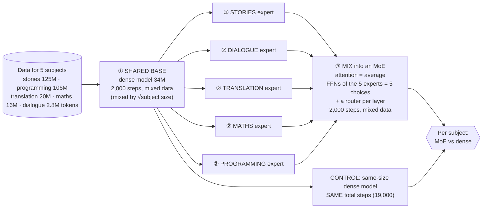
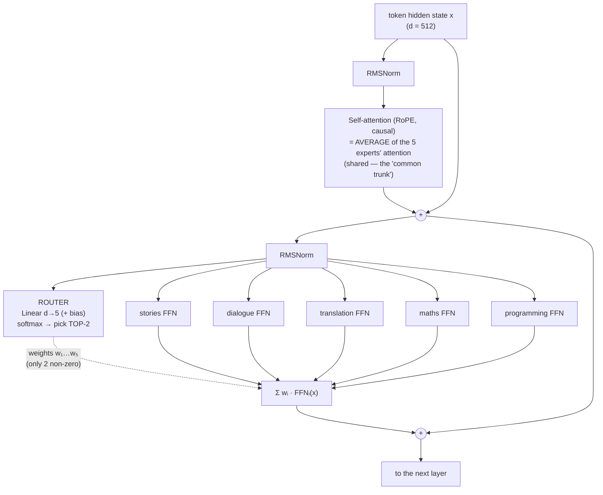
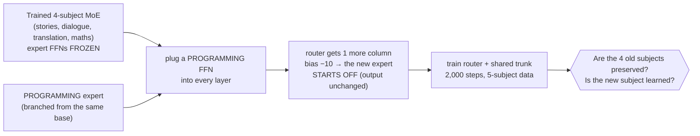
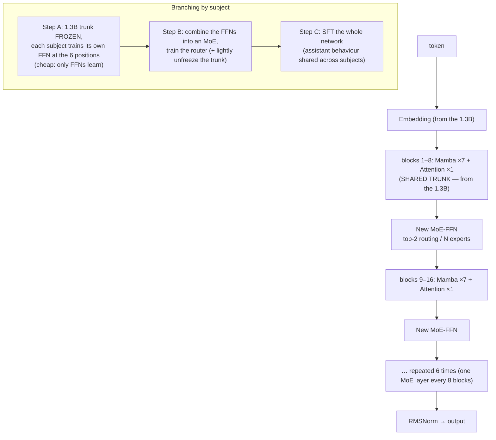

# TK_104 — Research: "a child moving up through school grades": learning by grade, revision, multi-pass thinking, growing over time

*English translation of the Vietnamese original in the repository root.*

> Started 2026-10-01. Follows [TK_103](TK_103_VAST_TRAIN_HANDOFF.md) (the 1.3B model is paused — the goal is now RESEARCH).
> Code: `curriculum/gen_toan.py` (data), `curriculum/loop_lm.py` (model + experiments), `curriculum/analyze.py` (tables).
> Raw results: `out/curriculum/*.json` (+ logs in `out/curriculum/logs/`).

## 1. Research questions

1. Is learning by grade (easy → hard) better than random mixing, with the same data and the same compute?
2. How much forgetting does revising old lessons prevent?
3. Does letting the model "think for more passes" let it solve harder problems?
4. Does "growing" (adding layers when moving up a grade) save compute versus a fixed-size model?

## 2. Design

- **Primary-school maths synthesised in code** (`gen_toan.py`): problems + step-by-step solutions, answers verified exactly.
  Grade 1 (1 step, numbers up to 10) → grade 5 (4 steps, numbers up to 1,000, 4 operations); **grade 6 (5–6 steps) is never trained** — used only to measure going beyond the curriculum. 40K training problems + 500 test problems per grade, test disjoint from train, every calculation re-checked.
- **Looped-core model** (`loop_lm.py`, 4.74M parameters, character-level): a 2-layer prelude → **a 2-layer core looped r times** (re-injecting the problem each pass: `s = core(s + e)`) → a 2-layer coda. Trained with random r in 1..R. Transformer blocks (RoPE, SwiGLU); a Mamba core was left for later (the sequential scan on the Mac is too slow).
- **Measurement:** greedy decoding, correct = "Đáp số: N" ("Answer: N") matches exactly, 300 problems per grade, at r = 1, 2, 4, 8(, 16).
- **Infrastructure:** 1×H100 (700W), 9–10 experiments run IN PARALLEL (small models use only part of the GPU), 6,000 steps × batch 64, ~15–50 minutes per batch of runs. Trap: 10 experiments evaluating at once with batch 250 → overflowed 80GB → evaluation batch lowered to 100.

## 3. Round 1 results (2026-10-01)

**Q1 — final %, r=4, average of 2 seeds:**

| Schedule (6,000 steps) | Grade 1 | Grade 2 | Grade 3 | Grade 4 | Grade 5 | Grade 6 |
|:---|:---|:---|:---|:---|:---|:---|
| **Random mixing** | **100** | **100** | **100** | **97** | **97** | 6 |
| By grade + 30% revision | 100 | 93 | 96 | 14 | 19 | 2 |
| By grade, no revision | 4 | 2 | 6 | 1 | 35 | 2 |

**Q2 — forgetting** (grade k: right after finishing it → at the end): without revision grade 1 **100→4%**, grade 3 **99→3%**; with 30% revision grade 1 **100→100%**, grade 3 **97→94%**.

**Q3 — number of passes at inference (step-by-step written solutions):** a model trained with 1–4 passes is nearly flat in r (grade 4: 13/17/14/10% at r=1/2/4/8), grade 6 ~1% at every r. A model trained with a fixed 1 pass is actually better at grades 4–5 (38–46% at r=1) but collapses when r>1.

**Q4 — growing on the by-grade + revision schedule:** core 1→2 layers (89% compute) falls between a fixed 1 layer (72%) and 2 layers (100%) — whatever compute is saved is lost in accuracy.

## 4. Round 2 results (design fixed based on round 1)

**1b — move up a grade on passing an exam** (a separate 100-question test every 200 steps; move up at ≥95% or when stuck >2,400 steps; 30% revision):
grades 1–5 = 100 / 92 / 79 / 19 / 2% — still far behind random. Grade 1 passes at step 400–600, grade 2 takes ~2,000–2,400 steps, grade 4 can't pass (one seed had to "time out" at 73%) → almost no time left for grade 5.

**3b — silent thinking (write only "Answer: N", no solution):**

| How the problem is answered | Grade 3 | Grade 4 | Grade 5 |
|:---|:---|:---|:---|
| **Write a step-by-step solution** | **100** | **97** | **97** |
| Silent thinking, best (trained 1 pass, r=1) | 58 | 4 | 3 |
| Silent thinking, trained 1–8 passes: r=1 → r=16 | 39 → **44** | 3 | 2–3 |

Only the model trained with 1–8 passes shows a weak "think longer → better" signal (even r=16 beyond the trained range), but every looped model is still worse than a plain 1-pass model.

**4b — growing on the random schedule:** **89%** compute, grades 3–5 = 100 / 98.7 / 96.8% vs fixed 100 / 97.0 / 97.0% → **~11% compute saved with no loss of accuracy.**

## 5. Conclusions (after 2 rounds)

1. **Learning by grade does NOT help** a gradient-trained network on this task (neither equal time per grade nor moving up on passing); random mixing wins clearly. Plausibly: the hard problems can still be learned DIRECTLY, so detouring through easy ones just costs steps. Consistent with BabyLM results.
2. **If learning by grade, revision is MANDATORY** — without revision everything is forgotten (100→4%).
3. **"Thinking in words" (writing a step-by-step solution) is far stronger than "silent thinking"** (97% vs 3% on 4-step problems). Looping the core gives only a weak signal. → For deep reasoning, the biggest lever is teaching the model to WRITE OUT the solution.
4. **Growing really helps** (~11% compute) when the schedule is good.

**Limitations:** one subject (synthetic maths), a 4.7M model, 1–2 seeds per config, a simple looped-core design (additive, no Huginn-style adapter); the grade-6 failure may be due to solutions LONGER than anything seen (length generalisation) rather than a lack of depth.

## 6. Next directions

- Test where grade-by-grade learning CAN help: skills that CAN'T be learned directly from scratch (e.g. can grade 5 alone be learned from scratch? long chains of grade 6+).
- A better looped core: Huginn-style input injection (concatenation + adapter), truncated backprop, longer training.
- A second subject: **Vietnamese–English communication by level**, applying the lessons: quality mixed data, teach step-by-step presentation, grow over time.

## 7. Round 3 — layer-wise plasticity (the user's idea, evening of 2026-10-01)

**Hypothesis:** split the network into layers with different "stiffness" — lower layers nearly frozen (keep old knowledge), upper layers change freely (learn new things) → learn by grade without forgetting. Close to layer-wise LR decay (ULMFiT), FreezeOut, and critical periods in the brain.
**Design:** grade 1: all layers learn freely (critical period); from grade 2: (a) **gradual decay** — the learning rate of the 6 blocks scales ×0.01 → ×1 from bottom to top; (b) **gradual freezing** — after grade k, freeze the bottom k blocks. The embedding (shared with the output layer) stays free. With/without 30% revision. (`--plasticity lrdecay|freeze`)

| Learning method | Grade 1 | Grade 2 | Grade 3 | Grade 4 | Grade 5 |
|:---|:---|:---|:---|:---|:---|
| By grade, no revision | 4 | 2 | 6 | 1 | 35 |
| + layer-wise decay | 3 | 2 | 6 | 1 | 2 |
| + gradual freezing | 11 | 3 | 7 | 3 | 2 |
| By grade + 30% revision | **100** | **93** | **96** | **14** | **19** |
| + revision + decay | 99 | 6 | 13 | 1 | 1 |
| + revision + freezing | 99 | 61 | 64 | 2 | 2 |

Learning new material (grade k measured right after it is learned): decay gets grade 2 to only **4%** (control 70%); freezing gets grade 2 to 64% but grade 4 to only **5%** with 3/6 blocks frozen.

**Conclusion: NEGATIVE.** Stiffening the lower layers does NOT preserve old material (still forgets 100→3–11%) and also destroys the ability to learn new material; combined with revision it is even WORSE than revision alone. Plausible reason: "grade 1" knowledge doesn't live in the lower layers — it's spread across the whole network (the embedding/output layer stays free), and while learning grade 1 the lower layers only carry features SPECIFIC to grade 1 (numbers ≤10, only +/−), not general features → freezing them freezes the wrong thing.
→ Fix (round 4): let the lower layers learn TRULY GENERAL features first (kindergarten: read problems from every grade, no solutions) and only then freeze; give new knowledge its OWN PLACE (each grade grows a new block, old blocks frozen — LLaMA-Pro style).

## 8. Round 4 — separating "general features" from "per-grade knowledge" (early morning, 2026-10-02)

Fixing round 3 per the user's hint ("lower layers keep general features"):
- **Kindergarten** (`--preschool 600 --freeze-bottom`): the first 600 steps (within the 6,000 budget) only READ problems from every grade (language modelling on problems, NO solutions) → PERMANENTLY freeze the embedding + the 2 prelude blocks.
- **Block growth** (`--expand 1 --K 1`): on each grade change, freeze all old blocks and add 1 new block (identity-initialised) on top — new knowledge gets its own place (the LLaMA-Pro idea).

| Learning method (final %, r=4) | Grade 1 | Grade 2 | Grade 3 | Grade 4 | Grade 5 |
|:---|:---|:---|:---|:---|:---|
| Random mixing | 100 | 100 | 100 | 97 | 97 |
| **Kindergarten + frozen reading layers, random mixing** | **100** | **97** | **99** | 74 | 67 |
| By grade + 30% revision | 100 | 93 | 96 | 14 | 19 |
| Kindergarten + frozen reading layers, 30% revision | 100 | 82 | 87 | 20 | 15 |
| Block growth, revision 0% / 10% / 30% | 4 / 54 / 95 | 1–2 | 3–5 | 1–2 | 0–1 |

**Conclusions:**
1. **General features exist and can be separated.** The lower layers learn only to READ (never seeing a solution) and are then permanently frozen — the upper part still solves grades 1–3 at 97–100%. This is the first support for "lower layers = a general foundation that can stay fixed". (Grades 4–5 drop to 67–74%: partly because 10% of the steps went to kindergarten.)
2. **Growing blocks on top fails both ways:** a block on top can't learn the new grade (grade 2: 3%) AND still overwrites the old grades (every problem passes through it). New knowledge must slot in MIDWAY through the computation, and needs a ROUTING mechanism so the new block only switches on for new problems.
3. **Methodological bug found:** the cosine learning rate decays throughout training → with grade-by-grade learning, grades 4–5 land when the learning rate ≈ 0 (grade 4 only learned 18–27% during its phase). Every "by grade vs random" comparison in rounds 1–4 is biased toward random → round 5 re-tests with a fair schedule.

## 9. Round 5 — a fair learning-rate schedule: REVERSES the Q1 conclusion

`--lr-sched wsd` = flat, decaying only over the last 10% (for both methods); `--lr-sched stage` = one cycle per grade (restart the learning rate like a new school year). `--only-level 5` = train grade 5 only, from scratch.

| Learning method (final %, r=4) | Grade 1 | Grade 2 | Grade 3 | Grade 4 | Grade 5 |
|:---|:---|:---|:---|:---|:---|
| Random mixing, cosine | 100 | 100 | 100 | 97 | 97 |
| Random mixing, flat | 100 | 100 | 100 | 98 | 97 |
| By grade + 30% revision, cosine (round 1) | 100 | 93 | 96 | 14 | 19 |
| **By grade + 30% revision, flat** | **100** | **100** | **100** | **99** | **99** |
| By grade + 30% revision, one cycle per grade | 100 | 99 | 100 | 94 | 89 |
| Grade 5 only, from scratch | 3 | 1 | 5 | 2 | 99 |

**Conclusions:**
1. **"Learning by grade loses" in rounds 1–2 was an ARTIFACT** — the cosine schedule pushed the hard grades to when the learning rate ≈ 0. With a fair schedule, by grade + 30% revision is **equal/slightly better** than random mixing (grades 4–5: 99% vs 97%). Methodological lesson: every curriculum experiment must decouple the learning-rate schedule from data order (consistent with 2025 research that LR decay "wastes" the best data when it is placed last).
2. **Revision is still mandatory** (see round 6 for the minimum amount).
3. **Lower grades are NOT prerequisites on this task:** training grade 5 directly reaches 99%. → This synthetic maths "can be learned directly"; to see real cumulative value we need a task where higher skills can only be learned once lower skills exist (e.g. higher grades WITHOUT detailed solutions for sub-steps).
4. RELATIVE comparisons within the same cosine schedule (round 3 layering, round 4 block growth) remain valid.

## 10. Round 6 — amount of revision, little data, Mamba core (flat schedule)

| Learning method (final %, r=4) | Grade 1 | Grade 2 | Grade 3 | Grade 4 | Grade 5 | Grade 6 |
|:---|:---|:---|:---|:---|:---|:---|
| Random mixing (2 seeds) | 100 | 100 | 100 | 97.5 | 96.2 | 0.8 |
| **By grade + 30% revision (2 seeds)** | **100** | **99.8** | **100** | **98.8** | **97.8** | 1.0 |
| By grade + 10% revision | 100 | 97 | 99 | 85 | 93 | 0.7 |
| By grade, no revision | 4 | 2 | 9 | 2 | 88 | 3 |
| **Little data (2,000 problems/grade): random** | 100 | 100 | 100 | **94** | **89** | 2 |
| Little data: by grade + 30% revision | 100 | 90 | 95 | 44 | 43 | 1 |
| Attention core, random (cosine) | 100 | 100 | 100 | 97 | 97 | 5.8 |
| All Mamba2 (5.8M parameters) | 100 | 100 | 100 | 99.3 | 99.3 | 1.0 |
| Hybrid: Mamba2 + 1 attention block | 100 | 100 | 100 | 98.7 | 96.7 | 1.7 |

**Conclusions:**
1. Fair schedule: by grade + 30% revision ≥ random (confirmed over 2 seeds). 10% revision is not enough; no revision forgets everything.
2. **WITH LITTLE DATA, learning by grade LOSES BADLY** (grades 4–5: 44% vs 89–94%): each grade's 2,000 problems are crammed into 1,200 steps (~38 repetitions per problem) → memorisation instead of learning the method; random mixing spreads repetitions evenly (the spacing effect). Counter to the intuition "with little data, learn sequentially".
3. **Mamba is slightly better at grades 4–5 but grade 6 is still ~1%** → the grade-6 failure is not due to attention's positional encoding.
4. **Grade-6 diagnosis:** the model computes each operation CORRECTLY but writes at most 4 steps (= the longest it has seen): it drops/merges sentences to fit the pattern → a PROGRESS-TRACKING error, not a calculation error. E.g. a 6-step problem → model: "132 - 7 = 125. 125 - 15 = 110. 110 : 2 = 55. 55 - 1 = 54" (skips sentences, pairs one sentence's number with another's operation). → try SENTENCE-QUOTING solutions (`--quote`): each step restates the problem sentence being processed.

## 11. Round 7 — DEPTH: solving problems LONGER than anything learned (grade 6 = 5–6 steps, trained ≤ 4 steps)

Diagnosis (round 6): the model computes each operation correctly but drops/merges sentences to fit the ≤ 4-step pattern → a PROGRESS-TRACKING error.
Tried 4 ways of "working sentence by sentence like a person", all with random mixing + flat schedule, 6,000 steps; measuring grade 6 % (r=4):

| Solution format | Grade 5 | **Grade 6** | Grades 7–8 |
|:---|:---|:---|:---|
| Operations only (control, 2 seeds) | 96 | 0.8 | 0–2 |
| **Quote the problem sentence at each step** ("Lan dropped 57 fruits: 92 - 57 = 35.") — attention, 2 seeds | 92–96 | **14 / 30** | 0–1 |
| Quoting — all Mamba2 | 99 | 0.7 | — |
| Quoting — hybrid Mamba2 + 1 attention | 97 | 3 | — |
| Random-start sentence labels + quoting (2 seeds) | 95 | 14 / 14 | — |
| Sentence labels only (no quoting) | 93 | 1.7 | — |
| Quoting + 0–4 EXTRA distractor sentences (2 seeds) | 93–97 | 10 / 1 | — |

**Conclusions:**
1. **Quoting sentences is the only real lever** for depth: grade 6 from ~1% → 14–30% (×15–30). But no far extrapolation: grades 7–8 still ~0.
2. **Quoting needs ATTENTION** (content lookup): pure Mamba is best in-distribution (grades 4–5: 99–100%) but CAN'T use quoting (0.7%) — matching the known "copy/lookup" weakness of SSMs. → a hybrid architecture is right in principle, but 1 attention block at the bottom is not enough.
3. Error analysis (labels + quoting, 100 grade-6 problems): 58 missing steps, 21 calculation errors, 21 correct. The model writes the LABELS sequentially correctly (30, 31, 32…) but the CONTENT copied after "(31)" is actually sentence (32) → it still looks up by POSITION, not by label. Extra sentences (decoupling sentence count from step count) don't break this shortcut.
4. **Proposed next direction — "rewrite the problem after each step"** (like a person crossing out finished sentences): at each step the model rewrites the REMAINING problem with the new number ("Remaining: Lan has 102 fruits. Then …") → every step is always "process the FIRST sentence of a shrinking problem" — every step resembles what was learned. Expensive (solution length ~quadratic) but the best-founded way to extrapolate to arbitrary length; needs KV-cached evaluation.

### 11b. Depth — further attempts (2026-10-02)

| Model (quoting, random mixing, flat schedule) | Grade 5 | Grade 6 | Grade 7 | Grade 8 |
|:---|:---|:---|:---|:---|
| Quoting (6,000 steps) | 92–96 | 14–30 | 0–1 | 0–1 |
| **+ randomised positions** (Ruoss 2023), 2 seeds | 89–90* | **32–37** | 0–1 | 0 |
| + randomised positions, trained 12,000 steps | 99 | 19 | 0 | 0 |
| + randomised positions, wider (d=384) | 86 | 15 | 1 | 0 |
| Rewrite the remaining problem after each step | 95 | 0.5 | — | — |

*measured with `eval_deep.py`; at the end of training the same model measured 61–67% (different random positions → large fluctuation at grade 5).

**Depth conclusions:**
- The model has a **"count habit"**: it always forces the solution into the number of steps / sentences it has seen — even when rewriting the problem (dropping sentences so the remainder is ≤ 3 sentences as in training).
- Randomised positions + quoting is best (grade 6 ~35%) but **doesn't extrapolate far** (grades 7–8 = 0).
- **Training longer / a wider model makes extrapolation WORSE** (grade 6: 37 → 19 / 15%) even as grade 5 improves — the tighter the fit to seen lengths, the less ability to go beyond. Extrapolation peaks EARLY.
- → "Thinking deeper than what was learned" does NOT come from more training/more size at this scale. Remaining well-founded directions: (a) show A FEW longer problems ("learning ahead" — which is how people actually learn), (b) an architecture with real loops/recursion (the model calls itself on sub-problems), (c) external tools (a calculator / a scratch memory).

## 12. The Vietnamese–English COMMUNICATION subject (2026-10-01 → 02)

**Data:** parallel en/vi TinyStories (`nampdn-ai/tinystories-vietnamese`, 300K stories) + **DailyDialog translated into colloquial Vietnamese by Gemma 4 26B** (`curriculum/giaotiep/translate_dd.py` → `data/giaotiep/dd_envi.jsonl`, **12,196 dialogues**, 179 dropped due to mismatched turn counts) + two-way translation pairs (stories + individual turns). 148M-token corpus, byte-level BPE 16K (3.9 characters/token). A GPT model (the Transformer blocks of `loop_lm.py`), 8,000 steps × 64 × 512, random mixing.

**EVALUATION TRAP:** DailyDialog has **43% of test dialogues sharing turns with train** — the model copies original sentences VERBATIM ("We met them in Bermuda last May."). `eval_gt.py` only scores **535/937 CLEAN dialogues** (no turn of ≥4 words appears in train). Scores on the dirty set are inflated (`*_eval_bam.json`).

**Results on the CLEAN set** (Gemma grades 1–5; the original sentences ≈ 4.8–4.9; chrF = per-turn translation):

| Model | Training dialogues | Vietnamese naturalness | Vietnamese contextual fit | English naturalness | chrF En→Vi | chrF Vi→En |
|:---|:---|:---|:---|:---|:---|:---|
| v1 · Vietnamese only 33M | 4.4K ×8 | 2.49 | 2.41 | — | — | — |
| v1 · bilingual 33M | 4.4K ×8 | 2.86 | 2.79 | 2.48 | 14.5 | 16.9 |
| v1 · bilingual 100M | 4.4K ×8 | 2.87 | 2.66 | 2.30 | 14.9 | 19.2 |
| v1 · growing 33M | 4.4K ×8 | 2.75 | 2.71 | 2.37 | 13.7 | 17.0 |
| v2 · bilingual 33M | **10.3K ×3** | 2.77 | 2.73 | **2.90** | 18.9 | 19.5 |
| v2 · growing 33M (−25% compute) | 10.3K ×3 | 3.20 | 3.11 | 2.47 | 16.4 | 16.8 |
| **v2 · bilingual 100M** | 10.3K ×3 | **3.32** | **3.24** | 2.76 | **19.4** | **24.3** |

**Conclusions:**
1. **Bilingual training HELPS Vietnamese** (on the clean set): 2.49 → 2.86 naturalness at the same 33M size — learning English as well doesn't hurt and even transfers to Vietnamese (unlike the hasty conclusion on the dirty set).
2. **More dialogue data + fewer repetitions** (4.4K×8 → 10.3K×3) is the biggest lever: translation +4–5 chrF; the 100M model's Vietnamese 2.87 → 3.32. With 4.4K×8 the large model MEMORISES (val rises) so it's no better than the small model; only with enough data does the large model shine.
3. **Growing** works well a second time: v2 33M growing (Vietnamese 3.20) ≈ close to 100M (3.32), clearly better than a plain 33M (2.77) with less compute — but worse at English and translation.
4. Still far from the originals (3.3 vs 4.9): frequent topic drift ("was recommended to visit Washington, New York" → "Then I'll definitely go to Malaysia."), translation only captures the gist of short sentences.

**Next for communication:** more dialogues (Gemma generates NEW dialogues by topic — no test overlap; native Vietnamese sets), 100M+ models trained longer, a small SFT in assistant format; multi-turn evaluation.

## 13. BTX architecture — combining specialist networks (the user's idea, 2026-10-02)

> Idea: one expert network per subject — programming, stories/style, email, maths, conversation, science… →
> freeze → combine through a connecting layer → train on mixed data. In the literature this is called **BTX — Branch-Train-MiX**
> (Meta 2024); a variant combining frozen models through a connecting layer: **CALM** (Google 2024). An earlier small version on the M4:
> the combiner-MoE experiments (a real win — the combiner learned semantic routing by itself).
> Code: `curriculum/btx/btx.py` · run schedule: `/workspace/run_btx.sh` on the box.

### 13.1 The 3-step process

- Step ②: each expert **branches from the SAME base** (to share a language foundation), learns ≤ 3,000 steps on ONLY its subject, with **early stopping** at the best point on that subject.
- Step ③ has 2 variants: **(a) frozen expert FFNs** — only the router + attention + norms learn (exactly the "freeze then combine" idea); **(b) everything unfrozen** (original BTX).

### 13.2 Inside ONE layer of the combined network (PER-TOKEN routing)

- **The combining gate does NOT need to be Mamba/attention**: contextual understanding is done by the shared trunk; the router is just a small linear layer reading the hidden state and deciding "which expert gets this token". **Per-token, per-layer** routing (BTX, Mixtral) is stronger than picking a whole model for a whole sentence — because a sentence often mixes subjects ("write an email reporting the result of the maths problem").
- Load balancing: an auxiliary Switch-style loss (0.01 × E × Σ fᵢ·pᵢ) so no expert is starved.
- Whole network: `Embedding → 8 × [layer above] → RMSNorm → output (weights tied with the Embedding)` · 5 experts × 8 layers.

### 13.3 Cumulative learning: PLUG IN a new subject without forgetting old ones

This is the question where round 3 (stiff lower layers) and round 4 (growing blocks on top) both FAILED: new knowledge overwrote the old. With
frozen experts, old knowledge stays intact in the old FFNs — the only remaining risk is in the router + shared trunk.

### 13.4 Preliminary results for step ② (expert vs dense model, loss on the RIGHT subject — lower is better)

| Subject (size) | Separate expert | Dense model (14K/17K steps) |
|:---|:---|:---|
| Stories (125M) | **1.60** | 1.68 |
| Maths (16M) | 0.336 | 0.346 |
| Translation (20M) | 2.07 | **1.85** |
| Dialogue (2.8M) | 2.82 | **2.71** |

- Experts only win on subjects with LOTS of data; data-poor subjects learn better when mixed (piggybacking on other subjects) — consistent with the bilingual result of §12.
- Each expert **completely forgets the other subjects** (the maths expert: loss 14–20 on prose) → the MIX + routing step is decisive.

### 13.4b Results for step ③ — mixing & plugging in (final loss, SAME evaluation passages; lower is better)

| Model | Stories | Dialogue | Translation | Maths | Programming |
|:---|:---|:---|:---|:---|:---|
| **Dense control** (19,000 steps, 34M) | **1.544** | **2.696** | **1.882** | 0.343 | **1.040** |
| Separate expert (on its own subject) | 1.599 | 2.816 | 2.071 | **0.336** | 1.048 |
| Mix 5 · experts FROZEN (16.8M trainable parameters) | 1.687 | 2.907 | 2.092 | 0.342 | 1.148 |
| Mix 5 · everything UNFROZEN (100.7M trainable) | 1.664 | 2.827 | 2.032 | 0.338 | 1.126 |
| Mix 4 (no programming yet) | 1.650 | 2.853 | 2.033 | 0.339 | 4.883 |
| **Mix 4 + PLUGGED-IN programming expert** | 1.656 | 2.868 | 2.042 | 0.340 | 1.232 |

Self-learned routing (share of tokens going to each expert): dialogue → dialogue expert **92%**; maths → maths expert **72–84%**;
stories → stories 54% + translation 29% (both bilingual prose). Right after mixing the loss jumps (stories 2.72) because attention
is the average of experts that have drifted apart → 2,000 steps of re-learning.

**Conclusions:**
1. **At small scale, the DENSE model beats BTX** on every subject (except maths, ~equal): the subjects support each other, the dense model learns jointly for 19K steps while the
   MoE has only 2K joint steps; averaged attention doesn't fit. Original BTX only pays off at billion-parameter scale + lots of data per subject.
2. **CUMULATIVE LEARNING SUCCEEDS FOR THE FIRST TIME:** plugging in the programming expert → the 4 old subjects are almost unchanged (+0.001…+0.015) and the new subject
   is learned (4.88 → 1.23). Round 3 (stiff lower layers) and round 4 (growing blocks on top) both failed at exactly this point →
   **FROZEN experts + a router are the first solution to "learning more without forgetting"**.
3. **Freezing then mixing (the user's idea) is nearly as good as unfreezing everything** (worse by 0.02–0.08) with ~6× fewer parameters to train.
4. In practice: need a model good at many subjects equally → train jointly; need to ADD subjects gradually without retraining or forgetting → combine
   frozen experts.

### 13.5 Scaling up to our 1.3B model — must differ from Jamba

The 1.3B model (HybridLM) = **42 Mamba blocks + 6 attention blocks, with NO FFN blocks** → there is nowhere to "split the FFN into experts" as in BTX/Jamba.
Turning Mamba blocks themselves into experts doesn't work either: Mamba keeps a state running continuously over EVERY token; per-token selection breaks the chain.
Proposed approach — **insert MoE-FFN layers** into the existing Mamba/attention trunk:

- **SFT is not a separate expert**: SFT teaches BEHAVIOUR (right format, honesty, politeness) needed in every subject → SFT the whole network after combining. **Style** (formal email / casual chat / storytelling) really is the experts' job; SFT teaches WHEN to use which style.
- Cost: each token only goes through 2 experts → compute ≈ 1.3B + 2 FFNs; memory grows with the number of experts.
- Extra data to gather for the 1.3B version: programming (106M open tokens already), email/office, Vietnamese science.

## 14. Building up our 1.3B model (2026-10-02) — main direction: NO open-source models

Every version starts from our 1.3B checkpoint (pretrained on 18.8B Vietnamese tokens → SFT). The old checkpoint is kept unchanged;
each new version is a separate file (`checkpoints/hf_hybrid/`). Grading: eval_v1 (158 clean questions, Gemma-graded) + a shared conversation grader
(`curriculum/giaotiep/eval_chat.py`: 100 CLEAN DailyDialog dialogues × 2 languages + 275 "remember the detail" items).

### 14.1 The 1.3B versions on eval_v1

| Version | Naturalness / usefulness | Facts: correct / don't know / WRONG | Fake entities: admits / fabricates | Maths | Office |
|:---|:---|:---|:---|:---|:---|
| Original SFT (step 5,216) | 4.29 / 2.04 | 2% / 0% / **98%** | 0% / **100%** | 0% | 2.5 |
| **SFT v2** (honesty + source grounding + step-by-step maths) | 3.96 / 2.04 | 5% / 75% / 20% | 70% / 30% | 6% | 2.5 |
| Conversation v1 (dialogue, 10K SFT v2 revision) | 4.28 / 1.64 | 2% / 92% / 5% | 80% / 20% | 0% | **1.2** |
| Conversation v2 (+ mode-switching SYSTEM PROMPT, 20K revision) | 3.81 / 1.70 | 2% / 88% / 10% | 75% / 25% | 6% | 2.1 |
| Conversation v1 + programming expert (gated) | 4.19 / 1.56 | 2% / 90% / 8% | 85% / 15% | 0% | 1.2 |

- **SFT v2 completely changes honesty behaviour**: fabricated facts 98% → 20%; admitting "don't know" for fake entities 0% → 70%. Knowledge does NOT increase (correct 2→5%) — SFT teaches knowing what you don't know, not more understanding.
- **Conversation v1 plays a chat partner even when asked to do work** ("Draft an email…" → "Sure, I'll send you the draft by email right away") → office 2.5 → 1.2. Cause: speaker B in DailyDialog only TALKS, never DOES anything.
- **Fixed with a system prompt** ("Chat naturally like a friend." attached to every dialogue sample; no system prompt = assistant): office recovers 1.2 → 2.1, email drafting works properly again. Cost: translation 1.7 → 1.3, naturalness 4.28 → 3.81.

### 14.2 Conversation: the pretraining foundation decides (shared grader, same questions)

| Model | Remembers details (vi) | Naturalness (vi) | Contextual fit (vi) | Naturalness (en) |
|:---|:---|:---|:---|:---|
| 33M trained from scratch | 0.7% | 3.28 | 3.18 | 2.81 |
| 100M trained from scratch | 1.5% | 3.61 | 3.62 | 2.86 |
| **1.3B + conversation fine-tune** | **50.5%** | **4.47** | **4.48** | 3.47 |
| *Original human-written sentences* | — | *4.86* | *4.97* | *4.39* |

220M from scratch ≈ 100M (dialogue loss 2.641 vs 2.626) — a 150M-token corpus can't feed a larger model. Only the 1.3B's 18.8B-token foundation makes the difference.

### 14.3 Plugging a PROGRAMMING expert into the 1.3B (frozen trunk, §13.5)

6 GatedFFN layers (151M parameters) inserted after each attention block; A: the FFN learns code (25M Magicoder tokens); B: only the gate learns on mixed data.

| Stage | Code loss | Vietnamese/dialogue loss |
|:---|:---|:---|
| Original 1.3B | 1.639 | 1.263 |
| A: code FFN always on | **0.639** | 2.381 ❌ (forgets) |
| **B: gated** | **0.640** | **1.273** (≈ original) |

The gate opens 78% on average on code, 20% on Vietnamese → **cumulative learning without forgetting at real scale**; eval_v1 almost unchanged (§14.1 last row).
BUT MBPP (100 Python problems, real tests run): original 0/100, + expert 0/100 — the expert raises answers with a Python function from 16% → **100%** in the right format/function name, but the LOGIC IS WRONG. It learned the FORM, not the SUBSTANCE → experiment §14.5.

### 14.4 A calculator for maths (no retraining, `scripts/math_calc.py`)

During generation, whenever the model finishes writing "expression =", the system computes it and inserts the correct result.

| | Vietnamese GSM8K (250 problems, TEST split, translated by Gemma) | eval_v1 maths (18) |
|:---|:---|:---|
| SFT v2 computing itself | 3.2% | 5.6% |
| **SFT v2 + calculator** | **6.8%** | **16.7%** |
| Conversation v1 + calculator | 6.0% | 5.6% |

×2–3 but still low: the calculator fixes CALCULATION errors, not errors in SETTING UP the calculation (reasoning).

**General lesson:** the 1.3B learns FORM very quickly (presentation, code format, honesty, conversational tone); SUBSTANCE (code logic, maths reasoning) is limited by pretraining knowledge — small fine-tunes and tools can't compensate.

### 14.5 Running: BUILDING UP CODE KNOWLEDGE with ~1.1B tokens (`scripts/build_code_corpus.py`, `expert_ffn_1p3b.py trainPT`)

Testing the hypothesis "the lack of substance is due to a lack of data VOLUME", following the Phi-1 recipe (1.3B + carefully filtered code → 50% HumanEval):
- Data: **900M tokens of Python** (codeparrot-clean, "textbook"-style filtering: has functions + docstrings/comments, not auto-generated, not minified — 65% kept) + **236M tokens of exercises with solutions** (Magicoder 75K + CodeFeedback 157K + Evol-Instruct 78K, Q/A template).
- A **302M-parameter** expert FFN (twice the size) plugged into the frozen **conversation v2** trunk; code:exercises mixed 3:1; snapshots at 300M/600M/900M tokens → self-graded MBPP → a "code volume → code ability" curve; at the end: gate + eval_v1 to check for no forgetting.

**The "code volume → code ability" curve** (MBPP 100 problems, real tests run; expert FFN always on; conversation v2 trunk):

| Code tokens learned | Held-out code loss (py / exercises) | MBPP pass | Python function in the right format |
|:---|:---|:---|:---|
| 0 (original trunk) | 2.39 / 2.22 | 0% | 16% |
| 25M (§14.3, Magicoder) | — | 0% | 100% |
| **300M** | 0.97 / 0.86 | 7% (100 problems) · **4.0% (500 problems)** | 95% |
| 600M | 0.93 / 0.80 | 2% (100) · **2.6% (500)** | 100% |
| 900M | | | |
| 1.1B (+ LR decay) | | | |

Grading 100 problems is noisy (±2–3 points) → re-graded on 500. 300M → 600M DROPS (4.0 → 2.6%, ~1.5 standard errors) even though code loss
keeps falling: snapshots were taken while the LR was still high (not yet decayed) and/or an FFN that only learns code leans toward "continuing code" rather than "solving the task" —
the final version (after LR decay) will tell. The FIRST time the 1.3B writes code that RUNS CORRECTLY (e.g. `find_rect_num(n): return n * (n + 1)`). 25M → 0%, 300M → 7% ⇒ the hypothesis "the lack of substance is due to a lack of data VOLUME" is supported. Training speed 23,600 tokens/second (H100, 680W).

## 15. Roadmap for a CODE + OFFICE assistant (decided 2026-10-03)

**Assessment of direction.** Proven principles: (1) gated experts plugged into a frozen trunk → learn more WITHOUT forgetting
(dialogue loss 1.317 → 1.253 after 1.1B code tokens); (2) English knowledge + a thin Vietnamese bridge (<1% of the data)
→ the 1.3B writes code with Vietnamese explanations; (3) Phi-1-style filtered data → MBPP 0 → ~8%; (4) honesty can be taught.
Frank limits: absolute quality is still low (Phi-1 at the same size reaches ~50% HumanEval with ~7B "textbook" tokens +
full-model training); the gate costs code strength; reads without remembering facts; deep reasoning is a hard ceiling for the 1.3B.
→ The RIGHT direction for a **specialised, cheap, self-reliant Vietnamese assistant**, not a general-purpose assistant.

**Five tasks (the user approved "do as proposed"):**

| # | Task | Tool | Status |
|:--|:--|:--|:--|
| 1 | Focus on **verifiable** areas: code (real tests run), Excel (actually computed with `formulas`), office (Gemma-graded) | `gen_office.py` | generating on the H100 |
| 2 | **A Phi-1-style Vietnamese programming textbook**: exercises with passing asserts + lessons with runnable examples, ~70 topics | `gen_code_textbook.py` | trial of 40 samples |
| 3 | **Fix the gate**: measure MBPP-500 for code_VI with the gate fully open vs gated; train the gate with Vietnamese data from the start; or force the expert open when the domain is known | `--code-open` | measuring |
| 4 | **Measurement discipline**: only trust ≥500 problems; shared set MBPP-500 + HumanEval-164 + held-out office tasks + eval_v1 (no forgetting) | `expert_office_1p3b.py` (mbpp/humaneval/evaloff/evalv1) | built |
| 5 | The Zamba2 bridge (TK_105) is only a **research branch**, pursued if Step 0 shows a much higher ceiling | `zamba_ceiling.py` | running tonight |

**Office expert** (`expert_office_1p3b.py trainOFF`): a second GatedFFN (hid 4096) plugged in series after the (frozen) code expert
at the 6 points; FFN + gate learn on a mix of office 50% · dialogue 20% · Vietnamese code 15% · English code 15%.
Baseline before training: eval_v1 office group 2.5/5 (Gemma 4.2).

### 15.1 Results of the 2026-10-03 batch (H100)

**Code** (frozen chat v2 trunk; MBPP = 500 problems, HumanEval = 164 problems, real tests run):

| Version | MBPP-500 | HumanEval | Notes |
|:--|:--|:--|:--|
| chat v2 (no expert) | 0% (100 problems) | — | |
| pt_final — 1.1B tokens, no gate | **8.4%** | 1.8% | curve: 300M 4.0% · 600M 2.6% · final (after LR decay) 8.4% |
| code_B — gate only | 0.8% | — | gate opens 64% on code → loses code strength |
| **code_VI** — Vietnamese bridge (8,195 translated problems), FFN + gate | 5.4% (gate fully open 4.6%) | **7.9%** (gate open) | answers in Vietnamese; code gate 76% / chat 31% |

Forcing the gate open does NOT rescue code_VI's MBPP → it's not a gate bug: the bridge trades a bit of "pure code writing" for
"following instructions + Vietnamese" (HumanEval 1.8 → 7.9%). code_VI's eval_v1 vs the chat v2 trunk: naturalness 3.81 → 4.45, correctness 1.70 → 1.66
→ NO forgetting. Remaining side effect: over-honesty ("Capital of Vietnam?" → refuses).

**Office v1** (2,108 Gemma-generated samples, not yet judged; a 151M GatedFFN in series after the code expert; 700 steps):
office val loss 1.699 → 0.737; dialogue 1.253 → 1.273; Vietnamese/English code unchanged. The office gate opens 33% on office,
11–15% on code/dialogue; the code gate 73–78% on code, 29% on office → the two experts divide the work themselves.

150 HELD-OUT office tasks (Gemma grades correctness/naturalness 1–5; Excel actually computed with `formulas`):

| Group (n) | code expert only | + office expert |
|:--|:--|:--|
| email (23) | 2.17 / 3.42 | **3.61 / 4.48** |
| Word/Excel operations (28) | 1.36 / 2.79 | **3.07 / 4.43** |
| documents (31) | 1.90 / 3.16 | **2.59 / 3.81** |
| editing (16) | 1.31 / 2.62 | **2.00 / 4.06** |
| automation (23) | 1.09 / 2.39 | **1.96 / 4.00** |
| Excel (27) | 1.04 / 2.74 | **1.93 / 4.59** |
| Excel formulas COMPUTING CORRECTLY | 0/27 (only 4/27 had a formula) | **6/27** (27/27 had a formula) |

Typical remaining errors: Excel picks the WRONG COLUMN (AVERAGEIF(C…, F…) instead of (A…, C…)), LEFT ↔ RIGHT; inserting details not in
the question ("a real-estate project"). The data-generation prompt was fixed (only use information in the request, correct Excel columns) for v2.
Measurement trap: the first grading reported Excel 0/27 because the grader ran the system python (missing `formulas`) — Excel grading must run
with `/workspace/zenv/bin/python`.

**A single checkpoint:** `hybrid_1p3b_assistant_v2.pt` = chat v2 trunk + code expert + office expert (the `experts` entry
in the checkpoint; the UI plugs them in automatically, gates route automatically) — UI `hybrid-ui-code` (port 8795).

### 15.2 v3 (2026-10-04) — code v2 + office v2 + honesty calibration → `hybrid_1p3b_assistant_v3.pt`

- **Code v2** (`trainCODE2`): continues from code_VI on **2,473 Vietnamese textbook items** (1,610 exercises with passing asserts
  + 863 lessons with runnable examples; 482 items with failing tests removed) mixed with Vietnamese/English code + dialogue revision; FFN lr 1e-4, 1,000 steps.
  Textbook loss 1.59 → 0.83; dialogue 1.253 → 1.270; old code kept.
- **Office v2**: 3,911 samples (new prompt + Gemma filtering, 98.5% kept) + **3,253 calibration samples** (2,677 common questions that must be answered
  + 576 fake entities that must be declined), 1,200 steps; the office test set UNCHANGED (148 overlapping tasks removed from train).

| | v2 (code_VI + office v1) | **v3** |
|:--|:--|:--|
| easy20 (temperature 0): correct / refused | 5 / 10 | **17 / 0** |
| office email / documents / operations | 3.61 / 2.59 / 3.07 | **3.71 / 3.53 / 3.18** |
| editing / automation / Excel | 2.00 / 1.96 / 1.93 | **2.56 / 2.35 / 2.37** |
| Excel formulas computing correctly | 6/27 | **11/27** |
| eval_v1 naturalness / correctness | 4.26 / 1.94 | **4.50 / 2.10** |
| eval_v1 facts correct / don't know / wrong | 0 / 90 / 10% | 2 / 62 / **35%** |
| fake entities: admits / fabricates | 75 / 25% | 70 / 30% |
| MBPP-500 / HumanEval | 5.4% / 7.9%* | 6.0% / 6.7% |

*code_VI's HumanEval measured with the gate fully open. **Trade-off:** curing "over-honesty" makes the model bold even on RARE facts →
wrong answers rise 10 → 35%; needs RAG for facts or more "rare question → say you're not sure" samples. Excel still often picks the WRONG COLUMN (D → F) and invents
a "Result".

### 15.3 v4 (2026-10-04) — building up textbook knowledge + maths + code + multi-turn chat → `hybrid_1p3b_assistant_v4.pt`

Teacher **Gemma-4-31B FP8 via vLLM** (2,169 tokens/second, ~13× Ollama's 162). Data (machine-verified where possible): 1,264 GDPT 2018 textbook lessons
(lessons + 8,803 Q&As repeated in many styles + teaching dialogues; answers of 2–5 sentences + open questions in the user's direction); 6,953 generated maths problems
(answers checked in Python) + 7,398 Vi-GSM8K; 8,865 multi-turn dialogues; 9,240 code textbook items; calibration rewritten to be complete.
Added an **academic expert** (GatedFFN 302M) — total model **2.03B** (1.277B trunk + 302M code + 151M office + 302M academic);
the final "long chat" step re-trains all 3 experts. Gates: the code expert opens 25–49% even on textbooks/maths/dialogue (becoming a "general expert").

### 15.4 v5 (2026-10-05) — the TEACHER LOOP: CHAT–GRADE–CORRECT (the user's idea) → `hybrid_1p3b_assistant_v5.pt`

Gemma-4-31B plays the user, chatting 4–6 turns with the 1.3B (the conversation continues with the 1.3B's OWN replies), grades 0–10, and writes a correction
(<8 points); 2 rounds × ~1,000 dialogues = **9,487 turns** → SFT on the final turns only (corrections + replies ≥9) + DPO (correction ≻ poor reply, β 0.1).
Teacher scores (0–10, new dialogues each round):

| | turn 1 | 2 | 3 | 4 | 5 |
|:--|:--|:--|:--|:--|:--|
| v4 | 3.95 | 1.97 | 1.43 | 0.83 | 0.57 |
| v5r1 (after round 1) | 6.06 | 2.81 | 1.99 | 1.43 | 1.08 |
| **v5r2 (final)** | **6.46** | **3.49** | **2.41** | **1.73** | **1.47** |

Reasons for low scores in later turns (601 turns ≤2): wrong knowledge 468 · repeating earlier replies 363 · nonsense 113 · fabrication 90. Side effect: the model learns
"I sincerely apologise…" but still repeats the mistake → the teacher loop fixes FORM well; SUBSTANCE is limited by the 1.3B's knowledge.

**Standard benchmark v3 → v4 → v5** (Gemma-4-26B judge; the same 150 office tasks; Excel actually computed):

| | v3 | v4 | v5 |
|:--|:--|:--|:--|
| Textbook 400 questions: correct / wrong | 30 / 44% | **53 / 33%** | 53 / 33% |
| generated maths (200) · Vi-GSM8K (300) · eval_v1 (18) | 6.5% · 6.7% · 2 | **42%** · 6.7% · 0 | 40% · 5.0% · 1 |
| easy20 | 17 | **18** | 15 |
| office email / documents / operations | 3.71 / 3.53 / 3.18 | **3.83** / 3.31 / **3.32** | 3.50 / 3.19 / 3.07 |
| office Excel / automation / editing | 2.37 / 2.35 / 2.56 | **2.81 / 2.65** / 2.44 | 2.74 / 2.13 / 2.06 |
| Excel computing correctly | 11/27 | 10/27 | 11/27 |
| MBPP-500 / HumanEval | 6.0 / 6.7% | 5.0 / 7.3% | **5.6 / 8.5%** |
| fixed 5-turn chat (1–5): turns 1/2/3/4/5 | 1.92/1.45/1.35/1.49/1.50 | **4.23/3.28**/2.09/2.06/1.29 | **4.35**/3.15/**2.29/2.40/1.57** |
| eval_v1 naturalness / correctness | **4.50** / 2.10 | 4.34 / **2.23** | 4.17 / 2.14 |
| rare facts wrong · fake entities: admits | 35% · 70% | 55% · 50% | 58% · 55% |

**Conclusions:** v4 = a big jump (textbooks +23 points, textbook-style maths ×6, chat turns 1–2 ×2). v5 = better **conversation continuity** (teacher
scores for turns 2–5 ×1.7–2.6; fixed probe turns 3–5 +0.2–0.3) and code inches up, BUT **slight forgetting in office** (−0.1…−0.5), easy20 −3,
naturalness −0.17 — 50% revision data is not enough when all 3 experts learn. Longer answers → **more fabrication** on rare facts/non-existent
entities (the trade-off of the "answer completely" request). Multi-step maths (GSM8K) doesn't progress: it learns the solution format, not deep reasoning.
**Infrastructure traps:** a bare `wait` in bash waits for the background Ollama server too → hung for 1.7 hours (wait on the exact PID); vLLM 40GB + 4 1.3B processes
→ out of memory (3 processes + history ≤1,400 tokens); killing the parent `multiprocessing` process leaves orphan children holding the GPU; DPO needs vLLM off.
**Next:** (1) a "fix forgetting" round: re-learn office/textbooks/easy20 from v5 (small LR, no teacher data); (2) RAG for facts + "if unsure, say so"
data to pull fabrication down; (3) the teacher corrects KNOWLEDGE too: attach evidence (viwiki) when grading.
