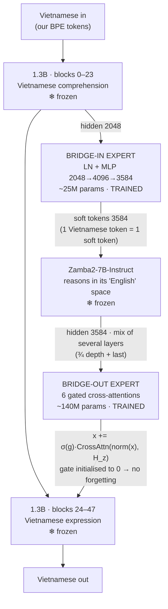

# TK_105 · Hidden-state bridge 1.3B ↔ Zamba2 — "a Vietnamese speaker" + "an English brain"

> Status: **DESIGN + Step 0 (ceiling measurement) script ready** · 2026-10-03
> Premise: TK_104 (our 1.3B: natural Vietnamese 4.47/5 but correctness 2.04/5, VMLU 24.6% = random, math 0/18).
> Note: this direction **adds an open-source model** (Zamba2, Apache-2.0) as the knowledge block — chosen by the user on
> 2026-10-03, complementing the "grow the 1.3B" direction (TK_104 §14), not replacing it.
> *English translation of the Vietnamese original in the repository root.*

## 1. Idea

Our 1.3B speaks Vietnamese well but knows little; Zamba2-7B knows a lot (several trillion tokens) but can barely
speak Vietnamese (pilot B: 1.6→2.6/5 after LoRA). Join the two models into **one network**, connected through **hidden
states** — no text passed back and forth. "Translation" becomes two **bridge experts** inside the architecture.

Unlike BTX (TK_104 §13): BTX combines experts with a common origin (shared tokenizer, shared hidden space), so a router can pick
per token. Here the two models have different tokenizers (Vietnamese BPE 32K vs an English tokenizer) and different hidden sizes (2048 vs 3584) → we need
**projection** layers between the two spaces; an expert-selecting router cannot be used.

Precedents: LangBridge (2024) and MindMerger (2024) connect multilingual models to English LLMs via projection layers, improving reasoning
in low-resource languages; CALM (Google DeepMind, 2024) composes 2 frozen models with learned cross-attention.

## 2. Architecture

**Lockstep execution.** Every Vietnamese token (both the question and the answer being generated) passes through
bridge-in to become a soft token for Zamba2. Zamba2 is Mamba2 → fixed-size state, so "thinking along" token by token is very
cheap. Zamba2's hidden state at position t holds the idea of "what to say next" (in its English concept space);
bridge-out reads that state so the 1.3B continues speaking in Vietnamese.

**Masking.** Position t of the 1.3B can see: all of Zamba2's hidden states for the question + answer states ≤ t. Because the mapping is
1 token ↔ 1 soft token, the causal mask is simple and no alignment between the two tokenizers is needed.

**Placement.** Bridge-in takes the hidden state after block 23 (mid-trunk — semantics, little surface form). Bridge-out plugs into 6 points next to
the 1.3B's 6 attention blocks (7, 15, …, 47; only points ≥ 23 receive useful signal — also try the top 3 only).
All configurable.

**Trainable parameters ≈ 165M**, everything else frozen → the 1.3B does not forget (same mechanism as the code expert, TK_104 §14).

## 3. Training the bridge experts — 3 stages

| Stage | What is learned | Data | Signal |
|:--|:--|:--|:--|
| 1 · bridge-in | Vietnamese sentence → soft tokens that Zamba2 **understands correctly** | Vietnamese–English pairs (PhoMT, OPUS, translated DailyDialog, translated code) | Zamba2 receives the soft tokens and must write the correct English version (backprop through the frozen Zamba2) |
| 2 · bridge-out | Zamba2 hidden states → the 1.3B says the right thing in Vietnamese | same pairs, reversed | Zamba2 reads the English sentence (real tokens); the 1.3B only sees the cross-attention and must write the Vietnamese version |
| 3 · end-to-end | Vietnamese question → Zamba2 thinks → Vietnamese answer | SFT v2 (truthful), chat v2, Vi-GSM8K, QA with answers | loss on the Vietnamese answer; train both bridges together |

Variant for math (TK_104: *writing out the solution >> thinking silently*): **"draft in English"** — Zamba2 generates its own English reasoning chain
(hidden, not shown to the user), then the 1.3B speaks the Vietnamese solution, cross-attending to those states. Try in stage 4 if lockstep is
not enough for multi-step math.

## 4. Step 0 — measure the ceiling (before building anything)

Even the best bridge can only transfer what Zamba2 knows. Measured with `scripts/zamba_ceiling.py`:

1. `translate` (Mac, Gemma): eval_v1 (158 questions) + VMLU validation (744 questions) → reference English versions.
2. `gen` (H100, separate venv `/workspace/zenv`): Zamba2-7B-Instruct answers in 2 modes — **vi** (reads Vietnamese directly)
   and **en** (reads the reference translation = a perfect bridge). VMLU scored by letter log-probability; eval_v1 free generation.
3. `judge` + `report`: graded with exactly the eval_clean prompt, compared against the 1.3B (sftv2).

**Decision criteria**

| Result of Zamba2 reading English (en) | Conclusion |
|:--|:--|
| facts correct ≫ 1.3B, math ≥ 50%, VMLU ≥ 40% | **GO** — the knowledge is there, only the language bridge is missing |
| en ≈ vi and both high | Zamba2 already understands Vietnamese input → bridge-in matters less, focus on bridge-out |
| en low (VMLU near 25–30%) | **STOP** — Zamba2 doesn't know this kind of knowledge (VMLU is Vietnam-centric) → move to RAG |

The report's "most divergent subject (en−vi)" column shows which subjects have the knowledge but are blocked by language.

## 5. Risks

1. **The ceiling = the UNION of both models**, not Zamba2 alone: the 1.3B layers still run fully, the gate only adds the Zamba2
   signal. But right now the 1.3B **has read but not memorised** Vietnamese knowledge: eval_v1 facts (from viwiki, present in pre-training)
   2/40 correct, VMLU 24.6% (+RAG 24.1%) — facts seen only a few times in 18.8B tokens are not retained. Vietnam-specific knowledge
   (history, geography, law) is also thin in Zamba2 → we also need a **repeated Vietnamese knowledge-building** track
   for the 1.3B (viwiki/textbooks → many Q&A forms, each fact many times), like the code round in TK_104 §14.
   The Step 0 report compares every VMLU subject 1.3B vs Zamba2 to see which part is Vietnam-specific knowledge.
2. **Zamba2 has never received soft tokens** from another model — stage 1 is the most fragile part; measure early with the BLEU of
   "Zamba2 rewrites the English version from soft tokens".
3. **The hidden state at t ≠ the full answer.** Lockstep lets Zamba2 "predict what comes next", not write out the full solution itself →
   may be weak at multi-step reasoning (see the drafting variant).
4. **Resources.** Backprop through a frozen 7B: an 80GB H100 suffices (checkpointing, small batches). The 24GB M4 cannot train it;
   inference on the M4 is only practical with Zamba2-2.7B. Generation speed ≈ a 7B model.

## 6. GPU estimate (H100)

| Step | Work | Hours |
|:--|:--|:--|
| 0 | measure the ceiling | ~1 |
| 1 | bridge-in + check "Zamba2 understands correctly" | ~3 |
| 2 | bridge-out + measure translation quality | ~3 |
| 3 | end-to-end + compare with the 1.3B alone | ~3–4 |

## 7. Step 0 RESULTS (2026-10-03, H100) — **GO**

Technical trap: transformers 5.16.1 loads Zamba2-7B wrongly due to `tie_weights_keys` — it picks the shared block by `layer_id % 2`
instead of the ORDER of hybrid layers (hybrid_layer_ids 6, 11, 17… alternate odd/even) → per-layer LoRA adapters attach to the wrong block.
Patched `modeling_zamba2.py` (venv `/workspace/zenv`): `block_id = (number of preceding hybrid layers) % num_mem_blocks` → clean load
(0 missing / 0 unexpected). The 2.7B is unaffected because its hybrid-layer order matches parity.

| | facts correct / don't know / wrong | made-up entity: admits / invents | math (18) | VMLU (743) |
|:--|:--|:--|:--|:--|
| 1.3B sft v2 | 5% / 75% / 20% | 70% / 30% | 6% | 24.6% |
| Zamba2-7B reading **Vietnamese** | 8% / 28% / **65%** | 50% / 50% | 50% | 38.0% |
| Zamba2-7B reading **English** (= perfect bridge) | **28%** / 35% / 38% | **75%** / 25% | **100%** | **55.5%** |

- By the §4 criteria: facts ≫ 1.3B (28 vs 5%), math ≥ 50% (100%), VMLU ≥ 40% (55.5%) → **GO**.
- The en − vi gap = **+17.5 VMLU points, +50 math points** = what a bridge-in could unlock; reading Vietnamese directly,
  Zamba2 still **hallucinates a lot** (65% wrong) — it misreads the question and then answers confidently.
- **UNION** (1.3B correct or Zamba2-en correct) = 499/743 = 67%; the 1.3B contributes 87 extra questions, but mostly by luck (25% random guessing):
  even on Vietnam-specific subjects (founding of the Communist Party of Vietnam: 1.3B 4/13 vs Zamba2-en 10/13; Atlas geography 4 vs 7) Zamba2-en is still better
  → the hypothesis "the 1.3B already has Vietnamese knowledge" does not hold at present; it has read but not memorised.
- Rare facts from viwiki (the Adoretus beetle, the Coastal Army Corps): Zamba2 also gets them wrong → RAG is still needed.

**Next:** build stage 1 (bridge-in: soft tokens from block 23 of the 1.3B → Zamba2 rewrites the English version), measure the BLEU of
"Zamba2 understands correctly" before building bridge-out.

## 8. Stage 1 v1 — bridge-in FAILED (2026-10-04)

`scripts/tk105_bridge.py` (23M MLP, hidden state after block 23 of the 1.3B → soft tokens REPLACING the Vietnamese sentence; 3,000 steps × 16 DailyDialog sentences).

| Zamba2 receives | DailyDialog test (300) BLEU / chrF | eval_v1 questions (158) BLEU / chrF |
|:--|:--|:--|
| soft tokens (bridge v1) | **0.0 / 0.2** (empty output) | 0.0 / 0.0 |
| raw Vietnamese sentence (baseline) | 5.7 / 30.9 | **23.3 / 53.2** |

Debugging (`tk105_debug.py`): the soft tokens' magnitude blows up **×3.4** relative to real embeddings (0.047 vs 0.014) and they are not near any
token (cos ~0.1) → Zamba2 treats them as noise; the loss stalls at ~3.3 ≈ "guessing" the English. Side finding: Zamba2 **reads Vietnamese better
than expected** on its own (office questions: BLEU 23) — weak on everyday conversation with Vietnamese forms of address.
→ **v2 MindMerger-style**: soft tokens SUPPLEMENT the raw Vietnamese sentence (can't be worse than the baseline), magnitude FIXED to that of real embeddings, lr 1e-3.

## 9. Stage 2 — bridge-out SUCCEEDED (2026-10-04)

`scripts/tk105_bridge2.py`: 6 gated cross-attentions (138M, output layer initialised to 0) inserted after the 1.3B's attention blocks, reading
Zamba2 hidden states mixed from 3 layers (40/60/81; learned weights concentrate on the middle layer: 0.47/0.31/0.22). The 1.3B does NOT see the English sentence — every idea goes through the bridge.
3,000 steps × 16, loss 3.78 → 1.10, cross-attention gate ~0.1.

| English → Vietnamese (DailyDialog test, 150 sentences) | BLEU | chrF |
|:--|:--|:--|
| **1.3B speaking through the bridge** | **18.8** | **36.4** |
| Zamba2 translating to Vietnamese itself | 6.6 | 25.6 |

Example "How much would you like to change?" → 1.3B: "Anh muốn đổi bao nhiêu ạ?" · Zamba2: "Bạn muốn đổi được bao nhiêu?".
Remaining errors: some meaning drift ("too far" → "too expensive"), invention on rare words ("RIB"). **"Zamba2 thinks, the 1.3B speaks" is demonstrated.**

## 10. Stage 3 — end-to-end composition (2026-10-04)

`scripts/tk105_stage3.py`: Zamba2 writes its own English DRAFT solution (hidden) from the Vietnamese question (+ bridge-in v2 if its BLEU beats
raw reading), the 1.3B reads Zamba2's hidden states over [question + draft] through bridge-out (initialised from stage 2), then answers in Vietnamese. Cheap training on
English–Vietnamese GSM8K pairs (7,398 pairs with matching answers) + 30% translated DailyDialog. Evaluation: Vi-GSM8K test 100 + eval_v1 math 18 + eval_v1 facts/made-up
entities, compared with the 1.3B alone and with the answer in Zamba2's draft.

**Stage 1 v2 (MindMerger-style supplement) — also NOT achieved:** 4,000 steps, lr 1e-3, fixed magnitude; loss 2.82 → 2.97 (no
decrease); DailyDialog test: soft tokens + raw sentence **BLEU 2.2 / chrF 21.8** < raw sentence alone 5.7 / 30.9 → the soft tokens still add noise.
Tentative conclusion: teaching a FROZEN Zamba2-7B to understand another model's soft tokens with a small bridge (23M) + gradients through 7B is hard (LangBridge/
MindMerger use large multilingual encoders + more data). This does not block the composition: **the input uses the raw Vietnamese sentence** (Zamba2 can read it,
BLEU 23 on office questions), **the output uses bridge-out** (which works). Stage 3 automatically chose not to use bridge-in.

**Stage 3 v1 results** (Zamba2 reads the raw Vietnamese sentence; cross-attention trained 1,500 steps ≈ 1 pass over GSM8K, ~0.3 s/step):

| | **composite (1.3B answers in Vietnamese)** | Zamba2 draft (English, hidden) | 1.3B alone |
|:--|:--|:--|:--|
| Vi-GSM8K test (100) | **9** | 34 | 2 |
| eval_v1 math (18) | **5** | 11 | 1 |

eval_v1 facts (40): correct 0 · don't know 15 · wrong 25. Made-up entities (20): admits 14 · invents 6 (Zamba2's "I do not know" draft
is correctly conveyed by the 1.3B). → The composite helps math ×4–5 vs the 1.3B alone, with natural step-by-step Vietnamese solutions ("150 marbles / 6
marbles/bag = 25 bags … Answer: 20"), but LOSES ~3/4 relative to the draft: the 1.3B copies numbers wrongly (16.50 × 3 → "48.50"), repeats sentences, rambles until
the length limit before reaching the answer. The Zamba2 draft from raw Vietnamese (34/100) is also lower than when reading English (Step 0: 18/18 eval_v1).
Stage 3b: train 3,000 more steps + repetition penalty + allow longer generation.

**Stage 3b** (3,000 more steps from stage 3, lr 5e-5, loss 0.25; evaluated with repetition penalty 1.15 + up to 480 tokens):

| | stage 3 | stage 3 + rep. penalty | **stage 3b** | Zamba2 draft | 1.3B alone |
|:--|:--|:--|:--|:--|:--|
| Vi-GSM8K test (100) | 9 | 12 | **15** | 34 | 1 |
| eval_v1 math (18) | 5 | 4 | 4 | 11 | 0 |
| made-up entities: admits / invents | 14 / 6 | 14 / 6 | **16 / 4** | — | — |
| facts: don't know / wrong (40) | 15 / 25 | 16 / 24 | 19 / 21 | — | — |

## 11. TK_105 conclusions (2026-10-04)

1. **Output — "Zamba2 thinks, the 1.3B speaks": ACHIEVED.** Bridge-out (138M cross-attention) lets the 1.3B speak Vietnamese from Zamba2's hidden states better than
   Zamba2 writing it itself (BLEU 18.8 vs 6.6); the composite solves Vi-GSM8K **15/100** vs 1–2/100 for the 1.3B alone, with step-by-step Vietnamese solutions,
   and keeps "I don't know" for made-up entities (80%).
2. **Input — soft tokens: NOT ACHIEVED** (v1 BLEU 0, v2 supplement 2.2 < raw reading 5.7). Use the raw Vietnamese sentence; Zamba2 reads most of it itself.
3. **Remaining bottleneck:** ~55% is lost from draft to Vietnamese answer (34 → 15): the 1.3B miscopies numbers when restating, repeats, rambles. Fixes:
   a calculator (TK_104 §14.4) inside the composite solution; teach a short "Answer: X" early; train more passes; let the 1.3B copy numbers directly
   from the draft (a copy mechanism). The draft is also weaker when Zamba2 reads Vietnamese (34/100) than English.
4. The composite has ~9B parameters and generates slowly (draft + solution); only practical on a GPU. The 1.3B v3 assistant (TK_104 §15.2) remains the lightweight product.

Weights: `checkpoints/hf_hybrid/tk105/{bridge_out,stage3b}_bf16.pt` (Mac) · results `out/box_results/tk105/*.json`.
