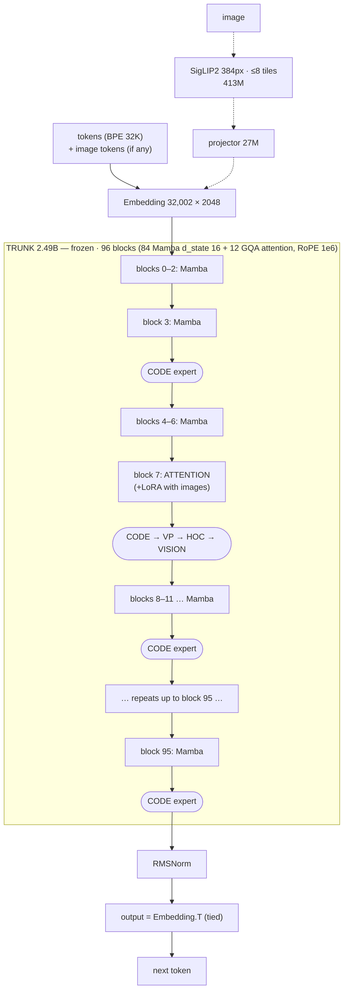
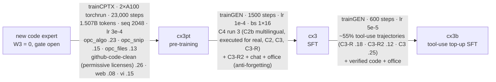

# TK_108 — aivie cx3b architecture (22/10/2026)

*Checkpoint `aivie_2p6b_p3_cx3b_bf16.pt` (HF `donaldluong/nn-aivie-2p6b-p3-snap`). Numbers read directly from the checkpoint. For how this version was made,
see `TK_108_CODE_TOOL_USE.md` §9–§13.*
*English translation of the Vietnamese original in the repository root.*

## 1. Overview

A single checkpoint containing:
- a hybrid Mamba + attention **trunk** of 2.49B parameters, **frozen** from P3 (TK_107);
- **4 gated GatedFFN experts**, inserted in series after some blocks;
- an **image-reading part**: SigLIP2 + projector + LoRA on the 12 attention blocks.

| Part | Parameters | Where it was learned | Status in cx3b |
|---|---|---|---|
| Trunk (96 blocks, d = 2048, ctx 8192, vocab 32,002) | 2,488 M | P1–P3 (20B tokens + SFT step 7676) | frozen |
| **Code expert** — 24 points × hidden 8192 | **1,208 M** | **TK_108: pre-training on 1.5B tokens (cx3pt) → SFT C4 run 3 + C3-R2 (cx3) → tool-use top-up SFT (cx3b)** | **new** |
| Office expert (vp) — 12 points × hidden 2048 | 151 M | P3 + Excel fixes (`p3r1xl_vp`) | frozen |
| Academic expert (hoc) — 12 points × hidden 4096 | 302 M | P3 (`p3r1_hoc`) | frozen |
| Vision expert — 12 points × hidden 2048 | 151 M | TK_106/107 | only active when the conversation has images |
| SigLIP2 (384 px images, up to 8 tiles) + projector | 413 M + 27 M | TK_106/107 | only runs when there are images |
| LoRA on wq/wk/wv/wo of the 12 attention blocks | 12.6 M | TK_106/107 | only active with images |
| **Total** | **≈ 4.75B** | | text chat runs ≈ 4.15B (image part skipped) |

## 2. Diagram



**One expert insertion point** (`GatedFFN`, `scripts/expert_ffn_1p3b.py`): the block output passes through each expert in order; each expert adds
a residual gated **per token**:

```text
h  = RMSNorm(x)
y  = W3 · ( SiLU(W1·h) ⊙ W2·h )          # SwiGLU, hidden 8192 (code) / 4096 (hoc) / 2048 (vp, vision)
g  = sigmoid(w_g · h + b_g)               # one number per token, initialised b_g = −2 (nearly closed)
x' = x + g · y                            # W3 initialised to 0 → at insertion the model is identical to the trunk
```

## 3. Insertion points

| Block | Block type | Experts inserted after the block |
|---|---|---|
| 3, 11, 19, 27, 35, 43, 51, 59, 67, 75, 83, 91 | Mamba | code |
| 15, 31, 47, 63, 79, 95 | Mamba | code |
| 7, 23, 39, 55, 71, 87 | **attention** | code → vp → hoc → vision |
| 14, 30, 46, 62, 78, 94 | **attention** | vp → hoc → vision |

- The code expert sits **every 4 blocks** (`range(3, 96, 4)`), i.e. 24 points, covering the full depth of the trunk evenly.
- The older experts (vp, hoc, vision) sit after the **12 attention blocks**, as since P3.
- The 6 attention blocks 7, 23, 39, 55, 71, 87 have all 4 experts in series.

## 4. How the gates behave (measured at the end of the cx3b SFT, mean gate value on held-out data)

| Data | Code gate | VP gate | HOC gate |
|---|---|---|---|
| Tool-use trajectories C3-R / C3-R2 / C3 | 0.79 | 0.03 | 0.05 |
| Verified code (c2bV) | 0.87 | 0.02 | — |

- On code content the code expert **opens to about 80–87%**, while vp and hoc stay nearly closed.
- On ordinary chat the code gate closes, so Vietnamese chat and office skills stay almost unchanged: easy20 16/20, Excel 15/27 vs 16/27 for cx3.

## 5. How the code expert was trained (3 stages; trunk and the other experts frozen)



Held-out loss during pre-training, step 0 to step 23,000:

| Group | Step 0 | Step 23,000 |
|---|---|---|
| algo | 0.881 | 0.217 |
| snip | 0.744 | 0.155 |
| files | 1.192 | 0.469 |
| GitHub | 1.273 | 0.857 |
| web | 2.486 | 2.096 |
| Vietnamese | 2.161 | 1.599 |

## 6. Results (eval scripts `scripts/code_eval.py`, `code_eval_ml.py`, `office_probe_light.py`; UI context 4096, tool frame v3)

| Version | Tool use (40 tasks) | HumanEval | MBPP | MultiPL-E (7 languages) | Excel | easy20 |
|---|---|---|---|---|---|---|
| p3r1 (before TK_108) | 0 | 6.1 | 5.1 | — | 9/27 | 16/20 |
| c4c (small code expert, 0.3B) | 45 | 11.0 | 9.7 | 2.4 | 16/27 | 15/20 |
| cx2 (large-expert pilot, pre-trained on 321M tokens) | 47.5 | 13.4 | 15.6 | 5.7 | 14/27 | 17/20 |
| cx3 (pre-trained on 1.5B tokens) | 42.5 | 12.2 | 22.2 | 6.7 | 16/27 | 16/20 |
| **cx3b** | **55.0** | 13.4 | **23.3** (24.9 after fixes) | — | 15/27 | 16/20 |

## 7. Known limits

- **The frozen trunk** determines how well the task is understood.
  - Tried on the M4 with 8 realistic, constraint-heavy tasks (VAT invoice, nginx log analysis, default-argument debugging, T-SQL report, Excel SUMIFS, JS debounce, .NET optimisation advice, an email): cx2 only did the email well.
  - The code expert adds code knowledge but does not make the trunk read the task better.
  - Next step if we need to break this ceiling: C6, i.e. training into the trunk.
- **Running on the 24 GB M4:** requires `--half` (bf16). In fp32 this version needs about 17 GB and spills into swap. Speed about 7–15 tokens/second.
- **The tokenizer** spends about 1.5× as many tokens on code as Qwen-Coder (§8 of the ticket).
