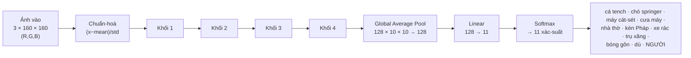
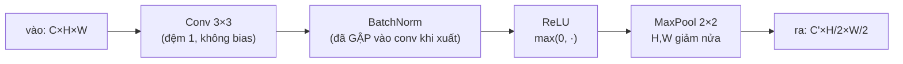
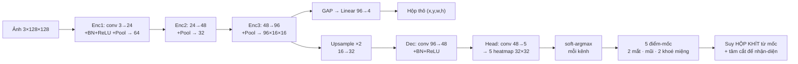

# Kiến-trúc mạng nhận-diện ảnh (CNN tự-viết)

Tài-liệu này mô-tả mạng **tích-chập (CNN)** trong demo `vision_cnn` — viết tay từ-đầu, luyện trên Apple M4,
suy-luận **ngay trong trình-duyệt** bằng JavaScript. Bản đang nói ở đây là bản **độ-phân-giải cao**:
ảnh vào **160×160**, **11 lớp** (10 lớp Imagenette + "người" từ LFW).

> Có 2 biến-thể cùng ý-tưởng: bản **CIFAR 32×32** (nhẹ, 3 conv + 2 FC) và bản **HD** (nét, 4 conv + Global-Average-Pool).
> Dưới đây tả bản HD; bản CIFAR chỉ khác kích-thước và phần đầu-ra.

---

## 1. Toàn cảnh: ảnh vào → xác-suất 11 lớp

Mỗi **khối** làm 4 việc theo thứ-tự: **Tích-chập → Chuẩn-hoá-batch → ReLU → Gộp-max (2×2)**.

---

## 2. Kích-thước qua từng tầng (ảnh 160×160)

| Tầng | Phép | Ra (kênh × cao × rộng) | Tham-số |
|---|---|---|---|
| Vào | ảnh RGB | 3 × 160 × 160 | — |
| Khối 1 | Conv 3→24, +BN+ReLU, Pool | 24 × 80 × 80 | 648 |
| Khối 2 | Conv 24→48, +BN+ReLU, Pool | 48 × 40 × 40 | 10 368 |
| Khối 3 | Conv 48→96, +BN+ReLU, Pool | 96 × 20 × 20 | 41 472 |
| Khối 4 | Conv 96→128, +BN+ReLU, Pool | 128 × 10 × 10 | 110 592 |
| GAP | trung-bình toàn ảnh mỗi kênh | 128 | 0 |
| FC | Linear 128→11 | 11 | 1 419 |
| Softmax | chuẩn-hoá thành xác-suất | 11 | 0 |

**Tổng ≈ 165 000 tham-số** (mạng tí-hon so ResNet triệu-tham-số). Ảnh càng vào to thì H×W ở các khối càng lớn →
**tính-toán nhiều hơn** (đó là lý-do 160px chạy chậm hơn 128/96), nhưng **số tham-số KHÔNG đổi** nhờ GAP.

---

## 3. Vì sao chọn từng bộ-phận

- **Conv 3×3 (đệm 1):** bộ lọc trượt khắp ảnh, học các hoa-văn cục-bộ (cạnh → kết-cấu → bộ-phận → vật). Đệm 1 giữ
  nguyên cao×rộng để xếp nhiều tầng.
- **BatchNorm:** ổn-định phân-bố → luyện nhanh & vững hơn. **Khi xuất trọng-số, BN được "gập" thẳng vào conv**
  (thành một phép nhân + cộng theo kênh) nên forward JS chỉ cần **conv + ReLU + pool**, không cần tính BN riêng.
- **ReLU:** phi-tuyến rẻ; bỏ phần âm, giữ phần dương.
- **MaxPool 2×2:** thu nhỏ ảnh một nửa mỗi khối → tăng "tầm nhìn" của mỗi nơ-ron và giảm tính-toán tầng sau.
- **Global Average Pool (GAP):** thay vì trải phẳng 128×10×10 = 12 800 số rồi nối FC khổng-lồ, ta **lấy trung-bình mỗi
  kênh** → chỉ còn **128 số**. Nhờ vậy FC cuối cực nhỏ (128→11) và mạng **nhận được ảnh kích-thước bất-kỳ** mà số
  tham-số không phình. Đây là mẹo giữ mạng nhẹ dù ảnh nét.
- **Softmax:** biến 11 điểm-số thô (logit) thành 11 xác-suất cộng lại bằng 1.

---

## 4. Chạy trong trình-duyệt như thế nào

1. Ảnh (mẫu hoặc bạn tải lên) được vẽ vào canvas **160×160**, đọc ra điểm-ảnh RGB.
2. JavaScript chạy **đúng phép toán trên**: chuẩn-hoá → 4 khối conv → GAP → FC → softmax.
3. Trọng-số nhúng thẳng trong trang (JSON), **không gọi máy-chủ**. Đã kiểm **parity**: forward JS ra **cùng con số**
  với PyTorch (vd một ảnh tench 100.0%, người 99.9% khớp khít).

Mã: `vision_hd.html` (forward JS tổng-quát theo **danh-sách conv**, đọc `input_size` từ phần meta của trọng-số).

---

## 5. Dữ-liệu & cách luyện

- **10 lớp vật:** Imagenette (ảnh ImageNet thật ~160px). **Lớp "người":** LFW (khuôn-mặt thật ~250px) —
  cố-ý dùng ảnh **nét cao**, KHÔNG dùng ảnh 32px (kẻo mạng "ăn-gian" bằng độ mờ).
- **Tăng-cường dữ-liệu:** cắt-ngẫu-nhiên + lật ngang (giúp khỏi học vẹt).
- **Cân lớp:** "người" nhiều ảnh hơn nên hạ trọng-số của nó khi tính lỗi, để công-bằng với 10 lớp kia.
- **Bộ tối-ưu:** SGD + momentum + OneCycle LR, ~34 vòng, trên PyTorch/MPS (Apple M4).
- Xuất: gập BN vào conv, làm tròn 5 chữ-số cho nhẹ, ghi `cnnw_hd.json`.

Lệnh: `python train_hd11.py --size 160 --load 176 --epochs 34 --device mps` → `python build_pub_hd.py`.

---

## 6. Trung-thực về giới-hạn

- **160×160 là mức nét gốc tối-đa của Imagenette-160** (cạnh ngắn 160). Muốn nét hơn phải đổi bộ ảnh gốc lớn hơn.
- Mạng **tí-hon (~165k tham-số)** và chỉ biết **11 lớp** — ảnh ngoài 11 lớp vẫn bị ép chọn 1, độ tự-tin thấp.
- **Lớp "người" học từ LFW** (chân-dung căn giữa) → giỏi nhận **mặt/chân-dung**, chưa chắc nhận người **đứng xa /
  trong cảnh phức-tạp**. Con số accuracy cao của lớp này phản-ánh "mặt vs 10 đồ-vật", không phải "thấy người mọi cảnh".
- Ở 160px, **forward JS ~2-3s mỗi lần bấm** (đánh-đổi nét ↔ mượt).

---

# Phần II — Mạng DÒ-MẶT bằng HEATMAP

Ngoài mạng phân-loại trên, "bộ não thị-giác" còn 2 mạng nữa: **nhớ-mặt** (vân-tay khuôn-mặt, ArcFace) và
**dò-mặt** (tìm khung + 5 điểm-mốc mắt/mũi/miệng). Phần này tả mạng **dò-mặt** — vì nó minh-hoạ một bài-học
kiến-trúc quan-trọng.

## 7. Vì sao phải dùng HEATMAP (không dùng hồi-quy toạ-độ)

Cách "ngây-thơ": cho ảnh qua CNN → **Global-Average-Pool → Linear** xuất thẳng 10 số (toạ-độ 5 điểm). Đã thử:
sai-số **đứng yên ~6–7%** dù thêm dữ-liệu (WIDER FACE), phóng to mạng, hay xếp tầng. **Nguyên-nhân gốc:** phép
**GAP lấy trung-bình toàn ảnh → xoá sạch thông-tin "ở đâu"**. Một mạng đã quên vị-trí thì không thể đoán vị-trí chính-xác.

**Cách đúng — HEATMAP:** thay vì ép ra vài con số, mạng xuất **một "bản-đồ nhiệt" cho mỗi điểm-mốc** — một ảnh nhỏ
32×32 mà chỗ nào sáng nhất = chỗ có điểm đó. Bản-đồ **giữ nguyên trục không-gian** nên định-vị khít. Đọc toạ-độ bằng
**soft-argmax** (trọng-tâm theo độ sáng). Kết-quả: **6–7% → 3,1%** (giảm một nửa), mà mạng lại **nhỏ hơn**.

> Bài-học: khi *kiến-trúc* sai (mất thông-tin không-gian), **thêm dữ-liệu/tham-số vô-ích** — phải đổi kiến-trúc.

## 8. Sơ-đồ mạng dò-mặt

**Encoder** nén ảnh (128→16) học "có mặt / bộ-phận". **Decoder** nở lại (16→32) để có bản-đồ đủ lớn định-vị.
**Head** cho 5 heatmap. Đầu **hộp** đi riêng bằng GAP→Linear (hộp không cần khít bằng mốc; và ta còn suy được
hộp *khít hơn* trực-tiếp từ 5 mốc).

## 9. Kích-thước qua từng tầng

| Tầng | Ra (kênh × cao × rộng) |
|---|---|
| Ảnh vào | 3 × 128 × 128 |
| Enc1 (+pool) | 24 × 64 × 64 |
| Enc2 (+pool) | 48 × 32 × 32 |
| Enc3 (+pool) | 96 × 16 × 16 |
| Upsample ×2 | 96 × 32 × 32 |
| Dec | 48 × 32 × 32 |
| Head | **5 × 32 × 32** (5 bản-đồ nhiệt) |
| soft-argmax | 5 × (x,y) = 10 số |

## 10. Cách luyện (nhãn tự-động + Gaussian)

- **Nhãn không cần gán tay:** dùng **YuNet** (bộ dò có sẵn của OpenCV) chấm hộp + 5 mốc lên **LFW + WIDER FACE**
  (~12k mặt) — máy tự dạy máy (chưng-cất).
- **Đích luyện:** với mỗi mốc, vẽ một **đốm Gaussian** sáng ở đúng chỗ trên bản-đồ 32×32. Mạng học sao cho heatmap
  của nó giống các đốm đó (loss = MSE heatmap) + soft-argmax ra đúng toạ-độ.
- **Tăng-cường để bám mặt thật:** dán mặt lên **nền phòng thật** (ảnh Imagenette) ở **vị-trí/kích-thước ngẫu-nhiên**
  (kể cả cận-cảnh lấp khung) + **rung sáng/màu** → quen webcam. Luyện SGD+OneCycle trên MPS (~7 giây/epoch).
- **Forward JS:** encoder (conv+pool) → GAP+Linear (hộp) và upsample→dec→head (5 heatmap) → soft-argmax từng kênh.

## 11. Trung-thực về giới-hạn (dò-mặt)

- Sai-số ~**3,1% cạnh (~4px/128)** — bám sát nhưng **chưa khít tuyệt-đối** như hệ thương-mại (họ dùng heatmap
  phân-giải cao hơn + mạng *hourglass* sâu + hàng triệu mặt gán tay).
- Là **1 mặt/ảnh** (giả-định mặt chính giữa/cận), không phải dò nhiều mặt trong đám-đông (bài đó cần anchor+NMS).
- Chạy 2 tầng (dò thô → zoom → dò lại) cho ổn-định; mỗi lần chụp thêm ~2 lượt forward.
