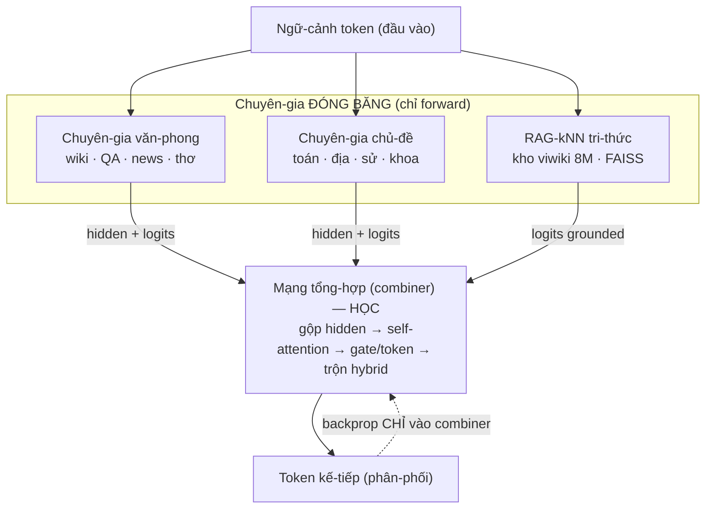

# Kiến trúc mạng hiện tại — Combiner-MoE + RAG

> Cập nhật: 2026-09-04 · TK_096–099
> "Nhiều chuyên-gia nơ-ron **đóng băng** → một **mạng tổng-hợp học-được** quyết định khi nào tin ai."

## Nguyên lý cốt lõi

Train **từng chuyên-gia riêng** trên từng miền dữ liệu → **đóng băng trọng-số** → chỉ một **combiner nhỏ** học bằng backprop để trộn đầu ra các chuyên-gia. Đây là họ kỹ thuật **MoE + Branch-Train-Merge + router-học-được**.

Vì sao hợp MacBook M4:
- Train từng expert tuần tự → vừa RAM.
- Combiner **không backward qua expert** (expert chỉ forward) → rất nhẹ.
- Thêm/bớt chuyên-gia = module hoá, không train lại cả hệ.

## Sơ đồ luồng

## Thành phần

### 1. Chuyên-gia nơ-ron (đóng băng)
- Kiến trúc: Mamba/hybrid (`scripts/train_mamba.py`, lớp `Mamba` với `forward(return_hidden=True)`).
- Mỗi chuyên-gia train riêng trên một miền, rồi `requires_grad_(False)`.
- **Hai trục chuyên-biệt hoá:**
  - *Văn-phong (register):* wiki (bách-khoa), QA (hỏi-đáp), news (báo chí), thơ.
  - *Chủ-đề (topic):* toán, địa lý, lịch sử, khoa học.
- Mỗi chuyên-gia xuất `(hidden, logits)` cho mỗi vị-trí token.

### 2. RAG expert tri-thức (đóng băng, không tham-số)
- kNN-LM datastore: khoá = hidden ngữ-cảnh của wiki-expert, value = token-kế-tiếp, lấy từ kho viwiki.
- Khi chạy: truy-xuất k láng-giềng gần nhất → phân-phối token **grounded** trong văn-bản thật.
- Quy mô: brute-force tới ~2M cặp; **FAISS IVFPQ** (nén 256d→64B) vượt lên **8.26M** (`scripts/build_faiss_datastore.py`, `KnnExpertFAISS`).

### 3. Combiner (mạng chung — CHỈ cái này học)
`scripts/train_combiner.py` · lớp `Combiner`:
1. **Gộp** hidden mọi chuyên-gia (concat) → Linear + GELU.
2. **Self-attention nhân-quả** ("mạng chú ý từ input").
3. **FFN** → trạng-thái tổng-hợp `z`.
4. **Gate per-token** `g = softmax(W·z)` trên K chuyên-gia.
5. **Trộn** theo `--mode`:
   - `prob`: `p = Σ gᵢ·softmax(logitsᵢ)` — chọn/pha đầu ra.
   - `hidden`: đầu-ra riêng `head(z)` — tự tổng-hợp dự-đoán mới.
   - `hybrid` (tốt nhất): `log(mixture) + head(z)` — vừa định-tuyến, vừa tổng-hợp.

Chỉ tham-số của combiner được cập-nhật (backprop); mọi chuyên-gia giữ nguyên.

## Hai đòn bẩy chất-lượng (đã kiểm chứng)

Đo bằng **fact-accuracy** (`scripts/fact_eval.py`) — độ chính xác dự-đoán token **nội-dung** (hiếm, mang sự-thật: tên/số/thực-thể), trên viwiki held-out.

| Cấu hình | top1 nội-dung | top5 nội-dung |
|---|---|---|
| base d256 — thuần | 10.6% | 18.8% |
| base d256 + RAG-2M | 14.1% | 26.0% |
| **base d512 (train đủ) — thuần** | **15.2%** | 25.3% |
| **base d512 + RAG-2M** | **17.2%** | **30.2%** |

- **Cỡ-kho RAG:** grounding scale đơn-điệu theo log(kho): kho 0→160k→640k→2M→8M ⇒ top1 nội-dung 10.6→11.2→12.7→14.1→**15.6%**. FAISS-8M gần-đúng còn **thắng** brute-force-2M chính-xác → **quy-mô kho > độ-chính-xác retrieval**.
- **Sức-base:** base to **train đủ** là đòn bẩy lớn (d512-thuần 15.2% > cả d256+RAG 14.1%). *Lưu ý:* base to mà **thiếu-train** thì bits tốt nhưng accuracy chưa lên — phải để accuracy hội-tụ mới kết-luận.
- **Cộng dồn:** hai đòn bẩy bù nhau: 10.6 → 15.2 (base) → 17.2 (+RAG) = **+62% so gốc**.

## Định-tuyến ngữ-nghĩa (combiner tự học, không cho nhãn)

Gate trung bình theo nguồn (`scripts/analyze_gate.py`) — đường chéo trội = mỗi miền token được định-tuyến tới đúng chuyên-gia của nó:

| Token thuộc | →wiki | →QA | →news |
|---|---|---|---|
| wiki | **0.89** | 0.08 | 0.03 |
| QA | 0.29 | **0.70** | 0.01 |
| news | 0.42 | 0.02 | **0.56** |

## Ranh giới thành thật

Đây là thắng lợi về **chất-lượng-mô-hình-hoá + định-tuyến + grounding-token**, **chưa** vượt tường tri-thức tuyệt đối (base vẫn ở quy-mô đồ-chơi; sinh tự-do vẫn bịa). Cả hai đòn bẩy tại-chỗ đều thật và bù nhau; muốn hệ trả-lời-đúng đáng-tin cần scale base cỡ tỷ-tham-số (ngoài M4) × kho lớn.

## File chính

| File | Vai trò |
|---|---|
| `scripts/train_mamba.py` | Kiến trúc + train chuyên-gia (Mamba/hybrid); `--grad-accum`, resume opt-state |
| `scripts/train_combiner.py` | `Combiner` (3 mode) + `KnnExpert`/`KnnExpertFAISS` + `make_knn` |
| `scripts/build_knn_datastore.py` | Datastore brute-force (`--backbone`, `--n-seq`, `--cap`) |
| `scripts/build_faiss_datastore.py` | Datastore FAISS IVFPQ (vượt trần 2M) |
| `scripts/build_topic_data.py`, `build_news_data.py` | Dựng data miền (HF + cắt wiki theo từ-khoá) |
| `scripts/analyze_gate.py` | Phân-tích định-tuyến gate theo nguồn |
| `scripts/fact_eval.py` | Đo fact-accuracy (token nội-dung vs chức-năng) |
| `scripts/rag_prompt_demo.py` | Demo cloze-fact thuần vs RAG |

## Bẫy kỹ thuật đã vá

- **Máy ngủ = MPS đơ** (pin tắt / gập nắp) → `caffeinate -i -s`; nhưng caffeinate KHÔNG chặn clamshell-sleep khi thiếu màn-hình-ngoài → đừng gập máy khi train.
- **FAISS + PyTorch xung-đột OpenMP** → `faiss.omp_set_num_threads(1)` + `KMP_DUPLICATE_LIB_OK=TRUE`.
- **Rò-rỉ datastore↔eval** (cùng seed) → tách seed, kiểm chồng-lấn.
- **Resume optimizer-state** để tránh "nảy bits" khi train tiếp.
